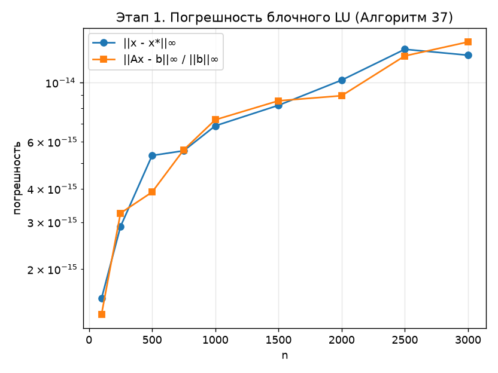
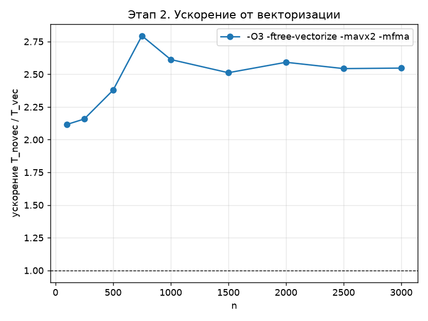
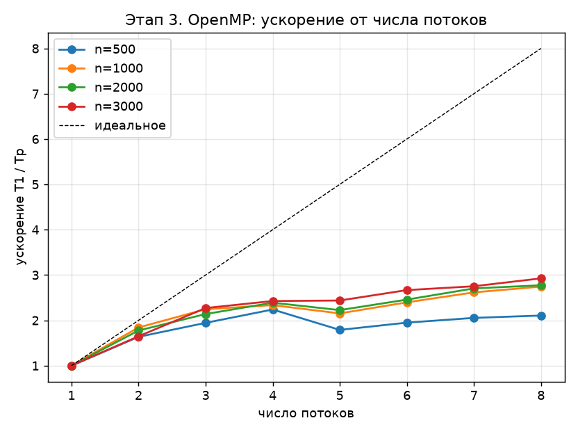
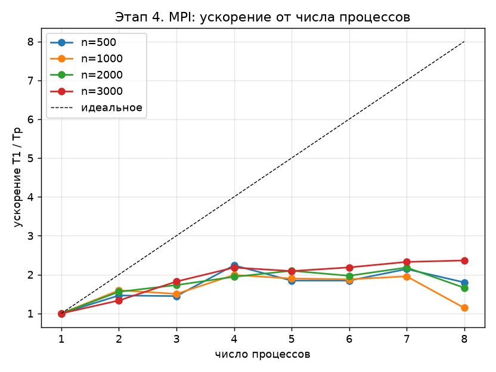

# Блочное LU-разложение

Учебная работа по курсу «Параллельные алгоритмы». Исходное задание — [PA.docx](PA.docx).
Реализован **Алгоритм 37** из параграфа 2.4 пособия Д. Л. Головашкина «Векторные алгоритмы
вычислительной линейной алгебры» (2019, с. 57–62). Один и тот же алгоритм реализован четырьмя
программами на C — по одной на каждый этап задания:

| Этап | Программа | Что исследуется | Подробное описание |
|---|---|---|---|
| — | — | теория: метод Гаусса в матричной форме, вывод формул, существование, трудоёмкость, устойчивость | [docs/00_lu_theory.md](docs/00_lu_theory.md) |
| 1 | [stage1_seq.c](stage1_seq.c) | последовательный алгоритм, рост погрешности с размерностью | [docs/01_sequential.md](docs/01_sequential.md) |
| 2 | [stage2_vec.c](stage2_vec.c) | автовекторизация GCC (AVX2 + FMA), ускорение | [docs/02_vectorization.md](docs/02_vectorization.md) |
| 3 | [stage3_omp.c](stage3_omp.c) | OpenMP: `#pragma omp parallel for`, итерации распределяет OpenMP | [docs/03_openmp.md](docs/03_openmp.md) |
| 4 | [stage4_mpi.c](stage4_mpi.c) | MPI-программа, ускорение от числа процессов и размера матрицы | [docs/04_mpi.md](docs/04_mpi.md) |
| — | все | справочник по коду: формулы → строки кода, обмены, скрипты | [docs/05_code_reference.md](docs/05_code_reference.md) |

---

## Алгоритм

Ищется разложение квадратной матрицы

$$
A = L\,U,
$$

где $L$ — нижняя унитреугольная, $U$ — верхняя треугольная. Обе матрицы записываются на место $A$,
выбора ведущего элемента нет. Матрица разбивается на малые блоки размера $\alpha = 32$:

$$
\begin{pmatrix} A_{11} & A_{12} \\ A_{21} & A_{22} \end{pmatrix}
=
\begin{pmatrix} L_{11} & 0 \\ L_{21} & E \end{pmatrix}
\begin{pmatrix} E & 0 \\ 0 & A' \end{pmatrix}
\begin{pmatrix} U_{11} & U_{12} \\ 0 & E \end{pmatrix}.
$$

Отсюда четыре шага одной итерации:

1. **LU малого блока**: $A_{11} = L_{11} U_{11}$.
2. **Треугольные системы** с $U_{11}$, по малым блокам блочного столбца: $L_{21} U_{11} = A_{21}$.
3. **Треугольные системы** с $L_{11}$, по малым блокам блочной строки: $L_{11} U_{12} = A_{12}$.
4. **Блочная модификация матрицы внешним произведением** по парам малых блоков:

$$
A' = A_{22} - L_{21}\, U_{12}.
$$

Затем за $A$ принимается $A'$, и шаги повторяются. Общая стоимость — $\frac23 n^3$ флопов, из них
98 % при $n = 3000$ приходится на шаг 4. Полный математический вывод — в
[docs/00_lu_theory.md](docs/00_lu_theory.md), алгоритм, схема и анализ погрешности — в
[docs/01_sequential.md](docs/01_sequential.md).

### Чем отличаются этапы

| | Этап 1 | Этап 2 | Этап 3 | Этап 4 |
|---|---|---|---|---|
| Запись | макрос `A(i, j)` | функция `saxpy` + `restrict` | как этап 2 | как этап 2, свои строки |
| Данные | общая матрица | общая матрица | общая матрица | блочные строки циклически по процессам |
| Параллелизм | — | SIMD внутри строки блока (4 `double`) | потоки OpenMP (`parallel for`) | процессы, `MPI_Bcast` блочной строки |
| Шаг 1 | последовательно | последовательно | последовательно | у владельца блочной строки |
| Шаг 4 | последовательно | векторизован | потоки по парам блоков | процессы над своими строками |
| Ускорение считается | — | $T_\text{novec}/T_\text{vec}$ | $T_{P=1}/T_P$ | $T_{p=1}/T_p$ |

---

## Результаты

Замеры на Intel Core i5-1135G7 (4 ядра / 8 потоков), MinGW GCC 9.2 (32 бита), MS-MPI, ноутбук
работал от батареи. Все CSV и графики — в [results/](results).

**Погрешность (этап 1).** Ошибка решения $\lVert x - x^* \rVert_\infty$ растёт с размерностью:
$1{,}55 \cdot 10^{-15}$ при $n = 100$ и $1{,}27 \cdot 10^{-14}$ при $n = 3000$ — примерно
пропорционально $\sqrt{n}\,\varepsilon$, где $\varepsilon \approx 1{,}1 \cdot 10^{-16}$.



**Ускорение** (лучшие значения):

| Этап | $n = 500$ | $n = 1000$ | $n = 3000$ | Главное ограничение |
|---|---|---|---|---|
| 2. Векторизация | 2,38 | 2,61 | 2,55 | загрузка блоков подматрицы из памяти |
| 3. OpenMP | 2,24 ($P = 4$) | 2,74 ($P = 8$) | 2,93 ($P = 8$) | память, частота, 4 физических ядра |
| 4. MPI | 2,24 ($p = 4$) | 1,99 ($p = 4$) | 2,36 ($p = 8$) | то же плюс шаги 1 и 3 у одного процесса |

| Векторизация | OpenMP | MPI |
|---|---|---|
|  |  |  |

Подробный разбор каждого результата — в соответствующем файле из [docs/](docs).

---

## Структура репозитория

| Путь | Назначение |
|---|---|
| `stage1_seq.c` … `stage4_mpi.c` | программы четырёх этапов |
| [docs/](docs) | подробные описания алгоритмов этапов |
| [docs/block_lu.pdf](docs/block_lu.pdf) | теория и описания этапов (`docs/00`–`04`) одним PDF |
| [docs/code_reference.pdf](docs/code_reference.pdf) | справочник по коду (`docs/05`) с листингами из исходников |
| [docs/build_pdf.py](docs/build_pdf.py) | сборка обоих PDF: `python docs/build_pdf.py [block_lu\|code_reference]` |
| [build.sh](build.sh) | сборка всех вариантов в `bin/` |
| [include/sal.h](include/sal.h) | пустая заглушка заголовка, нужная MS-MPI под MinGW |
| [plots.py](plots.py) | запуск всех экспериментов, CSV и графики в `results/` |
| [results/](results) | результаты замеров |
| [REPORT.md](REPORT.md) | отчёт по замерам |

## Требования

Проект собирается на Windows, Linux и macOS одним скриптом [build.sh](build.sh):
он сам определяет ОС и архитектуру процессора.

| | Windows | Linux | macOS |
|---|---|---|---|
| оболочка | Git Bash | любая POSIX | любая POSIX |
| компилятор | MinGW GCC (проверено на 9.2) + пакет `pthreads-w32` | `gcc` или `clang` | Apple clang + `libomp` или `gcc-N` из Homebrew |
| MPI | MS-MPI SDK и Runtime | Open MPI или MPICH (`mpicc`, `mpiexec`) | Open MPI или MPICH из Homebrew |
| графики | Python 3 + Matplotlib | то же | то же |
| PDF | Chrome/Edge, пакеты `markdown`, `pygments`, `pypdf` | Chrome/Chromium | Chrome/Edge |

Установка зависимостей:

```sh
# Ubuntu / Debian
sudo apt install build-essential libopenmpi-dev openmpi-bin python3-matplotlib
# Fedora
sudo dnf install gcc openmpi-devel python3-matplotlib && module load mpi/openmpi-x86_64
# macOS (Homebrew)
brew install libomp open-mpi python && pip3 install matplotlib
```

На Windows путь к MS-MPI SDK задаётся переменной `M` в [build.sh](build.sh). Используются
библиотеки `Lib/x86`: разрядность компилятора и библиотек должна совпадать. Без
`pthreads-w32` MinGW не собирает программы с `-fopenmp`.

Время замеряется через `QueryPerformanceCounter` на Windows и
`clock_gettime(CLOCK_MONOTONIC)` на Linux/macOS, в MPI — через `MPI_Wtime`.

## Сборка

```sh
sh build.sh
```

Компилятор можно заменить: `CC=clang sh build.sh`, `CC=gcc-14 sh build.sh`.

Создаются `bin/stage1_seq`, `bin/stage2_novec`, `bin/stage2_vec`, `bin/stage3_omp`
и `bin/stage4_mpi` — на Windows с расширением `.exe`.

| Программа | Флаги |
|---|---|
| `stage1_seq` | `-O2 -fno-tree-vectorize` |
| `stage2_novec` | `-O2 -fno-tree-vectorize` |
| `stage2_vec` | `-O3 -ftree-vectorize -mavx2 -mfma` (на ARM — без `-mavx2 -mfma`, NEON и FMA там базовые) |
| `stage3_omp` | `-O2 -fno-tree-vectorize -fopenmp` (Apple clang: `-Xpreprocessor -fopenmp -lomp`) |
| `stage4_mpi` | `-O2 -fno-tree-vectorize`; `msmpi` на Windows, `mpicc` на Linux/macOS |

Общий флаг — `-std=gnu99`. На Windows добавляются `-msse2 -mfpmath=sse`: 32-битный
MinGW иначе считает на x87. У clang к «без векторизации» добавляется
`-fno-slp-vectorize`.

## Запуск

Программы принимают список размеров матриц. Linux и macOS:

```sh
./bin/stage1_seq 100 500 1000
./bin/stage2_novec 100 500 1000
./bin/stage2_vec 100 500 1000
OMP_NUM_THREADS=4 ./bin/stage3_omp 500 1000
mpiexec -n 4 ./bin/stage4_mpi 500 1000
```

Windows (Git Bash) — те же команды с `.exe`:

```sh
./bin/stage1_seq.exe 100 500 1000
OMP_NUM_THREADS=4 ./bin/stage3_omp.exe 500 1000
mpiexec -n 4 ./bin/stage4_mpi.exe 500 1000
```

Open MPI не запускает процессов больше, чем ядер; для этого нужен ключ
`mpiexec --oversubscribe -n 8 ...` (`plots.py` добавляет его сам).

Без аргументов этапы 1–3 используют размеры `100, 250, 500, 750, 1000, 1500, 2000, 2500, 3000`,
этап 4 — `500, 1000, 2000, 3000`. Аргументы не проверяются; память растёт как $O(n^2)$,
в MPI полная матрица хранится у каждого процесса.

Число потоков этапа 3 задаётся переменной окружения `OMP_NUM_THREADS`,
число процессов MPI — ключом `mpiexec -n`.

Каждая программа печатает CSV (в MPI — только процесс 0):

| Поле | Значение |
|---|---|
| `n` | размер матрицы |
| `alpha` | размер малого блока (32) |
| `time` | минимальное время разложения из трёх повторов, с |
| `err` | $\lVert x - x^* \rVert_\infty$, где $x^* = (1, \dots, 1)$ |
| `res` | $\lVert A_0 x - b \rVert_\infty \,/\, \lVert b \rVert_\infty$ |
| `threads` | число потоков OpenMP (только этап 3) |
| `procs` | число MPI-процессов (только этап 4) |

## Полный эксперимент

```sh
sh build.sh
python plots.py            # на Linux/macOS: python3 plots.py
python docs/build_pdf.py   # пересобрать оба PDF, если менялись docs/*.md или код
```

Скрипт запускает все варианты (этап 3 — с 1–8 потоками, MPI — с 1–8 процессами),
сохраняет CSV и строит графики в `results/`, **перезаписывая** прежние файлы.
Результаты в репозитории получены на Intel i5-1135G7 под Windows; прогон на другой
машине даст другие времена. Скрипт не проверяет `err` и `res` — их стоит просмотреть в CSV.

## Литература

1. Голуб Дж., Ван Лоун Ч. Матричные вычисления.
2. Ортега Дж. Введение в параллельные и векторные методы решения линейных систем.
3. Higham N. J. Accuracy and Stability of Numerical Algorithms.
4. Пособия Головашкина.
