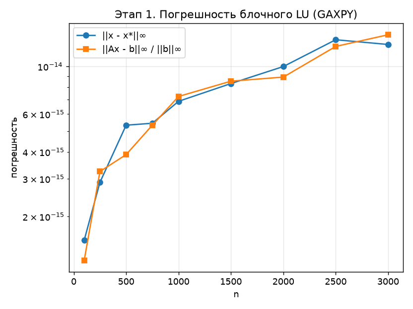
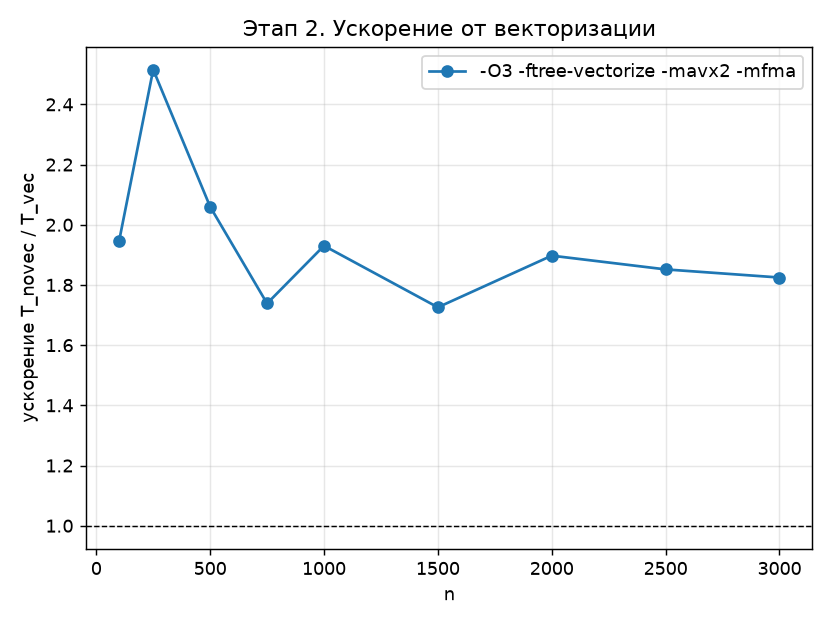
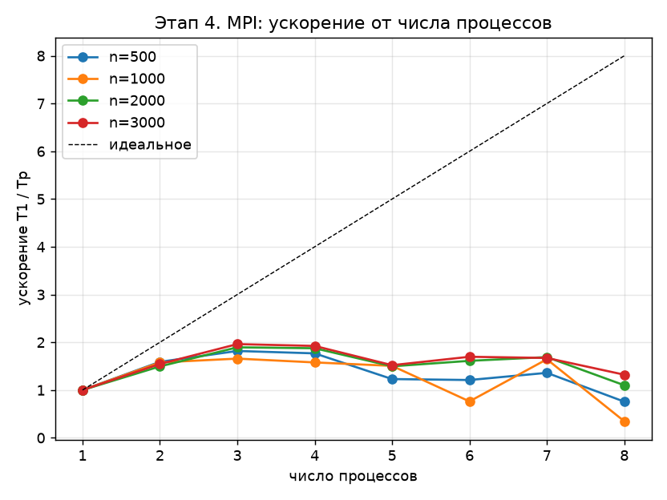
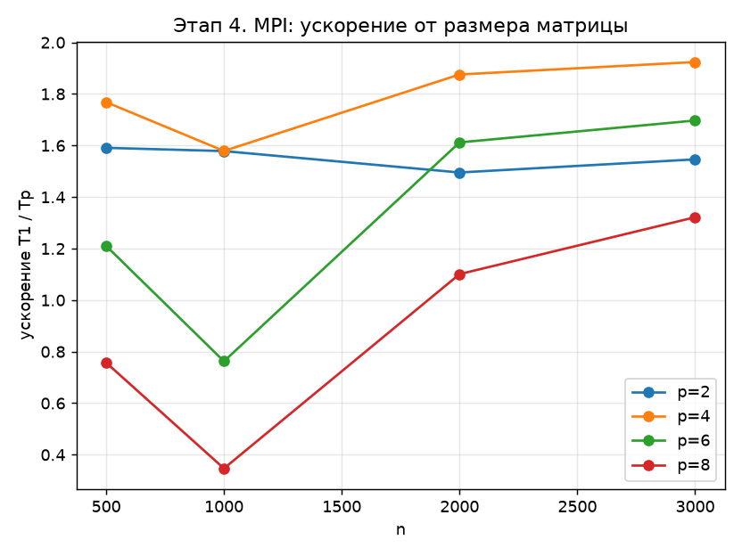

# Вариант 5. Блочное LU-разложение через GAXPY

Результаты ниже рассчитаны по сохранённым CSV из `results/`. В исходном отчёте
для этих экспериментов указана машина Intel i5-1135G7, 4 ядра / 8 потоков,
и сборка MinGW GCC 9.2 с MS-MPI. В самих CSV окружение не записано.
Инструкция по сборке и запуску — в [README.md](README.md).

## Алгоритм

Вычисляется `A = L·U`, где `L` — нижняя треугольная матрица с единичной
диагональю, `U` — верхняя треугольная. Обе хранятся на месте `A`: ниже
диагонали записана `L` без единичной диагонали, на диагонали и выше — `U`.
Выбор ведущего элемента отсутствует. Размер блока `r = 32`;
последний блок может быть короче.

В left-looking схеме для блочного столбца `K = [k, k+w)` выполняются:

1. Треугольное решение `L(0:k, 0:k)·U(0:k, K) = A(0:k, K)`.
2. Блочный GAXPY: `A(k:n, K) -= L(k:n, 0:k)·U(0:k, K)`.
3. Неблочное LU обновлённой панели `A(k:n, K)` в jki-форме.

В [этапе 1](stage1_seq.c) операции выполняются непосредственно над `A`.
В [этапе 2](stage2_vec.c) блок `U` и панель `P` копируются в отдельные
плотные буферы; внутренний цикл треугольного решения и GAXPY обрабатывает
соседние элементы строки. `restrict` описывает отсутствие перекрытия данных.
LU самой панели использует циклы по столбцам и строкам.

[Этап 3](stage3_autopar.c) дополнительно передаёт строки `L` через массив
указателей для автораспараллеливания GAXPY. Его строки `P` независимы;
треугольное решение имеет зависимость между строками `U`.
Реально преобразованные компилятором циклы нужно проверять по его отчёту:
сохранённых отчётов компилятора в репозитории нет.

В [MPI-версии](stage4_mpi.c) полная матрица хранится у каждого процесса.
Треугольное решение распределяется по столбцам блока, GAXPY — по строкам
панели. Результаты собираются через `MPI_Allgatherv`. Неблочное LU панели
каждый процесс выполняет целиком. У первого блока нет предшествующих
столбцов, поэтому треугольное решение и GAXPY пропускаются.

## Методика измерений

Для каждого размера генератор заново устанавливает `srand(12345)`, заполняет
`A₀` значениями из `[-0.5, 0.5]` и добавляет `n / 4` к диагонали.
Такая добавка не гарантирует строгого диагонального преобладания.
Правая часть `b` — сумма элементов каждой строки, поэтому точное решение
в арифметике без округления: `x* = (1, …, 1)`.

Перед каждым из трёх повторов исходная матрица восстанавливается. В CSV
записывается минимум времени; решение и ошибки проверяются по разложению
последнего повтора. Генерация матрицы, решение системы и расчёт ошибок
в измерение не входят.

На этапах 1–3 копирование `A₀` в `A` выполняется до запуска таймера.
На этапах 2–3 выделение и освобождение рабочих буферов, их упаковка
и распаковка входят во время вызова разложения.
В MPI начальная рассылка матрицы и первый барьер находятся до таймера;
выделение рабочих буферов, коллективные обмены внутри разложения и
завершающий барьер включены. Печатается время процесса 0.

Ускорения сравнивают варианты одного этапа:

| Этап | Формула | База |
|---|---|---|
| 2 | `T_novec / T_vec` | `stage2_novec.csv` |
| 3 | `T₁ / Tₚ` | `stage3_autopar1.csv` |
| 4 | `T₁ / Tₚ` | `stage4_mpi_p1.csv` |

## 1. Погрешность

По [stage1_seq.csv](results/stage1_seq.csv):

| n | 100 | 500 | 1000 | 2000 | 3000 |
|---|---|---|---|---|---|
| `‖x − x*‖∞` | 1,554·10⁻¹⁵ | 5,329·10⁻¹⁵ | 6,883·10⁻¹⁵ | 9,992·10⁻¹⁵ | 1,266·10⁻¹⁴ |

Ошибка в целом увеличивается с размером, но немонотонно: максимум в этой
выборке — `1,332·10⁻¹⁴` при `n = 2500`. Относительная невязка на этапе 1
не превышает `1,405·10⁻¹⁴`. Эти результаты характеризуют выбранные тестовые
матрицы и не доказывают устойчивость разложения без выбора ведущего элемента.

## 2. Векторизация

Сравниваются две сборки одного [исходника](stage2_vec.c):
`-O2 -fno-tree-vectorize` и `-O3 -ftree-vectorize -mavx2 -mfma`.
По [базовым](results/stage2_novec.csv) и [векторным](results/stage2_vec.csv)
замерам ускорение составляет:

| n | 100 | 250 | 1000 | 2000 | 3000 |
|---|---|---|---|---|---|
| `T_novec / T_vec` | 1,94 | 2,52 | 1,93 | 1,90 | 1,82 |

Флаги меняют и уровень оптимизации, и доступные инструкции, поэтому это
ускорение сборки в целом. Отдельный вклад SIMD и FMA этими замерами
не выделен. Для вывода об ограничении пропускной способностью памяти
нужны дополнительные измерения.

## 3. Автоматическое распараллеливание

GCC собирает [программу](stage3_autopar.c) с
`-O2 -fno-tree-vectorize -ftree-parallelize-loops=P` для `P = 1…8`.
Директив OpenMP в коде нет; `NTHREADS` используется только для вывода.

Относительно [сборки с P = 1](results/stage3_autopar1.csv) наибольшее
ускорение в сохранённых данных — около `1,32` при `n = 500`, `P = 7`
([CSV](results/stage3_autopar7.csv)). При `n = 3000` максимум — около `1,17`,
также при `P = 7`. Встречается и замедление: для `n = 1000`, `P = 2`
ускорение около `0,92` ([CSV](results/stage3_autopar2.csv)).

Последовательные зависимости треугольного решения и накладные расходы
потоков могут ограничивать ускорение. Доли времени отдельных шагов
не измерены, поэтому численную границу ускорения по закону Амдала
из этих данных определить нельзя.

## 4. MPI

Ускорение относительно [одного процесса](results/stage4_mpi_p1.csv):

| n / p | [2](results/stage4_mpi_p2.csv) | [3](results/stage4_mpi_p3.csv) | [4](results/stage4_mpi_p4.csv) | [6](results/stage4_mpi_p6.csv) | [8](results/stage4_mpi_p8.csv) |
|---|---|---|---|---|---|
| 1000 | 1,23 | 1,78 | 1,66 | 1,65 | 0,74 |
| 3000 | 1,46 | 1,87 | 1,73 | 1,82 | 1,27 |

Максимум по всем сохранённым MPI-замерам — около `1,87` при `n = 3000`,
`p = 3`. Восемь процессов на малых размерах дают замедление: при `n = 500`
ускорение около `0,22`. Для восьми процессов ускорение увеличивается
с размером матрицы, но эта тенденция не универсальна для всех `p`.

Реализация включает коллективные обмены на каждом блоке после первого
и повторяет LU панели на всех процессах. На указанной машине число
физических ядер равно четырём. Это возможные ограничения масштабирования;
их отдельный вклад без профилирования не установлен.

