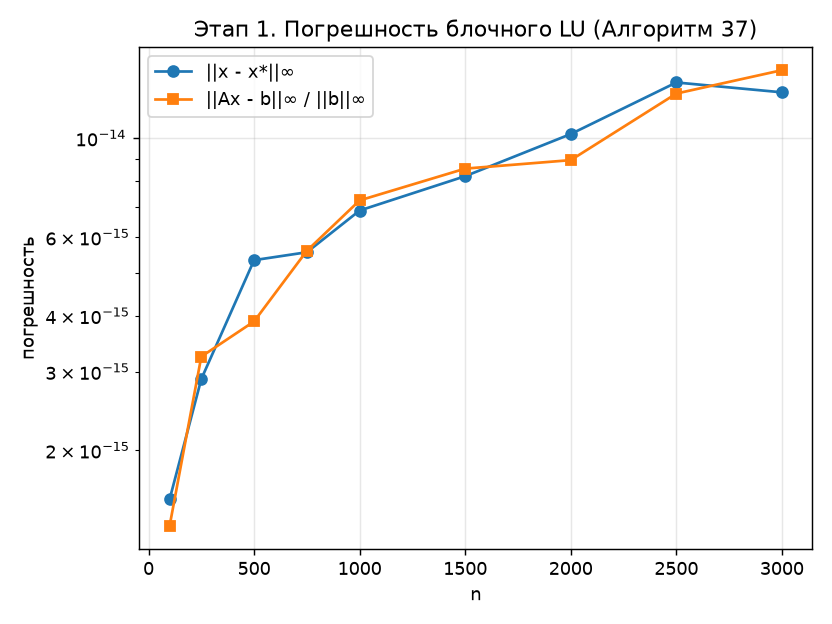
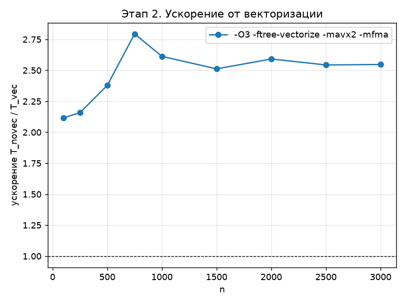
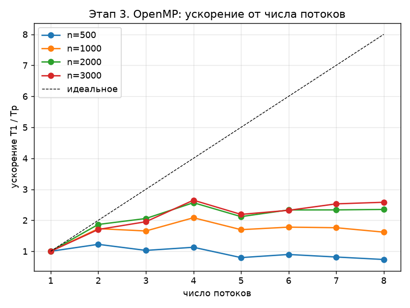
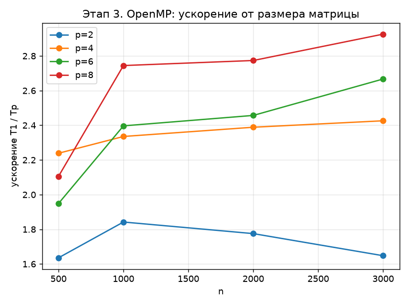
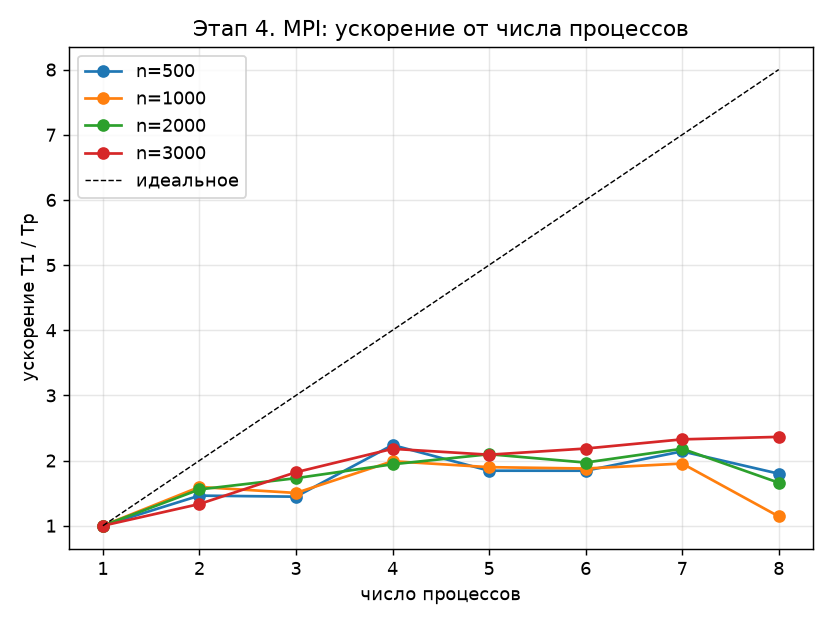
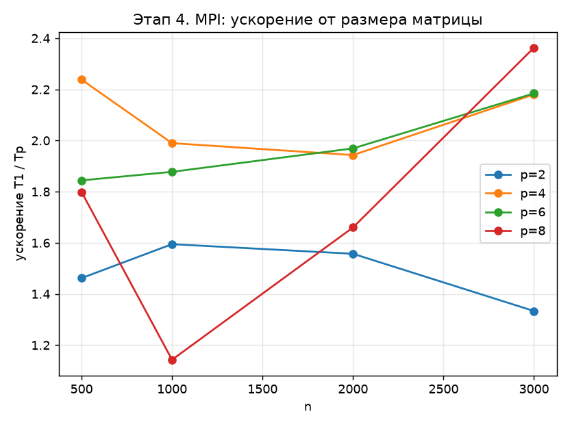

# Блочное LU-разложение (Алгоритм 37, параграф 2.4)

Результаты ниже рассчитаны по сохранённым CSV из `results/`. Машина: Intel i5-1135G7,
4 ядра / 8 потоков, сборка MinGW GCC 9.2 с MS-MPI, ноутбук работал от батареи.
В самих CSV окружение не записано. Инструкция по сборке и запуску — в [README.md](README.md).

## Алгоритм

Реализован Алгоритм 37 из пособия Д. Л. Головашкина «Векторные алгоритмы вычислительной
линейной алгебры» (2019, параграф 2.4, с. 57–62). Вычисляется `A = L·U`, где `L` — нижняя
унитреугольная матрица, `U` — верхняя треугольная. Обе хранятся на месте `A`: ниже
диагонали записана `L` без единичной диагонали, на диагонали и выше — `U`.
Выбор ведущего элемента отсутствует. Размер малого блока `α = 32`;
последний блок может быть короче (задача 2.4.4 пособия).

На итерации `k` для текущего малого блока `a` выполняются:

1. LU-разложение малого блока: `A(a,a) = L(a,a)·U(a,a)`.
2. Решение систем с верхней треугольной матрицей: `L(b,a)·U(a,a) = A(b,a)` по малым блокам `b`.
3. Решение систем с нижней треугольной матрицей: `L(a,a)·U(a,c) = A(a,c)` по малым блокам `c`.
4. Блочная модификация матрицы внешним произведением: `A'(b,c) = A(b,c) - L(b,a)·U(a,c)`.

На шаг 4 приходится 98 % операций при `n = 3000`.

В [этапе 1](stage1_seq.c) операции записаны поэлементно. В [этапе 2](stage2_vec.c) вся
арифметика сведена к одной операции `saxpy` вдоль строки; `restrict` описывает отсутствие
перекрытия строк. Разбор отчёта векторизатора GCC — в [docs/02_vectorization.md](docs/02_vectorization.md).

[Этап 3](stage3_omp.c) использует OpenMP: циклы шагов 2–4 помечены
`#pragma omp parallel for schedule(static)`, итерации между потоками распределяет
сама OpenMP. Шаг 2 делится по блокам столбца, шаг 3 — по блокам строки, шаг 4 — по парам
блоков (`collapse(2)`). Шаг 1 последователен. Анализ зависимостей — в [docs/03_openmp.md](docs/03_openmp.md).

В [MPI-версии](stage4_mpi.c) блочные строки циклически распределены по процессам, и каждый
хранит только свои. Владелец блочной строки `k` выполняет шаги 1 и 3 и рассылает её через
`MPI_Bcast`, шаги 2 и 4 каждый процесс выполняет над своими строками.

## Методика измерений

Для каждого размера генератор заново устанавливает `srand(12345)`, заполняет
`A₀` значениями из `[-0.5, 0.5]` и добавляет `n / 4` к диагонали.
Такая добавка не гарантирует строгого диагонального преобладания.
Правая часть `b` — сумма элементов каждой строки, поэтому точное решение
в арифметике без округления: `x* = (1, …, 1)`.

Перед каждым из трёх повторов исходная матрица восстанавливается. В CSV
записывается минимум времени; решение и ошибки проверяются по разложению
последнего повтора. Генерация матрицы, решение системы и расчёт ошибок
в измерение не входят.

На этапах 1–3 копирование `A₀` в `A` выполняется до запуска таймера.
В MPI начальная раздача строк и первый барьер находятся до таймера; выделение буфера,
рассылки внутри разложения и завершающий барьер включены, сбор разложения на процессе 0 —
после таймера. Печатается время процесса 0.

Ускорения сравнивают варианты одного этапа:

| Этап | Формула | База |
|---|---|---|
| 2 | `T_novec / T_vec` | `stage2_novec.csv` |
| 3 | `T₁ / Tₚ` | `stage3_omp_t1.csv` |
| 4 | `T₁ / Tₚ` | `stage4_mpi_p1.csv` |

## 1. Погрешность

По [stage1_seq.csv](results/stage1_seq.csv):

| n | 100 | 500 | 1000 | 2000 | 3000 |
|---|---|---|---|---|---|
| `‖x − x*‖∞` | 1,554·10⁻¹⁵ | 5,329·10⁻¹⁵ | 6,883·10⁻¹⁵ | 1,021·10⁻¹⁴ | 1,266·10⁻¹⁴ |

Ошибка в целом увеличивается с размером, но немонотонно: максимум в этой
выборке — `1,332·10⁻¹⁴` при `n = 2500`. Относительная невязка на этапе 1
не превышает `1,419·10⁻¹⁴`. Эти результаты характеризуют выбранные тестовые
матрицы и не доказывают устойчивость разложения без выбора ведущего элемента.

## 2. Векторизация

Сравниваются две сборки одного [исходника](stage2_vec.c):
`-O2 -fno-tree-vectorize` и `-O3 -ftree-vectorize -mavx2 -mfma`.
По [базовым](results/stage2_novec.csv) и [векторным](results/stage2_vec.csv)
замерам ускорение составляет:

| n | 100 | 250 | 500 | 1000 | 2000 | 3000 |
|---|---|---|---|---|---|---|
| `T_novec / T_vec` | 2,12 | 2,16 | 2,38 | 2,61 | 2,59 | 2,55 |

При `n ≥ 750` ускорение стабильно 2,5–2,8 и не падает с ростом размера.

Флаги меняют и уровень оптимизации, и доступные инструкции, поэтому это
ускорение сборки в целом. Отдельный вклад SIMD и FMA этими замерами
не выделен.

## 3. OpenMP

Программа [stage3_omp.c](stage3_omp.c) собирается один раз с
`-O2 -fno-tree-vectorize -fopenmp`; число потоков `P = 1…8` задаётся переменной
`OMP_NUM_THREADS`. Ускорение относительно [одного потока](results/stage3_omp_t1.csv):

| n / P | [2](results/stage3_omp_t2.csv) | [3](results/stage3_omp_t3.csv) | [4](results/stage3_omp_t4.csv) | [6](results/stage3_omp_t6.csv) | [8](results/stage3_omp_t8.csv) |
|---|---|---|---|---|---|
| 500 | 1,64 | 1,94 | 2,24 | 1,95 | 2,11 |
| 1000 | 1,84 | 2,24 | 2,34 | 2,40 | 2,74 |
| 2000 | 1,78 | 2,14 | 2,39 | 2,46 | 2,77 |
| 3000 | 1,65 | 2,27 | 2,43 | 2,67 | 2,93 |

Максимум — `2,93` при `n = 3000`, `P = 8`; при `P = 4` (числе физических ядер)
ускорение составляет 2,24–2,43. Последовательная часть (шаг 1) — около 0,01 % операций,
поэтому модель даёт `S ≈ P`; расхождение с ней вызвано оборудованием, отдельный
вклад памяти и частоты не измерялся. Погрешности для всех `P` совпадают с этапом 1.

## 4. MPI

Ускорение относительно [одного процесса](results/stage4_mpi_p1.csv):

| n / p | [2](results/stage4_mpi_p2.csv) | [3](results/stage4_mpi_p3.csv) | [4](results/stage4_mpi_p4.csv) | [6](results/stage4_mpi_p6.csv) | [8](results/stage4_mpi_p8.csv) |
|---|---|---|---|---|---|
| 500 | 1,46 | 1,45 | 2,24 | 1,84 | 1,80 |
| 1000 | 1,59 | 1,50 | 1,99 | 1,88 | 1,14 |
| 2000 | 1,56 | 1,73 | 1,94 | 1,97 | 1,66 |
| 3000 | 1,33 | 1,82 | 2,18 | 2,18 | 2,36 |

Максимум — `2,36` при `n = 3000`, `p = 8`. Замеры шумные: при `n = 1000`, `p = 8` в этом
прогоне получено `1,14`, а в предыдущем прогоне того же кода — `2,67`.
Погрешности для всех `p` совпадают с этапом 1.

Шаги 1 и 3 выполняет один процесс, пока остальные ждут рассылку; на указанной машине
число физических ядер равно четырём. Это возможные ограничения масштабирования;
их отдельный вклад без профилирования не установлен.

