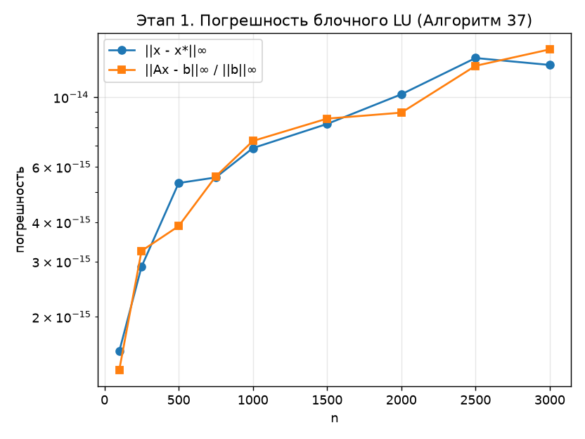

# Этап 1. Последовательное блочное LU-разложение

Программа: [stage1_seq.c](../stage1_seq.c). Результаты: [stage1_seq.csv](../results/stage1_seq.csv),
график [stage1_error.png](../results/stage1_error.png).

Реализован **Алгоритм 37** из параграфа 2.4 пособия Д. Л. Головашкина «Векторные алгоритмы
вычислительной линейной алгебры» (2019, с. 57–62). Этот файл описывает сам алгоритм. Все
остальные этапы ([векторизация](02_vectorization.md), [OpenMP](03_openmp.md), [MPI](04_mpi.md))
выполняют те же вычисления, но по-разному организуют данные и работу.

Математическая теория LU-разложения с полным выводом формул (метод Гаусса в матричной
форме, схема Дулиттла, существование и единственность, дополнение Шура, трудоёмкость,
устойчивость, разобранный пример) — в [отдельном документе](00_lu_theory.md).

---

## 1. Постановка задачи

Дана квадратная матрица $A \in \mathbb{R}^{n \times n}$. Требуется найти разложение

$$
A = L\,U,
$$

где $L$ — нижняя унитреугольная матрица ($\ell_{ii} = 1$), $U$ — верхняя треугольная.
После разложения система $A x = b$ решается двумя треугольными системами:

$$
L\,y = b \quad (\text{прямой ход}), \qquad U\,x = y \quad (\text{обратный ход}).
$$

### Когда разложение существует

Доказательство этого и следующих утверждений — в [теории, раздел 5](00_lu_theory.md#5-существование-и-единственность).

LU-разложение без перестановок строк существует и единственно, если все ведущие
главные миноры отличны от нуля:

$$
\det A_{1:k,\,1:k} \neq 0, \qquad k = 1, \dots, n-1.
$$

Достаточное условие — строгое диагональное преобладание по строкам или
по столбцам, а также симметричная положительная определённость.
В программе выбора ведущего элемента **нет**, как и в Алгоритме 37, поэтому тестовая
матрица подбирается так, чтобы диагональ была заметно больше остальных
элементов (см. [раздел 6](#6-тестовая-матрица-и-измерение-погрешности)).

### Хранение на месте

Матрицы $L$ и $U$ записываются поверх $A$. Единичная диагональ $L$ не хранится:

$$
A \;\longrightarrow\;
\begin{pmatrix}
u_{11} & u_{12} & u_{13} & \cdots \\
\ell_{21} & u_{22} & u_{23} & \cdots \\
\ell_{31} & \ell_{32} & u_{33} & \cdots \\
\vdots & \vdots & \vdots & \ddots
\end{pmatrix}.
$$

Матрица хранится по строкам (row-major): элемент $a_{ij}$ лежит по адресу
`A[i*n + j]`; в коде это макрос `A(i, j)`. Индексы в коде начинаются с нуля,
в формулах этого раздела — с единицы, как в пособии.

---

## 2. Вывод алгоритма

Выделим из матрицы первый малый блок размера $\alpha \times \alpha$ и запишем разложение
в виде трёх сомножителей (формула (18) пособия):

$$
\begin{pmatrix} A_{11} & A_{12} \\ A_{21} & A_{22} \end{pmatrix}
=
\begin{pmatrix} L_{11} & 0 \\ L_{21} & E \end{pmatrix}
\begin{pmatrix} E & 0 \\ 0 & A' \end{pmatrix}
\begin{pmatrix} U_{11} & U_{12} \\ 0 & E \end{pmatrix},
$$

где $A_{11}, L_{11}, U_{11} \in \mathbb{R}^{\alpha \times \alpha}$,
$A_{21}, L_{21} \in \mathbb{R}^{(n-\alpha) \times \alpha}$,
$A_{12}, U_{12} \in \mathbb{R}^{\alpha \times (n-\alpha)}$,
$A_{22}, A' \in \mathbb{R}^{(n-\alpha) \times (n-\alpha)}$, а $E$ — единичные матрицы.
Первый блочный столбец первого сомножителя — первый блочный столбец $L$,
первая блочная строка третьего — первая блочная строка $U$. Перемножив:

$$
\begin{pmatrix} A_{11} & A_{12} \\ A_{21} & A_{22} \end{pmatrix}
=
\begin{pmatrix} L_{11} U_{11} & L_{11} U_{12} \\ L_{21} U_{11} & L_{21} U_{12} + A' \end{pmatrix},
$$

получаем четыре соответствия и порядок их использования:

| Шаг | Равенство | Что ищется | Как |
|---|---|---|---|
| 1 | $A_{11} = L_{11} U_{11}$ | $L_{11}$, $U_{11}$ | неблочное LU блока $\alpha \times \alpha$ |
| 2 | $A_{21} = L_{21} U_{11}$ | $L_{21}$ | треугольные системы $xU = b$ |
| 3 | $A_{12} = L_{11} U_{12}$ | $U_{12}$ | треугольные системы $Lx = b$ |
| 4 | $A_{22} = L_{21} U_{12} + A'$ | $A'$ | **блочная модификация внешним произведением** |

Матрица $A' = A_{22} - L_{21} U_{12}$ — это дополнение Шура блока $A_{11}$. Осталось разложить
её тем же способом: «далее за матрицу $A$ принимается $A'$, и шаги алгоритма повторяются».

Матрица разбита на $N^2$ малых блоков размера $\alpha = n/N$. После $N-1$ таких итераций
остаётся разложить последний малый блок в правом нижнем углу.

---

## 3. Шаги алгоритма в поэлементной записи

Обозначим на итерации $k$ границы блоков: $a$ — индексы текущего блока, $b$ — строки малого
блока внутри блочного столбца, $c$ — столбцы малого блока внутри блочной строки.

### Шаг 1. LU малого блока

Пособие разрешает здесь «один из ранее сформулированных векторных алгоритмов».
При хранении по строкам выгоден Алгоритм 30 со строчным saxpy (kij-форма) — все
циклы идут вдоль строки:

$$
\ell_{sl} = \frac{a_{sl}}{u_{ll}}, \qquad
a_{s,\,l+1:} \;\leftarrow\; a_{s,\,l+1:} - \ell_{sl}\, u_{l,\,l+1:},
\qquad l \in a,\; s > l,\; s \in a.
$$

### Шаг 2. Решение $L(b,a)\,U(a,a) = A(b,a)$

Система с верхней треугольной матрицей $U_{11}$ разбивается на набор систем — по одной на
каждый малый блок блочного столбца. Каждая строка блока — система $xU = b$ (задача 2.1.3
пособия):

$$
x_l = \frac{b_l}{u_{ll}}, \qquad b_{l+1:} \;\leftarrow\; b_{l+1:} - x_l\, u_{l,\,l+1:},
\qquad l \in a.
$$

### Шаг 3. Решение $L(a,a)\,U(a,c) = A(a,c)$

Система с нижней унитреугольной матрицей $L_{11}$ разбивается на набор систем — по одной на
каждый малый блок блочной строки. Каждый столбец блока — система $Lx = b$, которую решает
Алгоритм 27:

$$
b_{l+1:} \;\leftarrow\; b_{l+1:} - \ell_{l+1:,\,l}\, b_l, \qquad l \in a.
$$

В коде циклы по $s$ и $q$ переставлены: $a_{sq} \mathrel{-}= \ell_{sl}\, u_{lq}$ идёт вдоль строки,
что при хранении по строкам обращается к соседним адресам. Операции над каждым столбцом
при этом те же и в том же порядке. Деления нет: $\ell_{ll} = 1$.

### Шаг 4. Основная операция

$$
\boxed{\;A'(b,c) = A(b,c) - L(b,a)\,U(a,c)\;}
$$

для всех пар малых блоков $(i, j)$, $i, j > k$. Умножение блочного столбца на блочную строку
организовано через произведение малых блоков — ради этого блочный алгоритм и составлялся:
каждое такое произведение работает с тремя блоками $\alpha \times \alpha$, которые помещаются
в кэш. Новые значения сразу записываются поверх $A$.

### Полный алгоритм

Алгоритм 37 в нумерации с нуля; неполный последний блок (задача 2.4.4) и итерация $k = N-1$,
где из четырёх шагов остаётся только первый, не требуют отдельного кода:

```text
N = ⌈n / α⌉
for k = 0 .. N-1:
    a = [kα, min((k+1)α, n))

    # 1. A(a,a) = L(a,a) U(a,a)
    for l in a:
        for s in a, s > l:
            A(s, l) /= A(l, l)
            A(s, l+1 : конец a) -= A(s, l) * A(l, l+1 : конец a)

    # 2. L(b,a) U(a,a) = A(b,a)
    for i = k+1 .. N-1:
        for s in блок i:
            for l in a:
                A(s, l) /= A(l, l)
                A(s, l+1 : конец a) -= A(s, l) * A(l, l+1 : конец a)

    # 3. L(a,a) U(a,c) = A(a,c)
    for j = k+1 .. N-1:
        for l in a:
            for s in a, s > l:
                A(s, блок j) -= A(s, l) * A(l, блок j)

    # 4. A'(b,c) = A(b,c) - L(b,a) U(a,c)
    for i = k+1 .. N-1:
        for j = k+1 .. N-1:
            for s in блок i:
                for l in a:
                    A(s, блок j) -= A(s, l) * A(l, блок j)
```

Это ровно функция `block_lu` в [stage1_seq.c](../stage1_seq.c).

### Схема одной итерации

```text
                a0        a1                    n
          ┌─────┬───────────────────────────────┐
          │ L\U │         U готово              │
       a0 ├─────┼─────────┬─────────────────────┤
          │     │ шаг 1   │ шаг 3               │
          │  L  │ L11\U11 │ U12                 │
       a1 │гото-├─────────┼─────────────────────┤
          │ во  │ шаг 2   │ шаг 4               │
          │     │ L21     │ A' = A22 - L21 U12  │
        n └─────┴─────────┴─────────────────────┘
```

Каждая итерация обновляет **всю** правую нижнюю подматрицу (right-looking). В left-looking
алгоритме, наоборот, столбец не трогается до своей очереди и получает все обновления сразу.

### Упрощённые варианты

В пособии упомянуты ещё два варианта с той же четвёртой операцией: вместо шагов 1–2 выполнить
$\alpha$ итераций LU через gaxpy (Алгоритм 34) или вместо шагов 1–3 — $\alpha$ итераций LU через
мм. (Алгоритм 30). В программе реализован основной вариант — сам Алгоритм 37.

---

## 4. Вычислительная сложность

Считаем умножение и вычитание отдельными флопами. На итерации с началом блока $x = k\alpha$
оставшийся размер $m = n - x - \alpha$:

| Шаг | Флопов на итерации | Сумма по итерациям | Доля при $n = 3000$ |
|---|---|---|---|
| 1. LU блока | $\tfrac23 \alpha^3$ | $\tfrac23 n \alpha^2$ | $0{,}01\%$ |
| 2. $L_{21}$ | $m\,\alpha^2$ | $\approx \tfrac12 n^2 \alpha$ | $0{,}8\%$ |
| 3. $U_{12}$ | $m\,\alpha^2$ | $\approx \tfrac12 n^2 \alpha$ | $0{,}8\%$ |
| 4. мм. | $2\,m^2 \alpha$ | $\approx \tfrac23 n^3 - n^2 \alpha$ | $98{,}4\%$ |

Слагаемые $n^2 \alpha$ сокращаются, и итого

$$
T_{\text{flops}} \approx \frac{2}{3}\,n^3,
$$

что совпадает со сложностью метода Гаусса (ответ на задачу 2.4.3 пособия). Вывод для следующих
этапов: **почти вся работа — в шаге 4**, поэтому алгоритм хорошо векторизуется и хорошо
параллелится.

Память: $n^2$ чисел для $A$ (разложение на месте). Для проверки программа хранит
ещё копию исходной матрицы $A_0$ — ещё $n^2$ чисел.

### Выбор размера блока

В задаче 2.4.5 пособия размер блока выбирается по ёмкости «быстрой» памяти на шаге 4: в кэш
должны поместиться три блока $\alpha \times \alpha$ ($A(b,c)$, $L(b,a)$, $U(a,c)$), то есть
$3\alpha^2 \le M$, где $M$ — ёмкость кэша в числах. Для кэша L1 процессора i5-1135G7
(48 КБ, $M = 6000$) получаем $\alpha \le 44$.

В программе $\alpha = 32$ (константа `ALPHA`): три блока занимают 24 КБ, а строка блока — 256 байт,
ровно 8 векторов AVX2 ([этап 2](02_vectorization.md)). Пробные замеры при $n = 2000$:

| $\alpha$ | 16 | 32 | 64 | 128 | 256 |
|---|---|---|---|---|---|
| $T$ без векторизации, с | 1,99 | 2,17 | 1,81 | 1,66 | 1,53 |
| $T$ с векторизацией, с | 1,09 | 0,89 | 0,91 | 1,07 | 0,95 |

Измерения однократные и шумные (ноутбук работал от батареи), поэтому таблица показывает лишь
порядок. У векторной сборки минимум — при $\alpha = 32$. Скалярная сборка, наоборот, быстрее при больших блоках; причины этого замерами не выделены.

---

## 5. Решение системы и проверка

После разложения функция `lu_solve` решает $LUx = b$.

**Прямой ход** ($L$ с единичной диагональю):

$$
y_i = b_i - \sum_{j<i} \ell_{ij}\, y_j, \qquad i = 0, 1, \dots, n-1.
$$

**Обратный ход**:

$$
x_i = \frac{1}{u_{ii}}\Bigl(y_i - \sum_{j>i} u_{ij}\, x_j\Bigr), \qquad i = n-1, \dots, 0.
$$

Оба хода стоят $O(n^2)$ и в замер времени не входят.

---

## 6. Тестовая матрица и измерение погрешности

### Генерация

$$
a_{ij} = \xi_{ij} - \tfrac12, \quad \xi_{ij} \sim U[0,1]; \qquad a_{ii} \mathrel{+}= \frac{n}{4}.
$$

Генератор каждый раз инициализируется `srand(12345)`, поэтому матрица
для данного $n$ всегда одна и та же. Сдвиг диагонали делает её доминирующей
**в среднем**, но не гарантирует строгого преобладания: математическое ожидание
суммы модулей внедиагональных элементов строки

$$
\mathbb{E}\sum_{j \ne i} \lvert a_{ij} \rvert = (n-1)\cdot\mathbb{E}\lvert \xi - \tfrac12 \rvert = \frac{n-1}{4}
$$

почти равно диагонали $n/4 \pm 1/2$. Для этих матриц разложение без выбора
ведущего элемента на практике проходит, но это свойство конкретных тестовых данных,
а не гарантия.

### Точное решение

Правая часть — сумма элементов каждой строки:

$$
b_i = \sum_{j} a_{ij} \quad\Longrightarrow\quad x^* = (1, 1, \dots, 1)^T.
$$

### Метрики

Программа печатает две величины:

$$
\text{err} = \lVert x - x^* \rVert_\infty = \max_i \lvert x_i - 1 \rvert,
\qquad
\text{res} = \frac{\lVert A_0 x - b \rVert_\infty}{\lVert b \rVert_\infty}.
$$

* `err` — **прямая** погрешность: насколько найденное решение отличается от точного;
* `res` — относительная **невязка**: насколько хорошо найденный $x$ удовлетворяет
  исходной системе.

### Чего ожидать теоретически

Для метода Гаусса в арифметике с плавающей точкой (машинная точность
$\varepsilon = 2^{-53} \approx 1{,}1 \cdot 10^{-16}$) вычисленные множители удовлетворяют

$$
\hat L \hat U = A + \delta A, \qquad
\lvert \delta A \rvert \le \gamma_n\, \lvert \hat L \rvert\, \lvert \hat U \rvert, \qquad
\gamma_n = \frac{n\varepsilon}{1 - n\varepsilon},
$$

(Higham, теорема 9.3; аналогичная оценка — у Голуба и Ван Лоуна, §3.3). Для прямой погрешности

$$
\frac{\lVert x - x^* \rVert}{\lVert x^* \rVert} \lesssim \kappa(A)\cdot \gamma_n \cdot \rho,
$$

где $\kappa(A) = \lVert A \rVert \lVert A^{-1} \rVert$ — число обусловленности,
$\rho$ — коэффициент роста элементов. Для матриц с выраженной диагональю
$\kappa(A)$ и $\rho$ малы, поэтому **ожидается рост погрешности примерно
пропорционально $n\varepsilon$**, но с запасом: оценка $\gamma_n$ — худший случай,
а на практике ошибки округления частично компенсируются (статистически рост
ближе к $\sqrt{n}\,\varepsilon$).

### Результаты

По [stage1_seq.csv](../results/stage1_seq.csv):

| $n$ | 100 | 250 | 500 | 750 | 1000 | 1500 | 2000 | 2500 | 3000 |
|---|---|---|---|---|---|---|---|---|---|
| err, $10^{-15}$ | 1,55 | 2,89 | 5,33 | 5,55 | 6,88 | 8,22 | 10,21 | 13,32 | 12,66 |
| res, $10^{-15}$ | 1,35 | 3,24 | 3,89 | 5,59 | 7,25 | 8,54 | 8,93 | 12,58 | 14,19 |
| время, с | 0,0002 | 0,003 | 0,025 | 0,086 | 0,207 | 0,707 | 1,72 | 3,39 | 5,88 |



Выводы:

* погрешность **растёт с размерностью**: при увеличении $n$ в 30 раз (с 100 до 3000)
  `err` растёт примерно в 8 раз — медленнее линейного $n\varepsilon$ и ближе к $\sqrt{n}\,\varepsilon$;
* рост не строго монотонный (при $n = 2500$ ошибка больше, чем при $n = 3000$):
  каждая матрица своя, и случайный характер ошибок округления заметен;
* во всех случаях ошибка остаётся порядка $10\,\varepsilon$–$100\,\varepsilon$, то есть
  разложение для этих матриц численно устойчиво;
* время растёт как $n^3$: от $n = 1000$ до $n = 3000$ — в 28,4 раза при теоретических $27$.

---

## 7. Соответствие коду

| Элемент алгоритма | Где в [stage1_seq.c](../stage1_seq.c) |
|---|---|
| Хранение $A$ по строкам | макрос `A(i, j)` |
| Граница малого блока, неполный блок | макрос `END(i)` |
| Размер блока $\alpha$, число повторов | `ALPHA = 32`, `REPS = 3` |
| Шаги 1–4 Алгоритма 37 | `block_lu` |
| Прямой и обратный ход | `lu_solve` |
| Генерация $A_0$, $b$, замер, метрики | `run` |
| Список размеров по умолчанию | `main` |

Замер времени — `QueryPerformanceCounter` на Windows, `clock_gettime` на Linux и macOS;
из трёх повторов берётся минимальное время. Копирование $A_0 \to A$ выполняется до запуска таймера.

## Литература

1. Головашкин Д. Л. Векторные алгоритмы вычислительной линейной алгебры. — 2019. — §2.1 (Алгоритм 27, задача 2.1.3), §2.2 (Алгоритм 30), §2.4 (Алгоритм 37).
2. Голуб Дж., Ван Лоун Ч. Матричные вычисления. — §3.2 (формы LU), §3.3 (анализ ошибок).
3. Higham N. J. Accuracy and Stability of Numerical Algorithms. — гл. 9 (LU-разложение), гл. 13 (блочные алгоритмы).
4. Ортега Дж. Введение в параллельные и векторные методы решения линейных систем.
