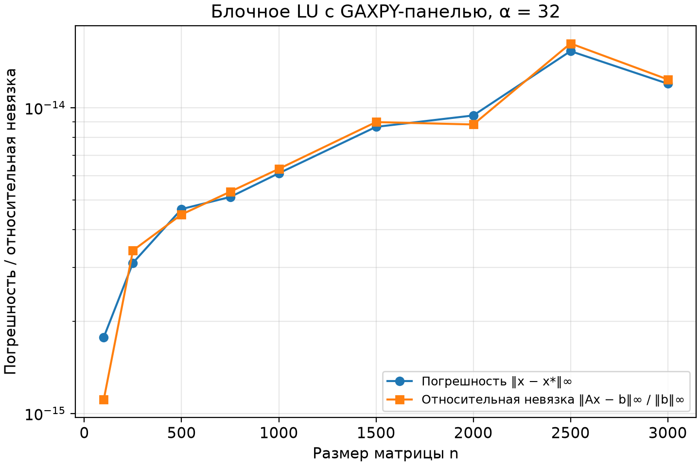

# Этап 1. Последовательное блочное LU-разложение

Программа: [stage1_seq.c](../stage1_seq.c). Результаты: [stage1_seq.csv](../results/stage1_seq.csv),
график [stage1_error.png](../results/stage1_error.png).

Реализован **второй вариант Алгоритма 37** из § 2.4 пособия Д. Л. Головашкина
«Векторные алгоритмы вычислительной линейной алгебры» (2019, с. 61).
Вместо первых двух шагов базового варианта выполняются первые $w$ итераций
GAXPY LU (Алгоритм 34, с. 54) для текущей оставшейся подматрицы.
Здесь $w = \min(\alpha, n-a_0)$, размер блока $\alpha = 32$.
**Изменена только лабораторная 1**: этапы 2–4 пока используют базовый вариант.
Общие гайды, PDF и отчёты описывают прежнюю реализацию; актуальное описание
первой лабораторной находится на этой странице.

Математическая теория LU-разложения с полным выводом формул (метод Гаусса в матричной
форме, схема Дулиттла, существование и единственность, дополнение Шура, трудоёмкость,
устойчивость, разобранный пример) — в [отдельном документе](00_lu_theory.md).

---

## 1. Постановка задачи

Дана квадратная матрица $A \in \mathbb{R}^{n \times n}$. Требуется найти разложение

$$
A = L\,U,
$$

где $L$ — нижняя унитреугольная матрица ($\ell_{ii} = 1$), $U$ — верхняя треугольная.
После разложения система $A x = b$ решается двумя треугольными системами:

$$
L\,y = b \quad (\text{прямой ход}), \qquad U\,x = y \quad (\text{обратный ход}).
$$

### Когда разложение существует

Доказательство этого и следующих утверждений — в [теории, раздел 5](00_lu_theory.md#5-существование-и-единственность).

LU-разложение без перестановок строк существует и единственно, если все ведущие
главные миноры отличны от нуля:

$$
\det A_{1:k,\,1:k} \neq 0, \qquad k = 1, \dots, n-1.
$$

Достаточное условие — строгое диагональное преобладание по строкам или
по столбцам, а также симметричная положительная определённость.
В программе выбора ведущего элемента **нет**, как и в Алгоритме 37, поэтому тестовая
матрица подбирается так, чтобы диагональ была заметно больше остальных
элементов (см. [раздел 6](#6-тестовая-матрица-и-измерение-погрешности)).

### Хранение на месте

Матрицы $L$ и $U$ записываются поверх $A$. Единичная диагональ $L$ не хранится:

$$
A \;\longrightarrow\;
\begin{pmatrix}
u_{11} & u_{12} & u_{13} & \cdots \\
\ell_{21} & u_{22} & u_{23} & \cdots \\
\ell_{31} & \ell_{32} & u_{33} & \cdots \\
\vdots & \vdots & \vdots & \ddots
\end{pmatrix}.
$$

Матрица хранится по строкам (row-major): элемент $a_{ij}$ лежит по адресу
`A[i*n + j]`; в коде это макрос `A(i, j)`. Индексы в коде начинаются с нуля,
в формулах этого раздела — с единицы, как в пособии.

---

## 2. Блочная схема

Пусть $B=A[a_0:n,a_0:n]$ — текущая подматрица, уже обновлённая предыдущими
блочными итерациями. На каждой итерации выполняются три действия:

1. **GAXPY LU панели** $B[:,0:w]$: находятся $L_{11}$, $U_{11}$, $L_{21}$.
2. **Прежний шаг 3**: решается $L_{11}U_{12}=B_{12}$.
3. **Прежний шаг 4**: вычисляется дополнение Шура $B_{22}\leftarrow B_{22}-L_{21}U_{12}$.

Нумерация комментариев «3» и «4» в коде сохранена для сопоставления
с базовым Алгоритмом 37. После последнего блока оба цикла пусты;
отдельная обработка последнего диагонального блока не нужна.

## 3. Почему GAXPY панели корректен

В формулах этого раздела индексы локальные, с нуля; $B$ означает значения
на входе в текущую блочную итерацию. Пусть столбцы панели до $j$ уже найдены.
Из равенства $B=LU$ для строк $i<j$ получаем

$$
u_{ij}=B_{ij}-\sum_{p=0}^{i-1}\ell_{ip}u_{pj}.
$$

Это прямая подстановка с единичной диагональю $L$.
Верхняя часть текущего столбца становится $U[0:j,j]$.
Далее GAXPY вычисляет для всех $s\ge j$

$$
v_s=B_{sj}-\sum_{p=0}^{j-1}\ell_{sp}u_{pj}.
$$

Поскольку $\ell_{jj}=1$, имеем $u_{jj}=v_j$, а для $s>j$

$$
\ell_{sj}=v_s/u_{jj}.
$$

Таким образом, одна итерация строит очередной столбец $U$ и весь столбец $L$
до нижней границы матрицы. По индукции после $w$ итераций

$$
B_{11}=L_{11}U_{11},\qquad B_{21}=L_{21}U_{11}.
$$

Это ровно результат первых двух шагов базового варианта. Панель не меняет
$B_{12}$ и $B_{22}$, поэтому последующее решение для $U_{12}$ и обновление
дополнения Шура остаются корректными.

### Соответствие коду

В `stage1_seq.c` локальный индекс $j$ заменён глобальным `j` из `[a0,a1)`:

```c
for (int j = a0; j < a1; j++) {
    /* Верх столбца U: прямая подстановка. */
    for (int p = a0; p < j - 1; p++)
        for (int s = p + 1; s < j; s++)
            A(s, j) -= A(s, p) * A(p, j);

    /* GAXPY для диагонального элемента и нижней части столбца. */
    for (int p = a0; p < j; p++)
        for (int s = j; s < n; s++)
            A(s, j) -= A(s, p) * A(p, j);

    for (int s = j + 1; s < n; s++)
        A(s, j) /= A(j, j);
}
```

Первый двойной цикл вычитает каждое слагаемое верхней треугольной системы
после того, как соответствующий `A(p,j)` окончательно найден.
Второй двойной цикл представляет произведение матрицы на вектор
в GAXPY как сумму масштабированных столбцов (Алгоритмы 34–35).
Деление выполняется только после полного обновления диагонального элемента.

Границы принципиальны:

- `p` начинается с `a0`: вклад предыдущих панелей уже вычтен шагом 4;
- `s` доходит до `n`, чтобы сформировать также $L_{21}$;
- `j` не выходит за `a1`, поэтому $A_{12}$ и $A_{22}$ пока не изменяются;
- `a1 = min(a0 + alpha, n)` поддерживает неполный последний блок.

Условия применимости прежние: для выполнения разложения нужны ненулевые
ведущие элементы, а для решения системы также нужен ненулевой последний
диагональный элемент $U$. Выбор ведущего элемента и его проверки не добавлены.
Изменение порядка операций не устраняет риск роста ошибки при малых пивотах.

Матрица по-прежнему хранится по строкам, однако циклы GAXPY панели идут
по столбцам. Поэтому совпадение арифметической сложности не означает
совпадения времени исполнения с прежним вариантом.

### Проверка

`python3 tests/test_stage1.py` собирает временную библиотеку из настоящего
`stage1_seq.c`. Проверяются матрицы с заранее заданными $L,U$, восстановление
$A=LU$, решение для нескольких правых частей и границы блоков.
Тесты не требуют MPI или OpenMP и не перезаписывают экспериментальные данные.

---

## 4. Вычислительная сложность

Первые две строки таблицы — вклады диагонального блока и $L_{21}$;
теперь оба вычисляются одной GAXPY панелью. Считаем умножение и вычитание отдельными флопами. На итерации с началом блока $x = k\alpha$
оставшийся размер $m = n - x - \alpha$:

| Шаг | Флопов на итерации | Сумма по итерациям | Доля при $n = 3000$ |
|---|---|---|---|
| 1. LU блока | $\tfrac23 \alpha^3$ | $\tfrac23 n \alpha^2$ | $0{,}01\%$ |
| 2. $L_{21}$ | $m\,\alpha^2$ | $\approx \tfrac12 n^2 \alpha$ | $0{,}8\%$ |
| 3. $U_{12}$ | $m\,\alpha^2$ | $\approx \tfrac12 n^2 \alpha$ | $0{,}8\%$ |
| 4. мм. | $2\,m^2 \alpha$ | $\approx \tfrac23 n^3 - n^2 \alpha$ | $98{,}4\%$ |

Слагаемые $n^2 \alpha$ сокращаются, и итого

$$
T_{\text{flops}} \approx \frac{2}{3}\,n^3,
$$

что совпадает со сложностью метода Гаусса (ответ на задачу 2.4.3 пособия). Вывод для следующих
этапов: **почти вся работа — в шаге 4**, поэтому алгоритм хорошо векторизуется и хорошо
параллелится.

Память: $n^2$ чисел для $A$ (разложение на месте). Для проверки программа хранит
ещё копию исходной матрицы $A_0$ — ещё $n^2$ чисел.

### Выбор размера блока

В задаче 2.4.5 пособия размер блока выбирается по ёмкости «быстрой» памяти на шаге 4: в кэш
должны поместиться три блока $\alpha \times \alpha$ ($A(b,c)$, $L(b,a)$, $U(a,c)$), то есть
$3\alpha^2 \le M$, где $M$ — ёмкость кэша в числах. Для кэша L1 процессора i5-1135G7
(48 КБ, $M = 6000$) получаем $\alpha \le 44$.

В программе $\alpha = 32$ (константа `ALPHA`): три блока занимают 24 КБ, а строка блока — 256 байт,
ровно 8 векторов AVX2 ([этап 2](02_vectorization.md)). Архивные пробные замеры прежнего варианта при $n = 2000$:

| $\alpha$ | 16 | 32 | 64 | 128 | 256 |
|---|---|---|---|---|---|
| $T$ без векторизации, с | 1,99 | 2,17 | 1,81 | 1,66 | 1,53 |
| $T$ с векторизацией, с | 1,09 | 0,89 | 0,91 | 1,07 | 0,95 |

Измерения однократные и шумные (ноутбук работал от батареи), поэтому таблица показывает лишь
порядок. У векторной сборки минимум — при $\alpha = 32$. Скалярная сборка, наоборот, быстрее при больших блоках; причины этого замерами не выделены.

---

## 5. Решение системы и проверка

После разложения функция `lu_solve` решает $LUx = b$.

**Прямой ход** ($L$ с единичной диагональю):

$$
y_i = b_i - \sum_{j<i} \ell_{ij}\, y_j, \qquad i = 0, 1, \dots, n-1.
$$

**Обратный ход**:

$$
x_i = \frac{1}{u_{ii}}\Bigl(y_i - \sum_{j>i} u_{ij}\, x_j\Bigr), \qquad i = n-1, \dots, 0.
$$

Оба хода стоят $O(n^2)$ и в замер времени не входят.

---

## 6. Тестовая матрица и измерение погрешности

### Генерация

$$
a_{ij} = \xi_{ij} - \tfrac12, \quad \xi_{ij} \sim U[0,1]; \qquad a_{ii} \mathrel{+}= \frac{n}{4}.
$$

Генератор каждый раз инициализируется `srand(12345)`, поэтому матрица
для данного $n$ всегда одна и та же. Сдвиг диагонали делает её доминирующей
**в среднем**, но не гарантирует строгого преобладания: математическое ожидание
суммы модулей внедиагональных элементов строки

$$
\mathbb{E}\sum_{j \ne i} \lvert a_{ij} \rvert = (n-1)\cdot\mathbb{E}\lvert \xi - \tfrac12 \rvert = \frac{n-1}{4}
$$

почти равно диагонали $n/4 \pm 1/2$. Для этих матриц разложение без выбора
ведущего элемента на практике проходит, но это свойство конкретных тестовых данных,
а не гарантия.

### Точное решение

Правая часть — сумма элементов каждой строки:

$$
b_i = \sum_{j} a_{ij} \quad\Longrightarrow\quad x^* = (1, 1, \dots, 1)^T.
$$

### Метрики

Программа печатает две величины:

$$
\text{err} = \lVert x - x^* \rVert_\infty = \max_i \lvert x_i - 1 \rvert,
\qquad
\text{res} = \frac{\lVert A_0 x - b \rVert_\infty}{\lVert b \rVert_\infty}.
$$

* `err` — **прямая** погрешность: насколько найденное решение отличается от точного;
* `res` — относительная **невязка**: насколько хорошо найденный $x$ удовлетворяет
  исходной системе.

### Чего ожидать теоретически

Для метода Гаусса в арифметике с плавающей точкой (машинная точность
$\varepsilon = 2^{-53} \approx 1{,}1 \cdot 10^{-16}$) вычисленные множители удовлетворяют

$$
\hat L \hat U = A + \delta A, \qquad
\lvert \delta A \rvert \le \gamma_n\, \lvert \hat L \rvert\, \lvert \hat U \rvert, \qquad
\gamma_n = \frac{n\varepsilon}{1 - n\varepsilon},
$$

(Higham, теорема 9.3; аналогичная оценка — у Голуба и Ван Лоуна, §3.3). Для прямой погрешности

$$
\frac{\lVert x - x^* \rVert}{\lVert x^* \rVert} \lesssim \kappa(A)\cdot \gamma_n \cdot \rho,
$$

где $\kappa(A) = \lVert A \rVert \lVert A^{-1} \rVert$ — число обусловленности,
$\rho$ — коэффициент роста элементов. Для матриц с выраженной диагональю
$\kappa(A)$ и $\rho$ малы, поэтому **ожидается рост погрешности примерно
пропорционально $n\varepsilon$**, но с запасом: оценка $\gamma_n$ — худший случай,
а на практике ошибки округления частично компенсируются (статистически рост
ближе к $\sqrt{n}\,\varepsilon$).

### Результаты прежнего варианта

Следующие сохранённые замеры получены до перехода первой лабораторной на GAXPY.
Они не являются измерениями текущего исходника.

По [stage1_seq.csv](../results/stage1_seq.csv):

| $n$ | 100 | 250 | 500 | 750 | 1000 | 1500 | 2000 | 2500 | 3000 |
|---|---|---|---|---|---|---|---|---|---|
| err, $10^{-15}$ | 1,55 | 2,89 | 5,33 | 5,55 | 6,88 | 8,22 | 10,21 | 13,32 | 12,66 |
| res, $10^{-15}$ | 1,35 | 3,24 | 3,89 | 5,59 | 7,25 | 8,54 | 8,93 | 12,58 | 14,19 |
| время, с | 0,0002 | 0,003 | 0,025 | 0,086 | 0,207 | 0,707 | 1,72 | 3,39 | 5,88 |



Выводы:

* погрешность **растёт с размерностью**: при увеличении $n$ в 30 раз (с 100 до 3000)
  `err` растёт примерно в 8 раз — медленнее линейного $n\varepsilon$ и ближе к $\sqrt{n}\,\varepsilon$;
* рост не строго монотонный (при $n = 2500$ ошибка больше, чем при $n = 3000$):
  каждая матрица своя, и случайный характер ошибок округления заметен;
* во всех случаях ошибка остаётся порядка $10\,\varepsilon$–$100\,\varepsilon$, то есть
  разложение для этих матриц численно устойчиво;
* время растёт как $n^3$: от $n = 1000$ до $n = 3000$ — в 28,4 раза при теоретических $27$.

---

## 7. Соответствие коду

| Элемент алгоритма | Где в [stage1_seq.c](../stage1_seq.c) |
|---|---|
| Хранение $A$ по строкам | макрос `A(i, j)` |
| Граница малого блока, неполный блок | макрос `END(i)` |
| Размер блока $\alpha$, число повторов | `ALPHA = 32`, `REPS = 3` |
| GAXPY панель вместо шагов 1–2, затем шаги 3–4 | `block_lu` |
| Прямой и обратный ход | `lu_solve` |
| Генерация $A_0$, $b$, замер, метрики | `run` |
| Список размеров по умолчанию | `main` |

Замер времени — `QueryPerformanceCounter` на Windows, `clock_gettime` на Linux и macOS;
из трёх повторов берётся минимальное время. Копирование $A_0 \to A$ выполняется до запуска таймера.

## Литература

1. Головашкин Д. Л. Векторные алгоритмы вычислительной линейной алгебры. — 2019. — §2.1 (Алгоритм 27), §2.3 (Алгоритмы 34–35, с. 54–55), §2.4 (Алгоритм 37 и второй вариант, с. 60–61).
2. Голуб Дж., Ван Лоун Ч. Матричные вычисления. — §3.2 (формы LU), §3.3 (анализ ошибок).
3. Higham N. J. Accuracy and Stability of Numerical Algorithms. — гл. 9 (LU-разложение), гл. 13 (блочные алгоритмы).
4. Ортега Дж. Введение в параллельные и векторные методы решения линейных систем.
