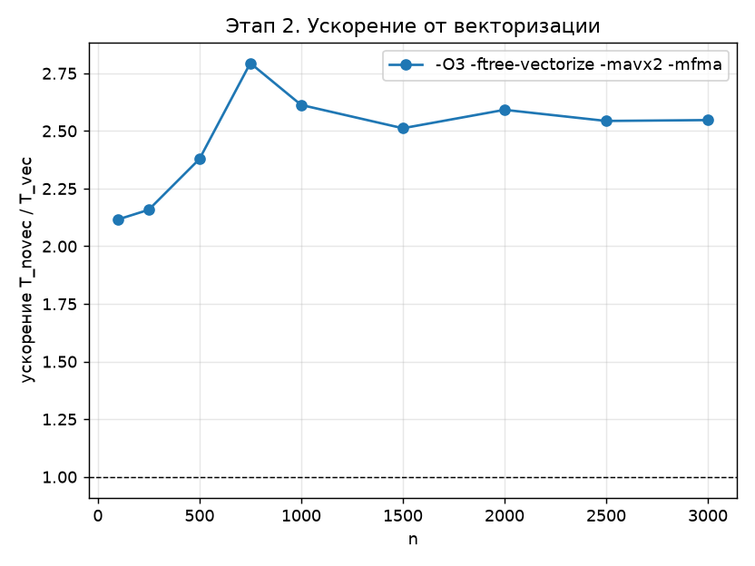

# Этап 2. Векторизация блочного LU-разложения

Программа: [stage2_vec.c](../stage2_vec.c). Результаты: [stage2_novec.csv](../results/stage2_novec.csv),
[stage2_vec.csv](../results/stage2_vec.csv), график [stage2_vec_speedup.png](../results/stage2_vec_speedup.png).

Алгоритм тот же, что на [этапе 1](01_sequential.md): Алгоритм 37 с четырьмя шагами на
каждой итерации. Здесь описано, как код подготовлен к автоматической векторизации
компилятором GCC и что из этого получилось.

---

## 1. Что такое векторизация

Современный процессор умеет выполнять одну инструкцию сразу над несколькими
числами — **SIMD** (Single Instruction, Multiple Data). На процессоре Intel
i5-1135G7 доступен набор **AVX2**: регистры по 256 бит, то есть

$$
\frac{256\ \text{бит}}{64\ \text{бита на double}} = 4\ \text{числа double в одном регистре}.
$$

Дополнительно набор **FMA** (fused multiply-add) выполняет за одну инструкцию

$$
d \leftarrow a \cdot b + c
$$

с одним округлением вместо двух. Векторная FMA над 4 числами делает 8 флопов.

**Автовекторизация** — преобразование компилятором скалярного цикла

```c
for (q = 0; q < m; q++)
    y[q] -= s * x[q];
```

в цикл, который за одну итерацию обрабатывает 4 элемента:

$$
\begin{pmatrix} y_q \\ y_{q+1} \\ y_{q+2} \\ y_{q+3} \end{pmatrix}
\leftarrow
\begin{pmatrix} y_q \\ y_{q+1} \\ y_{q+2} \\ y_{q+3} \end{pmatrix}
- s \cdot
\begin{pmatrix} x_q \\ x_{q+1} \\ x_{q+2} \\ x_{q+3} \end{pmatrix}
\qquad (\text{одна инструкция, например } \texttt{vfnmadd231pd}).
$$

Теоретическое ускорение такого цикла — до 4 раз за счёт ширины вектора
(и ещё до 2 раз, если без FMA умножение и вычитание выполнялись бы отдельно).
На практике оно ограничено скоростью подачи данных из памяти.

### Условия, при которых компилятор векторизует цикл

1. **Нет зависимостей между итерациями** внутреннего цикла: итерация $q$
   не читает то, что пишет итерация $q' \ne q$.
2. **Единичный шаг по памяти**: элементы $x_q, x_{q+1}, \dots$ лежат подряд —
   тогда их можно загрузить одной векторной инструкцией.
3. **Известно отсутствие перекрытия** (aliasing) массивов $y$ и $x$.
   Если компилятор не может это доказать, он либо отказывается от векторизации,
   либо вставляет проверку во время выполнения (*versioning*).
4. Простая форма цикла: счётчик с известными границами, без вызовов функций
   и ветвлений в теле.

---

## 2. Все шаги алгоритма — одна операция saxpy

Самая внутренняя операция всех четырёх шагов Алгоритма 37 одинакова и идёт вдоль строки:

$$
y \leftarrow y - s \cdot x, \qquad a_{sq} \mathrel{-}= a_{sl}\, a_{lq},
$$

| Шаг | $y$ | $s$ | $x$ | Длина |
|---|---|---|---|---|
| 1. LU блока | строка $s$ блока | $\ell_{sl}$ | строка $l$ блока | $< \alpha$ |
| 2. $L_{21}$ | строка $s$ столбца $L$ | $\ell_{sl}$ | строка $l$ блока $U_{11}$ | $< \alpha$ |
| 3. $U_{12}$ | строка $s$ блока $U(a,c)$ | $\ell_{sl}$ | строка $l$ блока $U(a,c)$ | $\alpha$ |
| 4. мм. | строка $s$ блока $A(b,c)$ | $\ell_{sl}$ | строка $l$ блока $U(a,c)$ | $\alpha$ |

Поэтому в [stage2_vec.c](../stage2_vec.c) вся арифметика разложения вынесена в одну функцию:

```c
static inline void saxpy(int m, double s, const double *restrict x, double *restrict y)
{
    for (int q = 0; q < m; q++)
        y[q] -= s * x[q];
}
```

Условия 1, 2 и 4 выполнены: при хранении по строкам $x$ и $y$ — соседние элементы строки
матрицы. Условие 3 обеспечивает ключевое слово `restrict`: это обещание программиста, что
через `y` нельзя изменить данные, которые читаются через `x`. Обещание верно, так как $x$ и $y$ —
**разные строки** матрицы ($s > l$ или $s$ лежит ниже блока $a$).

Именно поэтому в шаге 1 применена kij-форма LU, а в шаге 3 циклы переставлены
по сравнению с Алгоритмом 27: при хранении по строкам внутренний цикл вдоль столбца шёл бы с
шагом $n$, и его нельзя было бы загрузить одной векторной инструкцией.

На этапе 1 та же арифметика записана через `A(s, q) -= A(s, l) * A(l, q)`: все обращения идут к одному
массиву `A` без `restrict`, и компилятору сложнее доказать, что они не пересекаются.

---

## 3. Сборки и флаги компилятора

Один исходник собирается дважды ([build.sh](../build.sh)):

| Сборка | Флаги | Назначение |
|---|---|---|
| `stage2_novec.exe` | `-O2 -fno-tree-vectorize` | база: векторизация запрещена |
| `stage2_vec.exe` | `-O3 -ftree-vectorize -mavx2 -mfma` | векторизация с AVX2 и FMA |

Общие флаги обеих сборок: `-std=gnu99 -msse2 -mfpmath=sse`. Компилятор — 32-битный
MinGW GCC 9.2; без `-mfpmath=sse` он использовал бы для `double` устаревший
стековый сопроцессор x87, и сравнение было бы нечестным.

Значение флагов:

* `-ftree-vectorize` — включает автовекторизатор циклов (на `-O3` он включён
  и так; флаг указан явно, чтобы было видно, что именно сравнивается);
* `-fno-tree-vectorize` — явно запрещает его в базовой сборке;
* `-mavx2` — разрешает инструкции AVX2 (256-битные векторы);
* `-mfma` — разрешает инструкции fused multiply-add.

### Отчёт компилятора

Флаг `-fopt-info-vec-optimized` печатает, какие циклы векторизованы.
Для `stage2_vec.c` GCC 9.2 сообщает:

```text
stage2_vec.c:36:5: optimized: loop vectorized using 32 byte vectors
stage2_vec.c:87:5: optimized: loop vectorized using 32 byte vectors
stage2_vec.c:107:9: optimized: loop vectorized using 32 byte vectors
stage2_vec.c:126:9: optimized: loop vectorized using 32 byte vectors
```

* строка 36 — цикл `saxpy`: векторизован 32-байтными (AVX) векторами без проверок
  перекрытия, потому что указатели объявлены `restrict`. Это и есть основная работа алгоритма;
* строка 87 — цикл прямого хода в `lu_solve`, вне замера;
* строки 107 и 126 — суммы при вычислении $b$ и невязки, вне замера.

При $\alpha = 32$ цикл `saxpy` на шагах 3–4 — ровно 8 векторных итераций без «хвоста». В шагах
1–2 длина цикла меньше $\alpha$ и зависит от $l$, поэтому там часть элементов выполняется скалярно.

---

## 4. Модель ожидаемого ускорения

Пусть $T_{\text{scal}}$ — время без векторизации. Разделим его на долю $f$,
приходящуюся на векторизуемые циклы, и долю $1-f$ (все остальные операции). Если
векторизуемая часть ускоряется в $s$ раз, то по закону Амдала

$$
S = \frac{T_{\text{scal}}}{T_{\text{vec}}} = \frac{1}{(1-f) + f/s}.
$$

Вся арифметика проходит через `saxpy`, кроме делений в шагах 1 и 2 — их $O(n^2)$ при $\frac23 n^3$
флопов (раздел 4 [этапа 1](01_sequential.md#4-вычислительная-сложность)). Значит $f \approx 1$, и ускорение определяется
тем, насколько быстро работает векторный цикл.

Верхняя граница $s$ по арифметике — 4 (ширина AVX2). На одну векторную FMA приходится
загрузка 4 элементов $x$ (32 байта) и загрузка с записью 4 элементов $y$. Блоки $x$ и $y$
размером $\alpha \times \alpha$ помещаются в кэш L1 (48 КБ), однако каждая итерация алгоритма заново
читает и пишет всю оставшуюся подматрицу ($n = 3000$ — до 72 МБ), и блоки приходится сначала
подгружать из памяти. Поэтому реальное $s$ меньше 4.

---

## 5. Результаты

$$
S(n) = \frac{T_{\text{novec}}(n)}{T_{\text{vec}}(n)}
$$

| $n$ | 100 | 250 | 500 | 750 | 1000 | 1500 | 2000 | 2500 | 3000 |
|---|---|---|---|---|---|---|---|---|---|
| $T_{\text{novec}}$, с | 0,0002 | 0,003 | 0,030 | 0,109 | 0,257 | 0,850 | 2,04 | 4,01 | 6,90 |
| $T_{\text{vec}}$, с | 0,0001 | 0,002 | 0,012 | 0,039 | 0,098 | 0,338 | 0,786 | 1,58 | 2,71 |
| $S$ | 2,12 | 2,16 | 2,38 | 2,79 | 2,61 | 2,51 | 2,59 | 2,54 | 2,55 |



Выводы:

* при $n \ge 750$ ускорение стабильно **2,5–2,8** и не падает с ростом $n$. Это согласуется с тем, что
  основная операция работает с блоками $32 \times 32$, которые помещаются в кэш L1;
* при малых $n$ (100–500) ускорение ниже, **2,1–2,4**: блоков мало, и заметную долю времени занимают
  шаги 1–2 с короткими циклами, где векторные итерации не окупаются;
* до теоретического предела 4 ускорение не доходит. Наиболее вероятная причина — каждая итерация
  заново загружает блоки оставшейся подматрицы из памяти; отдельно это не измерялось;
* `err` векторной версии совпадает с этапом 1 до последнего знака, кроме $n = 2000$ и $n = 3000$
  ($1{,}243 \cdot 10^{-14}$ против $1{,}266 \cdot 10^{-14}$), `res` отличается в большинстве точек:
  FMA выполняет $a \cdot b + c$ с одним округлением вместо двух, поэтому результаты отличаются на
  уровне машинной точности.

### Ограничения эксперимента

Сборки отличаются не только векторизацией: база собрана с `-O2`, векторная — с `-O3`.
Уровень `-O3` включает и другие оптимизации (например, более агрессивную
развёртку циклов). Поэтому измерено ускорение **сборки в целом**; отдельный вклад
SIMD, FMA и `-O3` эти замеры не разделяют. Чтобы его выделить, нужны дополнительные
сборки, например `-O3 -fno-tree-vectorize` и `-O3 -ftree-vectorize` без `-mfma`.

---

## 6. Отличия от этапа 1

| | Этап 1 | Этап 2 |
|---|---|---|
| Доступ к элементам | макрос `A(i, j)` | указатели на строки, функция `saxpy` |
| Перекрытие указателей | неизвестно компилятору | `restrict` |
| Множитель $\ell_{sl}$ | читается из памяти на каждой итерации | передан по значению |
| Дополнительная память | нет | нет |

Алгоритм и порядок операций над каждым элементом одинаковы, поэтому `stage2_novec` даёт ту же
погрешность, что `stage1_seq`, с точностью до последнего знака. По времени `stage2_novec`
при $n \ge 1000$ проигрывает `stage1_seq` примерно 20 % (см. CSV), хотя обе собраны с одними флагами.
Цикл `saxpy` встроен, вызовов функции нет; вероятная причина — кодогенерация 32-битного компилятора
для этих двух форм записи, отдельно она не исследовалась. На сравнение внутри этапа 2 это не влияет.
