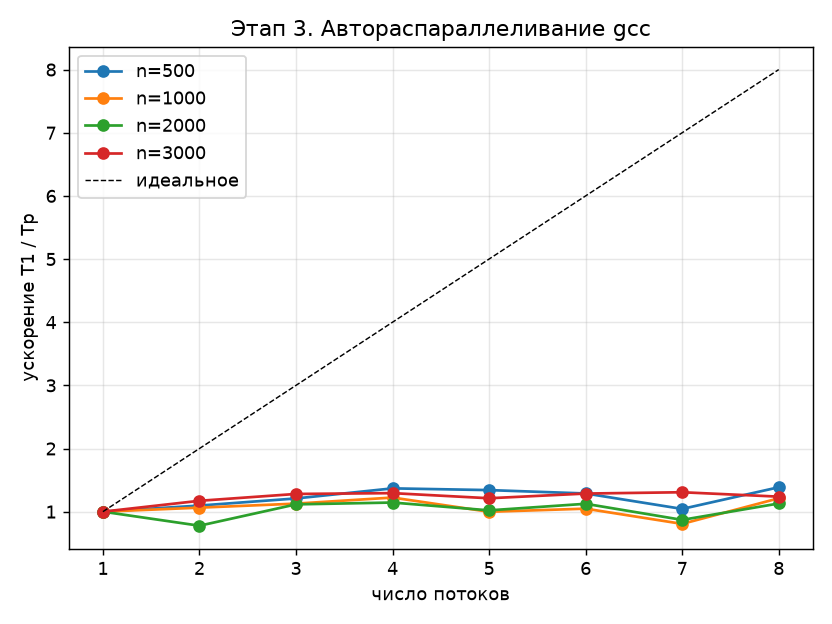

# Этап 3. Автоматическое распараллеливание (GCC, без директив OpenMP)

Программа: [stage3_autopar.c](../stage3_autopar.c). Результаты: `results/stage3_autopar1.csv` …
[stage3_autopar8.csv](../results/stage3_autopar8.csv), график
[stage3_autopar_speedup.png](../results/stage3_autopar_speedup.png).

По заданию разрешено **только автоматическое** распараллеливание: в коде нет ни одной
директивы `#pragma omp`. Параллельные циклы находит сам компилятор, а выполняются они
в потоках библиотеки OpenMP (libgomp). Алгоритм — тот же блочный LU через GAXPY
([этап 1](01_sequential.md)), структура данных — как на [этапе 2](02_vectorization.md).

---

## 1. Как работает автораспараллеливание в GCC

Ключ компилятора

```sh
gcc -O2 -ftree-parallelize-loops=P ...
```

включает проход оптимизации **parloops**. Для каждого цикла он:

1. проверяет, что цикл имеет простую форму (известное число итераций, один выход);
2. выполняет **анализ зависимостей по данным** — доказывает, что разные итерации
   не обращаются к одной ячейке памяти так, что порядок их выполнения важен;
3. оценивает выгоду: слишком короткие циклы не распараллеливаются (порог задаётся
   параметром `--param parloops-min-per-thread`);
4. если всё выполнено, выносит тело цикла в отдельную функцию и заменяет цикл вызовом
   `GOMP_parallel(fn, data, P, 0)`: итерации делятся на $P$ непрерывных частей,
   каждая выполняется своим потоком, в конце — барьер.

Это та же схема **fork–join**, что и у директивы `#pragma omp parallel for schedule(static)`,
только решение о параллельности принимает компилятор.

### Почему число потоков задаётся при компиляции

Число потоков $P$ передаётся в `GOMP_parallel` как явный аргумент (аналог
`num_threads(P)`), поэтому переменная окружения `OMP_NUM_THREADS` на него не влияет.
Для измерения ускорения программа собирается восемь раз ([build.sh](../build.sh)):

```sh
for p in 1 2 3 4 5 6 7 8; do
  gcc -std=gnu99 -msse2 -mfpmath=sse -O2 -fno-tree-vectorize \
      -ftree-parallelize-loops=$p -DNTHREADS=$p \
      stage3_autopar.c -o bin/stage3_autopar$p.exe
done
```

Макрос `NTHREADS` только подписывает значение $P$ в CSV. Векторизация запрещена
(`-fno-tree-vectorize`), чтобы измерить вклад именно многопоточности.
При $P = 1$ распараллеливание выключено — это база для ускорения.

---

## 2. Зависимости по данным

Пусть итерации $i_1 < i_2$ цикла обращаются к одной ячейке памяти. Различают:

| Тип | Итерация $i_1$ | Итерация $i_2$ | Пример |
|---|---|---|---|
| истинная (flow, RAW) | пишет | читает | `x[i] = x[i-1] + 1` |
| анти- (WAR) | читает | пишет | `x[i] = x[i+1]` |
| по выходу (WAW) | пишет | пишет | `s = x[i]` |

Цикл можно выполнять параллельно, если **никакая** зависимость не переносится
между итерациями (loop-carried dependence). Разберём три шага алгоритма.

### Шаг 2: GAXPY — параллелится

$$
p_{i,c} \leftarrow p_{i,c} - \sum_{j=0}^{k-1} l_{ij}\, u_{jc}, \qquad i = 0,\dots,m-1,\; c = 0,\dots,w-1.
$$

Итерация $i$ внешнего цикла:

* **пишет** только строку $i$ буфера панели: элементы `P[i*w + c]`, $0 \le c < w$;
* **читает** строку $i$ матрицы $L$ и весь блок $U$, которые в этом цикле не изменяются.

Две итерации $i_1 \ne i_2$ пишут в одну ячейку, только если

$$
i_1 w + c_1 = i_2 w + c_2, \quad 0 \le c_1, c_2 < w
\quad\Longrightarrow\quad
(i_1 - i_2)\,w = c_2 - c_1, \quad \lvert c_2 - c_1 \rvert < w,
$$

что возможно лишь при $i_1 = i_2$. Значит, зависимостей между итерациями по $i$ нет,
и строки панели можно распределить между потоками:

```text
поток 0: строки 0      .. m/P-1
поток 1: строки m/P    .. 2m/P-1
   ...
поток P-1: строки (P-1)m/P .. m-1
```

Чтобы компилятор смог это **доказать**, код организован особым образом:

```c
static void gaxpy(int m, int k, int w, const double *const *restrict L,
                  const double *restrict U, double *restrict P)
{
    for (int i = 0; i < m; i++) {                    /* <- распараллеливается */
        const double *restrict li = L[i];
        double *restrict pi = P + (size_t)i * w;
        for (int j = 0; j < k; j++) {
            double l = li[j];
            for (int c = 0; c < w; c++)
                pi[c] -= l * U[(size_t)j * w + c];
        }
    }
}
```

* панель `P` и блок `U` — отдельные буферы, помеченные `restrict`: записи в `P`
  не могут изменить `U`;
* строки $L$ передаются через массив указателей `L[i] = A + (k+i)*n`:
  матрица `A` внутри цикла только читается, и компилятору не нужно анализировать
  нелинейный индекс `(k+i)*n + j`.

### Шаг 1: треугольное решение — не параллелится

$$
u_{i,c} \leftarrow u_{i,c} - \sum_{j=0}^{i-1} l_{ij}\, u_{j,c}, \qquad i = 1, \dots, k-1.
$$

Итерация $i$ **читает** строки $u_{j,\cdot}$ при $j < i$, которые **записаны**
итерациями $j$. Это истинная зависимость с расстоянием $d = i - j \ge 1$:

$$
\text{итерация } j \xrightarrow{\text{пишет } u_{j,\cdot}} \text{итерация } i > j \xrightarrow{\text{читает } u_{j,\cdot}}
$$

Строки треугольной системы по своей природе вычисляются последовательно —
это рекуррентность. Параллелизм в этом шаге есть, но **по столбцам** $c$:
разные правые части системы $L_{11} U = A$ независимы. Чтобы им воспользоваться,
цикл по $c$ надо сделать внешним (перестановка циклов, loop interchange).
GCC 9.2 такую перестановку ради распараллеливания не выполняет, а попытка
явно вынести наружу цикл по порциям столбцов анализ зависимостей не прошла
(в индексе `i*w + c` множитель $w$ неизвестен на этапе компиляции).

### Шаг 3: LU панели — параллелятся только внутренние циклы

$$
p_{ic} \mathrel{-}= p_{ij}\, p_{jc}, \quad i > j; \qquad p_{ic} \mathrel{/}= p_{cc}, \quad i > c.
$$

Внешние циклы по столбцам $c$ и $j$ последовательны (каждый следующий столбец
использует результаты предыдущего). Внутренние циклы по строкам $i$ независимы,
и GCC распараллеливает часть из них. Но такой цикл вызывается $\sim w^2/2$ раз
на каждом шаге, и выигрыш съедается накладными расходами на запуск потоков.

### Отчёт компилятора

`-fopt-info-loop-optimized` для `stage3_autopar.c` (номера строк — по текущей версии):

```text
stage3_autopar.c:48:5: optimized: parallelizing outer loop 18     <- GAXPY, цикл по i
stage3_autopar.c:69:9: optimized: parallelizing inner loop 15     <- LU панели, деление на u_cc
stage3_autopar.c:84:9: optimized: parallelizing outer loop 2      <- копирование A -> U
stage3_autopar.c:87:9: optimized: parallelizing outer loop 3      <- копирование U -> A
stage3_autopar.c:90:9: optimized: parallelizing outer loop 4      <- копирование A -> P
stage3_autopar.c:92:9: optimized: parallelizing inner loop 5      <- заполнение указателей L[i]
stage3_autopar.c:95:9: optimized: parallelizing outer loop 6      <- копирование P -> A
(+ циклы генерации матрицы и проверки в run)
```

Цикл `trsm` (строки 29–40) в отчёте отсутствует — компилятор подтвердил вывод
предыдущего раздела.

> **Замечание из разработки.** В одной из промежуточных версий цикл GAXPY был
> дополнительно разбит на порции по $j$ (для лучшего использования кэша).
> GCC 9.2 распараллелил внешний цикл по порциям, хотя все порции обновляют одни и те же
> строки $P$ (это зависимость WAW/RAW), — и программа выдала неверный результат
> (ошибка $\sim 10^{-4}$ вместо $10^{-14}$). Поэтому оставлена простая форма цикла,
> а корректность каждой сборки проверяется по столбцам `err` и `res` в CSV.

---

## 3. Модель ускорения: закон Амдала

Пусть $f$ — доля времени, которая выполняется параллельно на $P$ потоках.
Тогда ускорение

$$
S(P) = \frac{T_1}{T_P} = \frac{1}{(1 - f) + \dfrac{f}{P}},
\qquad
\lim_{P\to\infty} S(P) = \frac{1}{1-f}.
$$

Из [оценки сложности](01_sequential.md#5-вычислительная-сложность): треугольное решение
и GAXPY дают по $\frac{n^3}{3}$ флопов. Параллелится только GAXPY, поэтому $f \approx \frac12$:

| $P$ | 2 | 3 | 4 | 6 | 8 | $\infty$ |
|---|---|---|---|---|---|---|
| $S_{\text{Амдал}}(P)$ при $f = 0{,}5$ | 1,33 | 1,50 | 1,60 | 1,71 | 1,78 | 2,00 |

Это **верхняя** оценка: она не учитывает

* накладные расходы fork–join. На каждом блочном шаге запускается несколько
  параллельных областей (GAXPY, копирования, деления в LU панели); всего их
  порядка $\frac{n}{r}(w + 6)$, около 3600 при $n = 3000$;
* общую для всех ядер пропускную способность памяти: все потоки GAXPY читают один
  и тот же блок $U$ и разные строки $L$;
* снижение тактовой частоты ноутбучного процессора при загрузке всех ядер
  (Turbo Boost: одно ядро работает быстрее, чем четыре одновременно);
* то, что у i5-1135G7 четыре физических ядра: при $P > 4$ потоки делят ядра
  через Hyper-Threading.

---

## 4. Результаты

$$
S(P) = \frac{T(P = 1)}{T(P)}
$$

| $n$ \ $P$ | 1 | 2 | 3 | 4 | 5 | 6 | 7 | 8 |
|---|---|---|---|---|---|---|---|---|
| 500 | 1,00 | 1,10 | 1,21 | 1,37 | 1,34 | 1,29 | 1,04 | 1,39 |
| 1000 | 1,00 | 1,06 | 1,13 | 1,22 | 1,00 | 1,05 | 0,81 | 1,21 |
| 2000 | 1,00 | 0,78 | 1,12 | 1,14 | 1,02 | 1,12 | 0,87 | 1,13 |
| 3000 | 1,00 | 1,17 | 1,28 | 1,29 | 1,21 | 1,29 | 1,31 | 1,24 |
| Амдал, $f = 0{,}5$ | 1,00 | 1,33 | 1,50 | 1,60 | 1,67 | 1,71 | 1,75 | 1,78 |

Время при $P = 1$: 0,034 с ($n = 500$), 0,218 с (1000), 1,541 с (2000), 5,675 с (3000).



Выводы:

* максимальное ускорение — около **1,3–1,4** при $P = 4$ и выше; это ниже оценки
  Амдала 1,6, но того же порядка: последовательное треугольное решение
  ограничивает ускорение величиной 2 при любом числе потоков;
* после $P = 4$ (числа физических ядер) ускорение не растёт;
* отдельные провалы (например, 0,78 при $n = 2000$, $P = 2$ и 0,81 при $n = 1000$, $P = 7$)
  связаны с шумом измерений на ноутбуке: из трёх повторов берётся минимум,
  но фоновые процессы и изменения частоты влияют на отдельные точки;
* погрешности `err` и `res` для всех $P$ совпадают с этапом 1 — распараллеленные циклы
  не меняют порядок суммирования внутри строки, поэтому результат побитово тот же.

### Что могло бы дать больше

Ускорение ограничено тем, что компилятор не нашёл параллелизм в треугольном решении.
Вручную (директивой `#pragma omp parallel for` по столбцам блока) или в MPI-версии
([этап 4](04_mpi.md)) этот шаг распараллеливается по столбцам, и граница Амдала
исчезает. Но по условию этапа ручные директивы запрещены — здесь измеряются
именно возможности автоматического распараллеливания.
