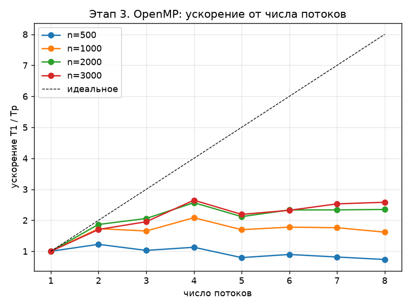
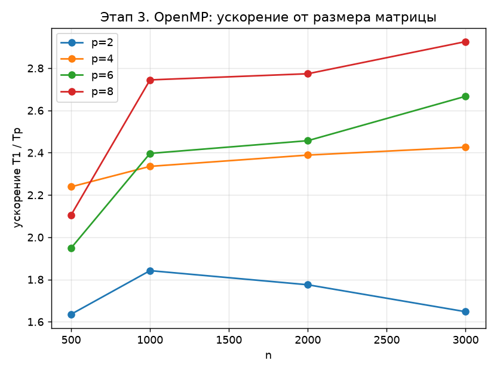

# Этап 3. OpenMP: блочное LU-разложение

Программа: [stage3_omp.c](../stage3_omp.c). Результаты: `results/stage3_omp_t1.csv` …
[stage3_omp_t8.csv](../results/stage3_omp_t8.csv), графики
[stage3_omp_speedup_p.png](../results/stage3_omp_speedup_p.png) и
[stage3_omp_speedup_n.png](../results/stage3_omp_speedup_n.png).

Алгоритм — Алгоритм 37 из [этапа 1](01_sequential.md), данные и операция `saxpy` организованы
как на [этапе 2](02_vectorization.md). Параллельные циклы помечены директивой
`#pragma omp parallel for`. **Итерации между потоками распределяет сама OpenMP** — в программе
нет ручного деления диапазонов по номеру потока (`omp_get_thread_num`), нет явных барьеров и
критических секций.

---

## 1. Модель OpenMP

OpenMP — стандарт параллельного программирования для систем с **общей памятью**.
Программа начинается одним (главным) потоком. Директива

```c
#pragma omp parallel for schedule(static)
for (int i = 0; i < m; i++)
    body(i);
```

работает по схеме **fork–join**:

1. *fork* — главный поток запускает команду из $P$ потоков (потоки создаются один раз
   и затем переиспользуются библиотекой libgomp);
2. итерации цикла $0, \dots, m-1$ распределяются между потоками;
3. каждый поток выполняет свои итерации;
4. *join* — неявный барьер в конце цикла: главный поток продолжает работу, когда все
   итерации завершены.

```text
главный поток ──┬── поток 0: i = 0      .. m/P-1    ──┬── главный поток
                ├── поток 1: i = m/P    .. 2m/P-1   ──┤
                │      ...                            │
                └── поток P-1: i = (P-1)m/P .. m-1  ──┘
              fork                                  join (барьер)
```

### Распределение итераций

`schedule(static)` — итерации делятся на $P$ непрерывных частей почти равного размера. Стандарт
OpenMP оставляет точное деление реализации; в libgomp (GCC) при $q = \lfloor m/P \rfloor$ и
$r = m \bmod P$ поток $t$ получает

$$
\bigl[\, t q + \min(t, r),\;\; (t+1) q + \min(t+1, r) \,\bigr), \qquad t = 0, \dots, P-1,
$$

то есть первые $r$ потоков — на одну итерацию больше. Например, 25 итераций на 3 потока
делятся как $9 + 8 + 8$ (это видно в трассировке [docs/trace/stage3_threads_n12_p3.txt](trace/stage3_threads_n12_p3.txt)).

Это деление выполняет библиотека OpenMP, а не программа. Статическое расписание подходит,
потому что все итерации каждого параллельного цикла имеют почти одинаковую стоимость: малые
блоки одного размера.

### Переменные

Переменные, объявленные **внутри** тела цикла (`c0`, `m`, `s`, `l`, …), и счётчик
параллельного цикла — **локальные** для каждого потока. Массив `A` — **общий**: корректность
обеспечивается тем, что разные итерации пишут в разные элементы
(см. [раздел 2](#2-какие-циклы-можно-распараллелить)).

### Число потоков

Число потоков задаётся при запуске переменной окружения:

```sh
OMP_NUM_THREADS=4 ./bin/stage3_omp.exe 1000 2000
```

Программа печатает его в столбце `threads` (через `omp_get_max_threads()`).
Сборка одна:

```sh
gcc -std=gnu99 -msse2 -mfpmath=sse -O2 -fno-tree-vectorize -fopenmp stage3_omp.c -o bin/stage3_omp.exe
```

Флаг `-fopenmp` включает обработку директив и подключает libgomp. Векторизация запрещена
(`-fno-tree-vectorize`), как и на этапе 1, — чтобы измерить вклад именно многопоточности.
База для ускорения — та же программа с `OMP_NUM_THREADS=1`.

---

## 2. Какие циклы можно распараллелить

Директива `parallel for` корректна, только если итерации цикла **независимы**:
ни одна итерация не читает и не пишет то, что пишет другая. Различают зависимости:

| Тип | Итерация $i_1$ | Итерация $i_2 > i_1$ | Пример |
|---|---|---|---|
| истинная (flow, RAW) | пишет | читает | `x[i] = x[i-1] + 1` |
| анти- (WAR) | читает | пишет | `x[i] = x[i+1]` |
| по выходу (WAW) | пишет | пишет | `s = x[i]` |

Компилятор при `#pragma omp parallel for` **не проверяет** независимость — за неё
отвечает программист. Разберём четыре шага алгоритма. Внешний цикл по $k$ параллелить нельзя:
итерация $k$ работает с матрицей $A'$, полученной на итерации $k-1$.

### Шаг 1: LU малого блока — последовательно

$$
a_{sq} \mathrel{-}= \ell_{sl}\, u_{lq}, \qquad s, q \in a,\; s, q > l.
$$

Строки блока зависят друг от друга: строка $l$ должна быть готова раньше строк $s > l$.
На шаг приходится $0{,}01\%$ работы при $n = 3000$, поэтому он оставлен последовательным.

### Шаг 2: $L(b,a)\,U(a,a) = A(b,a)$ — блоки блочного столбца независимы

Итерация $i$ **пишет** только строки своего малого блока $b$ в столбцах $a$, а **читает** их же и
блок $U(a,a)$, который на этом шаге не меняется:

```c
#pragma omp parallel for schedule(static)
for (int i = k + 1; i < N; i++)
    for (int s = i * alpha; s < END(i); s++)
        for (int l = a0; l < a1; l++) {
            ROW(s)[l] /= ROW(l)[l];
            saxpy(a1 - l - 1, ROW(s)[l], ROW(l) + l + 1, ROW(s) + l + 1);
        }
```

### Шаг 3: $L(a,a)\,U(a,c) = A(a,c)$ — блоки блочной строки независимы

Внутри одного малого блока строки зависимы: строка $s$ использует строки $l < s$. Но система
$L_{11} U_{12} = A_{12}$ разбивается на набор систем с разными правыми частями, и малые блоки
$U(a,c)$ не зависят друг от друга. Итерация $j$ пишет только столбцы своего блока $c$:

```c
#pragma omp parallel for schedule(static)
for (int j = k + 1; j < N; j++) {
    int c0 = j * alpha, m = END(j) - c0;
    for (int l = a0; l < a1; l++)
        for (int s = l + 1; s < a1; s++)
            saxpy(m, ROW(s)[l], ROW(l) + c0, ROW(s) + c0);
}
```

Разные потоки пишут в одни и те же строки матрицы, но в разные столбцы. На границе малых
блоков два потока могут работать с одной кэш-линией — это ложное разделение (false sharing),
но оно затрагивает лишь края блоков длиной 256 байт, и шаг занимает меньше $1\%$ работы.

### Шаг 4: основная операция — пары блоков независимы

Итерация $(i, j)$ **пишет** только блок $A(b, c)$, а **читает** его же, $L(b, a)$ и $U(a, c)$. Блоки
$L(b,a)$ и $U(a,c)$ лежат в столбцах $a$ и строках $a$, куда на этом шаге никто не пишет.
Значит, две итерации пересекаются по записи, только если совпадают и $i$, и $j$:

```c
#pragma omp parallel for collapse(2) schedule(static)
for (int i = k + 1; i < N; i++)
    for (int j = k + 1; j < N; j++) {
        int c0 = j * alpha, m = END(j) - c0;
        for (int s = i * alpha; s < END(i); s++)
            for (int l = a0; l < a1; l++)
                saxpy(m, ROW(s)[l], ROW(l) + c0, ROW(s) + c0);
    }
```

`collapse(2)` объединяет два цикла в один из $(N-k-1)^2$ итераций, и OpenMP делит на потоки
уже его. Это даёт хорошую балансировку и на последних итерациях, когда блоков остаётся меньше,
чем потоков. Порядок вычитаний над каждым элементом ($l$ по возрастанию) не меняется.

### Сводка

| Шаг | Как выполняется | Число итераций | Флопы (всего) |
|---|---|---|---|
| 1. LU блока | последовательно | — | $\tfrac23 n \alpha^2$ |
| 2. $L_{21}$ | параллельно по блокам столбца | $N-k-1$ | $\approx \tfrac12 n^2 \alpha$ |
| 3. $U_{12}$ | параллельно по блокам строки | $N-k-1$ | $\approx \tfrac12 n^2 \alpha$ |
| 4. мм. | параллельно по парам блоков | $(N-k-1)^2$ | $\approx \tfrac23 n^3 - n^2 \alpha$ |

На одну итерацию по $k$ приходится **три** параллельные области, при $n = 3000$ — около 280 за всё
разложение.

---

## 3. Модель ускорения

Обозначим $T_1 \approx \frac23 n^3 t_c$ — время на одном потоке. Последовательная часть —
только шаг 1. Для неё по закону Амдала

$$
\sigma = \frac{\tfrac23 n \alpha^2}{\tfrac23 n^3} = \frac{\alpha^2}{n^2},
\qquad
S(P) = \frac{T_1}{T_P} \approx \frac{1}{\sigma + (1-\sigma)/P}.
$$

При $n = 3000$ и $\alpha = 32$ доля $\sigma \approx 10^{-4}$, поэтому модель даёт $S(P) \approx P$:
алгоритм с модификацией внешним произведением почти идеально параллелится по арифметике.

Модель не учитывает:

* **общую пропускную способность памяти.** Каждая итерация по $k$ читает и записывает всю
  оставшуюся подматрицу, а при $n = 3000$ это до 72 МБ — больше кэша L3 (8 МБ). Несколько потоков
  одновременно упираются в канал памяти;
* **снижение частоты.** При загрузке всех ядер Turbo Boost снижает частоту, поэтому один поток
  работает быстрее, чем каждый из четырёх;
* **накладные расходы fork–join.** Каждая область стоит единицы микросекунд, что заметно только
  при $n = 100$–$250$;
* **число физических ядер — четыре.** При $P > 4$ потоки делят ядра через Hyper-Threading.

---

## 4. Результаты

$$
S(P) = \frac{T(\,\texttt{OMP\_NUM\_THREADS}=1\,)}{T(\,\texttt{OMP\_NUM\_THREADS}=P\,)}
$$

| $n$ \ $P$ | 1 | 2 | 3 | 4 | 5 | 6 | 7 | 8 |
|---|---|---|---|---|---|---|---|---|
| 500 | 1,00 | 1,64 | 1,94 | **2,24** | 1,79 | 1,95 | 2,05 | 2,11 |
| 1000 | 1,00 | 1,84 | 2,24 | 2,34 | 2,15 | 2,40 | 2,62 | **2,74** |
| 2000 | 1,00 | 1,78 | 2,14 | 2,39 | 2,23 | 2,46 | 2,70 | **2,77** |
| 3000 | 1,00 | 1,65 | 2,27 | 2,43 | 2,44 | 2,67 | 2,75 | **2,93** |

Время одного потока: 0,030 с ($n = 500$), 0,256 с ($n = 1000$), 2,010 с ($n = 2000$), 6,892 с ($n = 3000$).
Эффективность $E = S/P$ при $n = 3000$: 0,82 ($P = 2$), 0,61 ($P = 4$), 0,37 ($P = 8$).





### Выводы

* при $P = 4$ (число физических ядер) ускорение составляет **2,24–2,43** и растёт с размером матрицы;
* лучшее значение — **2,93** при $n = 3000$, $P = 8$. Потоки сверх четырёх работают на тех же ядрах через
  Hyper-Threading, поэтому прирост от $P = 4$ до $P = 8$ небольшой;
* при $P = 2$ ускорение 1,64–1,84 и слабо зависит от $n$. При $P = 5$ и $n \le 2000$ заметен провал: потоков
  уже больше, чем ядер, и статическое распределение, вероятно, ждёт самый медленный из них;
* реальное ускорение заметно ниже модели $S \approx P$. Доля последовательного кода здесь ничтожна, поэтому
  ограничение — в оборудовании: общая память, снижение частоты при загрузке всех ядер. Замеры сделаны
  на ноутбуке от батареи, что усиливает этот эффект и добавляет шум;
* погрешности `err` и `res` для всех $P$ совпадают с последовательной версией:
  каждый элемент вычисляется одним потоком в том же порядке вычитаний.

### Сравнение с MPI

OpenMP-версия на этом компьютере работает быстрее MPI-версии ([этап 4](04_mpi.md)): при $n = 3000$
ускорение 2,43 против 2,18 при четырёх исполнителях и 2,93 против 2,36 при восьми. Потоки
обращаются к одной общей матрице без упаковки блочной строки и рассылок. Кроме того, в OpenMP-версии
шаги 2–3 делятся на всех, а в MPI шаги 1 и 3 выполняет один процесс, пока остальные ждут рассылку.
