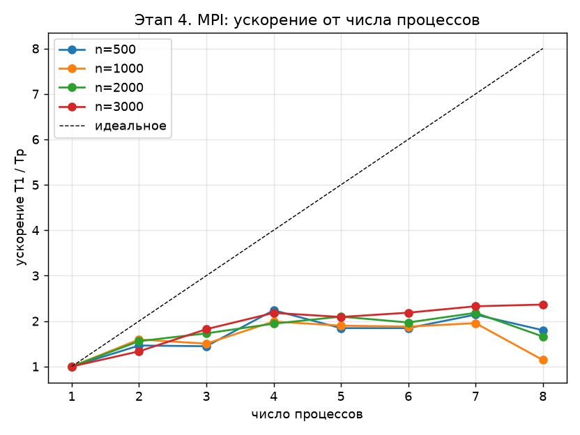
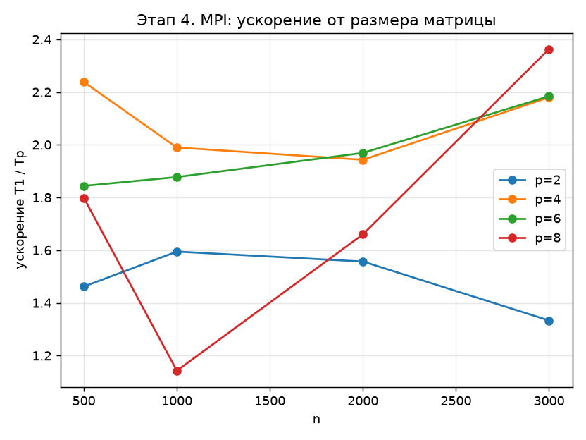

# Этап 4. MPI-версия блочного LU-разложения

Программа: [stage4_mpi.c](../stage4_mpi.c). Результаты: `results/stage4_mpi_p1.csv` …
[stage4_mpi_p8.csv](../results/stage4_mpi_p8.csv), графики
[stage4_mpi_speedup_p.png](../results/stage4_mpi_speedup_p.png) и
[stage4_mpi_speedup_n.png](../results/stage4_mpi_speedup_n.png).

Алгоритм — Алгоритм 37 из [этапа 1](01_sequential.md). Здесь описано, как данные и работа
распределяются между $p$ MPI-процессами и какими сообщениями они обмениваются.

---

## 1. Модель MPI

MPI-программа запускается как $p$ независимых процессов с **раздельной памятью**:

```sh
mpiexec -n 4 bin/stage4_mpi.exe 1000 2000
```

Каждый процесс знает свой номер `rank` $\in \{0, \dots, p-1\}$ и общее число `size` $= p$.
Данные между процессами передаются только явными сообщениями:

| Операция | Что делает | Где |
|---|---|---|
| `MPI_Bcast` | владелец рассылает блочную строку всем | внутри разложения, на каждой итерации |
| `MPI_Send`, `MPI_Recv` | процесс 0 раздаёт и собирает блочные строки | вне замера |
| `MPI_Barrier` | синхронизация всех процессов | вокруг замера |

Используется реализация MS-MPI; все процессы работают на одном компьютере,
и сообщения передаются через общую память.

---

## 2. Распределение данных

Каждый процесс хранит **только свои блочные строки**. Распределение циклическое:

$$
\text{владелец блока } i = i \bmod p, \qquad i = 0, \dots, N-1.
$$

Например, для $N = 10$ и $p = 3$:

| Процесс | Блочные строки |
|---|---|
| 0 | 0, 3, 6, 9 |
| 1 | 1, 4, 7 |
| 2 | 2, 5, 8 |

Строка хранится целиком ($n$ чисел), потому что в ней лежат и найденные элементы $L$, и ещё не
обработанные элементы $A'$. Строки процесса идут в локальном массиве подряд, блок $i$
начинается со строки $\lfloor i/p \rfloor \cdot \alpha$: все предшествующие блоки этого
процесса полные, короче может быть только последний блок матрицы.

**Почему циклически.** На итерации $k$ в работе участвуют только блоки $i > k$. При распределении
непрерывными кусками процесс с первыми строками быстро остался бы без работы, а при
циклическом у всех процессов остаётся поровну блоков почти до конца разложения.

**Почему по строкам.** Шаги 1 и 3 Алгоритма 37 работают с блочной строкой $k$, которая целиком
лежит у одного процесса, и не требуют обменов. Шаги 2 и 4 для блока $i$ пишут только в строки блока
$i$. Единственное, что нужно снаружи, — блочная строка $k$.

Память на процесс — $\approx n^2/p$ чисел для строк плюс $\alpha n$ чисел для буфера `W`.
При $n = 3000$ и $p = 4$ это около 19 МБ вместо 72 МБ. Процесс 0 ещё хранит $A_0$ и собранное
разложение для проверки, но это вне алгоритма.

---

## 3. Параллельный алгоритм одной итерации

Обозначения, как на этапе 1: $a$ — текущий малый блок, $w$ — его размер, $t = n - k\alpha$ —
длина строк блочной строки $k$, начиная с диагонального блока.

```text
для k = 0 .. N-1:
    q = k mod p                                   # владелец блочной строки k
    если rank == q:
        шаг 1: LU блока A(a,a)                    # локально
        шаг 3: L(a,a) U(a,c) = A(a,c) для всех c  # локально
        упаковать блочную строку k в W            # w x t чисел
    если k == N-1: конец
    Bcast(W, w*t, от q)                           # единственный обмен
    для своих блоков i > k:
        шаг 2: L(b,a) W(0:w, 0:w) = A(b,a)
        шаг 4: A(b,c) -= L(b,a) W(0:w, c) для всех c
```

### Шаги 1 и 3: у владельца

Владелец блочной строки $k$ раскладывает блок и находит $U_{12}$, как на этапе 2, но в
координатах локального массива. Затем копирует строки в плотный буфер `W`: у них шаг $n$
в локальном массиве, а для `MPI_Bcast` нужен непрерывный участок. В `W` первые $w$ столбцов — блок
$L_{11}\backslash U_{11}$, остальные — $U_{12}$.

### Обмен

`MPI_Bcast` передаёт $w \cdot t$ чисел от владельца всем остальным. После вызова у каждого процесса
есть всё, что нужно для шагов 2 и 4. Последний блок рассылать незачем: строк ниже нет.

### Шаги 2 и 4: у всех, над своими строками

Первый свой блок ниже $k$ находится как

$$
i_0 = k + 1 + \bigl((\text{rank} - k - 1) \bmod p\bigr),
$$

далее $i = i_0, i_0 + p, i_0 + 2p, \dots$. Для каждого блока строки решается система
$x\,U_{11} = b$, где $U_{11}$ берётся из `W`, а затем выполняется основная операция по малым
блокам $c$:

$$
A(b, c) \leftarrow A(b, c) - L(b, a)\, W(0{:}w,\, c).
$$

Разные процессы не пересекаются по записи: каждый пишет только в свои строки.

### Совпадение результатов

Каждый элемент вычисляется одним процессом в том же порядке вычитаний, что и на этапе 1, а
рассылка копирует числа без изменения. Поэтому `err` и `res` совпадают с этапом 1 до последнего
знака при любом $p$.

---

## 4. Анализ стоимости

Обозначим $t_c$ — время одного флопа, $\lambda$ — задержку сообщения, $\beta$ — время передачи
одного байта. Для `MPI_Bcast` объёмом $V$ байт по двоичному дереву

$$
T_{\text{bcast}}(V) \approx \lceil \log_2 p \rceil\,(\lambda + V \beta).
$$

### Вычисления

| Шаг | Кто выполняет | Сумма по итерациям |
|---|---|---|
| 1. LU блока | один процесс | $\tfrac23 n \alpha^2$ |
| 3. $U_{12}$ | один процесс | $\approx \tfrac12 n^2 \alpha$ |
| 2. $L_{21}$ | все, свои строки | $\approx \tfrac{1}{2p} n^2 \alpha$ |
| 4. мм. | все, свои строки | $\approx \tfrac{1}{p}\bigl(\tfrac23 n^3 - n^2\alpha\bigr)$ |

### Обмены

На итерации $k$ рассылается $w \cdot t$ чисел: от $\alpha n$ в начале до почти нуля в конце.
За всё разложение — $\sum_k \alpha\,(n - k\alpha) \approx \tfrac12 n^2$ чисел, то есть

$$
V_{\text{всего}} \approx 4 n^2\ \text{байт},
\qquad
T_{\text{comm}} \approx \lceil \log_2 p \rceil \Bigl( N \lambda + 4 n^2 \beta \Bigr).
$$

При $n = 3000$ это 36 МБ за разложение и 93 рассылки.

### Итоговая модель

$$
T_p \approx \underbrace{\frac{2n^3}{3p}\, t_c}_{\text{делится}}
\;+\; \underbrace{\frac{n^2 \alpha}{2}\, t_c}_{\text{шаг 3, у владельца}}
\;+\; \underbrace{\lceil \log_2 p \rceil \bigl(N\lambda + 4n^2\beta\bigr)}_{\text{обмены}},
\qquad
S(p) = \frac{T_1}{T_p}.
$$

Главный член растёт как $n^3$, а обмены и неделимая часть — как $n^2$. Поэтому **при росте $n$
ускорение должно приближаться к $p$**, а при малых $n$ и больших $p$ обмены заметнее.

### Балансировка нагрузки

При циклическом распределении число блоков ниже $k$ у разных процессов различается не больше чем
на один. Различие заметно лишь в конце разложения, когда блоков ниже $k$ меньше $p$ и работы уже мало.

### Что модель не учитывает

Модель считает, что флоп стоит одинаково независимо от числа процессов.
На одном ноутбуке это не так:

* **Пропускная способность памяти общая.** Процессы хранят разные строки, но обращаются к ним через
  один канал памяти.
* **Частота процессора.** При загрузке всех ядер Turbo Boost снижает частоту.
* **Физических ядер четыре.** При $p > 4$ два процесса делят одно ядро (Hyper-Threading);
  к тому же MS-MPI в коллективных операциях ожидает данные активным опросом,
  отнимая у соседнего процесса время ядра.

---

## 5. Замер времени

```c
scatter_rows(n, alpha, A0, A);       /* вне замера */
MPI_Barrier(MPI_COMM_WORLD);
double t = MPI_Wtime();
block_lu_mpi(n, alpha, A);           /* все обмены внутри */
MPI_Barrier(MPI_COMM_WORLD);         /* ждём самого медленного */
t = MPI_Wtime() - t;
```

В замер входят вычисления, все `MPI_Bcast`, упаковка в `W`, выделение буфера и завершающий барьер.
Начальная раздача строк и сбор разложения на процессе 0 не входят. Из трёх повторов берётся
минимум; печатает результат процесс 0, он же проверяет решение
(`err`, `res` — как на [этапе 1](01_sequential.md#метрики)).

---

## 6. Результаты

### Ускорение от числа процессов

$$
S(p) = \frac{T_1}{T_p}
$$

| $n$ \ $p$ | 1 | 2 | 3 | 4 | 5 | 6 | 7 | 8 |
|---|---|---|---|---|---|---|---|---|
| 500 | 1,00 | 1,46 | 1,45 | **2,24** | 1,84 | 1,84 | 2,14 | 1,80 |
| 1000 | 1,00 | 1,59 | 1,50 | **1,99** | 1,90 | 1,88 | 1,95 | 1,14 |
| 2000 | 1,00 | 1,56 | 1,73 | 1,94 | 2,10 | 1,97 | **2,18** | 1,66 |
| 3000 | 1,00 | 1,33 | 1,82 | 2,18 | 2,09 | 2,18 | 2,33 | **2,36** |

Время одного процесса: 0,033 с ($n = 500$), 0,267 с ($n = 1000$), 2,084 с ($n = 2000$), 7,162 с ($n = 3000$).
Эффективность $E = S/p$ при $n = 3000$: 0,67 ($p = 2$), 0,55 ($p = 4$), 0,30 ($p = 8$).



### Ускорение от размера матрицы



### Выводы

* лучшее ускорение — **2,36** при $n = 3000$, $p = 8$; при $p = 4$ (число физических ядер) оно составляет
  **1,94–2,24**;
* ускорение ниже, чем у OpenMP-версии ([этап 3](03_openmp.md), 2,93 и 2,43): шаги 1 и 3 выполняет один
  процесс, пока остальные ждут рассылку, а блочную строку приходится упаковывать;
* при $p > 4$ процессы делят физические ядра, поэтому результат слабо растёт и становится шумным.
  Например, при $n = 1000$, $p = 8$ в этом прогоне $S = 1{,}14$, а в предыдущем прогоне того же кода было
  $S = 2{,}67$: разложение длится около 0,1–0,2 с при $p = 8$, а MS-MPI ждёт данные активным опросом, отнимая
  у соседнего процесса время ядра. Замеры сделаны на ноутбуке от батареи;
* объём обменов — не главное ограничение: за разложение при $n = 3000$ рассылается около 36 МБ через
  общую память при времени разложения в несколько секунд. Ограничения те же, что на [этапе 3](03_openmp.md):
  общая память и снижение частоты одного ноутбука;
* погрешности `err` и `res` для всех $p$ совпадают с последовательной версией:
  каждый элемент вычисляется одним процессом в том же порядке вычитаний.

### Как улучшить масштабирование

* запускать на кластере или нескольких виртуальных машинах, где у каждого процесса
  собственная память и ядро: распределённое хранение здесь уже есть;
* использовать двумерное блочно-циклическое распределение (как в ScaLAPACK): обмены идут
  только внутри строк и столбцов сетки процессов;
* совмещать обмены с вычислениями (неблокирующий `MPI_Ibcast`), чтобы следующий владелец не ждал
  окончания шага 4 у остальных.
