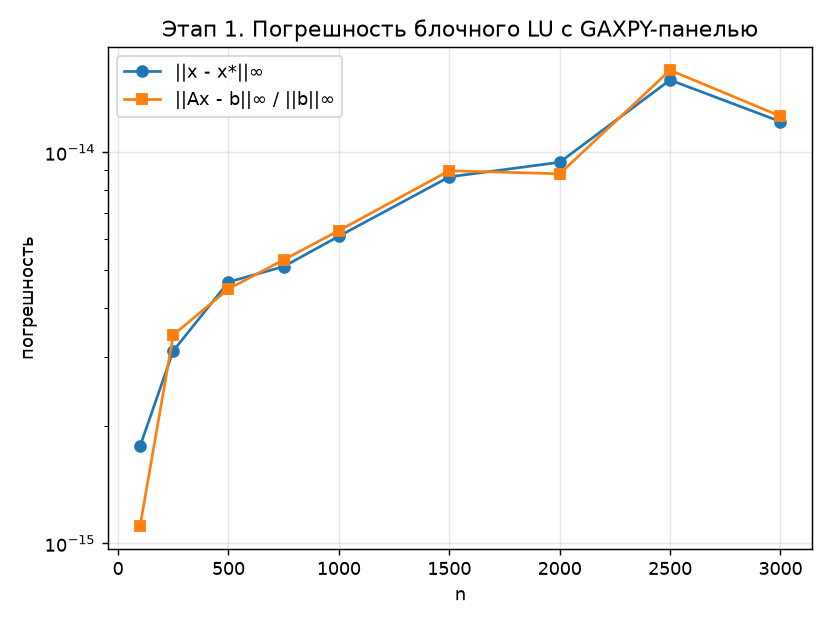

# Задание

Реализовать последовательное блочное LU-разложение с обработкой панели по столбцам. Исследовать зависимость ошибки решения системы линейных уравнений от размера матрицы и построить график.

# Введение

LU-разложение представляет квадратную матрицу в виде произведения $A=LU$, где $L$ — нижняя треугольная матрица с единичной диагональю, а $U$ — верхняя треугольная [1, 2]. Оба множителя хранятся в исходном массиве. Элементы $L$ расположены строго ниже диагонали, элементы $U$ — на диагонали и выше.

Панель текущей подматрицы состоит из диагонального блока $A_{11}$ и блока $A_{21}$ под ним. Её ширина $w$ равна $\alpha$, кроме последнего блока, который может быть короче. Нумерация внутри панели начинается с нуля.

Столбцы панели обрабатываются слева направо. После прямой подстановки для элементов $U$ выше диагонали из столбца вычитаются вклады предыдущих столбцов $L$. Для $i\ge j$ получаем

$$
v_i=a_{ij}-\sum_{q=0}^{j-1}l_{iq}u_{qj},\qquad
u_{jj}=v_j,\qquad l_{ij}=v_i/u_{jj}\quad(i>j).
$$

Обновление столбца называется GAXPY [1]. Вычисление даёт $L_{11}$, $U_{11}$ и $L_{21}$ и требует ненулевых $u_{jj}$. Блок $U_{12}$ можно вычислить сразу после получения $L_{11}$.

$$
L_{11}U_{12}=A_{12},\qquad A_{22}\leftarrow A_{22}-L_{21}U_{12}.
$$

Блочные равенства следуют из умножения факторов. В панели имеем $A_{11}=L_{11}U_{11}$ и $A_{21}=L_{21}U_{11}$. Поскольку правая нижняя часть произведения содержит слагаемое $L_{21}U_{12}$, его вычитание оставляет матрицу для следующей итерации.

# Теоретические ожидания

## Трудоёмкость

Панель ширины $w$ в остатке размерности $m$ требует $O(mw^2)$ операций. Столько же операций по порядку роста требует вычисление $U_{12}$. Обновление правой нижней части выполняет приблизительно $2w(m-w)^2$ операций. Суммирование по панелям при фиксированной ширине блока даёт ведущий член $2n^3/3$.

## Погрешность

Для проверки выбирали точное решение $x^*=(1,\ldots,1)^T$ и формировали $b=Ax^*$. После разложения решали системы $Ly=b$ и $Ux=y$. Измеряли ошибку решения и относительную невязку.

$$
\mathrm{err}=\|x-x^*\|_\infty,\qquad
\mathrm{res}=\frac{\|Ax-b\|_\infty}{\|b\|_\infty}.
$$

Ошибки округления накапливаются при разложении и подстановках. Ошибка решения зависит также от обусловленности матрицы и роста промежуточных элементов [3]. Поэтому сравниваются ошибка и невязка для конкретных тестовых матриц. Монотонный рост ошибки с увеличением $n$ из этих оценок не следует.

# Результаты экспериментов

## Методика

Эксперименты проведены 24 ноября 2026 г. на компьютере с процессором Intel Core i5-12450H (8 ядер, 12 логических процессоров) под Linux x86-64. Использован GCC 16.2.1. Режим управления частотой процессора — `powersave`. Ширина блока составляла 32. Для каждого размера использовалась одна и та же матрица во всех конфигурациях. Перед каждым повтором восстанавливались её исходные элементы. В таблицах приведён минимум из трёх замеров времени разложения. Размеры $n$ лежали в диапазоне от 100 до 3000. Элементы матрицы генерировались в интервале $[-0{,}5;,0{,}5]$ с начальным значением генератора 12345. К каждой диагональной записи добавлялось $n/4$. Подготовка матрицы и решение системы выполнялись вне замера времени.

## Погрешность и время работы

В таблице 1 приведены времена разложения, ошибки решения и относительные невязки. На рисунке 1 показано, как обе величины меняются с ростом $n$.

Таблица 1 – Погрешность и время последовательного разложения

| $n$ | $\mathrm{err}$ | $\mathrm{res}$ | Время, с |
| --- | --- | --- | --- |
| 100 | 1,776·10⁻¹⁵ | 1,110·10⁻¹⁵ | 0,000213 |
| 250 | 3,109·10⁻¹⁵ | 3,414·10⁻¹⁵ | 0,001753 |
| 500 | 4,663·10⁻¹⁵ | 4,477·10⁻¹⁵ | 0,015019 |
| 750 | 5,107·10⁻¹⁵ | 5,313·10⁻¹⁵ | 0,051104 |
| 1000 | 6,106·10⁻¹⁵ | 6,312·10⁻¹⁵ | 0,120479 |
| 1500 | 8,660·10⁻¹⁵ | 8,979·10⁻¹⁵ | 0,389491 |
| 2000 | 9,437·10⁻¹⁵ | 8,817·10⁻¹⁵ | 0,923910 |
| 2500 | 1,532·10⁻¹⁴ | 1,623·10⁻¹⁴ | 1,794897 |
| 3000 | 1,199·10⁻¹⁴ | 1,238·10⁻¹⁴ | 3,259518 |

{width=85%}

Рисунок 1 – Зависимость ошибки решения и невязки от размера матрицы

Ошибка решения увеличилась с 1,776·10⁻¹⁵ при $n=100$ до 1,199·10⁻¹⁴ при $n=3000$. Наибольшая ошибка 1,532·10⁻¹⁴ и наибольшая невязка 1,623·10⁻¹⁴ получены при $n=2500$. При переходе от $n=1000$ к $n=3000$ время выросло с 0,120479 до 3,259518 с, примерно в 27,1 раза.

# Заключение

Реализовано блочное LU-разложение с вычислением $L_{11}$, $U_{11}$ и $L_{21}$ за один проход по столбцам панели. На девяти тестовых размерах ошибка решения и относительная невязка остались на уровне $10^{-15}$–$10^{-14}$. При $n=3000$ разложение заняло 3,260 с. Дополнительно тесты на матрицах с заданными множителями проверили восстановление $A=LU$ и решение двух систем с разными правыми частями.

# Список использованных источников

1. Головашкин, Д. Л. Векторные алгоритмы вычислительной линейной алгебры : учебное пособие / Д. Л. Головашкин. – Самара : Изд-во Самарского университета, 2019. – 76 с.
2. Голуб, Дж. Матричные вычисления / Дж. Голуб, Ч. Ван Лоун ; пер. с англ. – Москва : Мир, 1999. – 548 с.
3. Higham, N. J. Accuracy and Stability of Numerical Algorithms / N. J. Higham. – 2nd ed. – Philadelphia : SIAM, 2002. – 680 p.

# Приложение А. Исходный код программы

Команды сборки и запуска из корня проекта приведены ниже.

```sh
gcc -std=gnu99 -O2 -fno-tree-vectorize stage1_seq.c -lm -o bin/stage1_seq
```

```sh
./bin/stage1_seq 100 500 1000
```

Листинг файла `stage1_seq.c`.

```c
/*
 * Последовательное блочное LU-разложение с обработкой панели по столбцам (GAXPY).
 * Разложение выполняется без выбора ведущего элемента и требует ненулевых U(j,j).
 */
#include <stdio.h>
#include <stdlib.h>
#include <math.h>

#define ALPHA 32
#define REPS  3

#ifdef _WIN32
#include <windows.h>
static double wtime(void)
{
    LARGE_INTEGER f, c;
    QueryPerformanceFrequency(&f);
    QueryPerformanceCounter(&c);
    return (double)c.QuadPart / (double)f.QuadPart;
}
#else
#include <time.h>
static double wtime(void)
{
    struct timespec t;
    clock_gettime(CLOCK_MONOTONIC, &t);
    return (double)t.tv_sec + 1e-9 * (double)t.tv_nsec;
}
#endif

/* Ниже диагонали хранятся элементы L, на диагонали и выше — U. Диагональ L единичная. */
#define A(i, j) A[(size_t)(i) * n + (j)]
#define END(i) ((i) * alpha + alpha < n ? (i) * alpha + alpha : n)

void block_lu(int n, int alpha, double *A)
{
    int N = (n + alpha - 1) / alpha;

    for (int k = 0; k < N; k++) {
        int a0 = k * alpha, a1 = END(k);

        /* Панель даёт L11, U11 и L21. Вклад столбцов левее a0 уже вычтен. */
        for (int j = a0; j < a1; j++) {
            /* Верх столбца U: прямая подстановка с единичной диагональю L. */
            for (int p = a0; p < j - 1; p++)
                for (int s = p + 1; s < j; s++)
                    A(s, j) -= A(s, p) * A(p, j);

            /* GAXPY: v = A(j:n,j) - L(j:n,a0:j) U(a0:j,j).
             * A(j,j) становится U(j,j), нижняя часть пока содержит v. */
            for (int p = a0; p < j; p++)
                for (int s = j; s < n; s++)
                    A(s, j) -= A(s, p) * A(p, j);

            for (int s = j + 1; s < n; s++)
                A(s, j) /= A(j, j);
        }

        /* Прямая подстановка для U12: L11 * U12 = A12. */
        for (int j = k + 1; j < N; j++)
            for (int l = a0; l < a1; l++)
                for (int s = l + 1; s < a1; s++)
                    for (int q = j * alpha; q < END(j); q++)
                        A(s, q) -= A(s, l) * A(l, q);

        /* A22 становится остатком A22 - L21 * U12 для следующей итерации. */
        for (int i = k + 1; i < N; i++)
            for (int j = k + 1; j < N; j++)
                for (int s = i * alpha; s < END(i); s++)
                    for (int l = a0; l < a1; l++)
                        for (int q = j * alpha; q < END(j); q++)
                            A(s, q) -= A(s, l) * A(l, q);
    }
}

/* Решение L U x = b (x на входе содержит b) */
static void lu_solve(int n, const double *A, double *x)
{
    for (int i = 0; i < n; i++)
        for (int j = 0; j < i; j++) x[i] -= A(i, j) * x[j];
    for (int i = n - 1; i >= 0; i--) {
        for (int j = i + 1; j < n; j++) x[i] -= A(i, j) * x[j];
        x[i] /= A(i, i);
    }
}

static void run(int n)
{
    double *A0 = malloc((size_t)n * n * sizeof(double));
    double *A  = malloc((size_t)n * n * sizeof(double));
    double *b  = malloc(n * sizeof(double));
    double *x  = malloc(n * sizeof(double));

    srand(12345);
    for (size_t i = 0; i < (size_t)n * n; i++) A0[i] = (double)rand() / RAND_MAX - 0.5;
    for (int i = 0; i < n; i++) A0[(size_t)i * n + i] += n / 4.0;
    for (int i = 0; i < n; i++) {           /* b = A x*, x* = (1,...,1) */
        double s = 0;
        for (int j = 0; j < n; j++) s += A0[(size_t)i * n + j];
        b[i] = s;
    }

    double tmin = 1e30;
    for (int rep = 0; rep < REPS; rep++) {
        for (size_t i = 0; i < (size_t)n * n; i++) A[i] = A0[i];
        double t = wtime();
        block_lu(n, ALPHA, A);
        t = wtime() - t;
        if (t < tmin) tmin = t;
    }

    for (int i = 0; i < n; i++) x[i] = b[i];
    lu_solve(n, A, x);
    double err = 0, res = 0, bn = 0;
    for (int i = 0; i < n; i++) {
        err = fmax(err, fabs(x[i] - 1.0));
        double s = -b[i];
        for (int j = 0; j < n; j++) s += A0[(size_t)i * n + j] * x[j];
        res = fmax(res, fabs(s));
        bn = fmax(bn, fabs(b[i]));
    }
    printf("%d,%d,%.6f,%.3e,%.3e\n", n, ALPHA, tmin, err, res / bn);
    fflush(stdout);
    free(A0); free(A); free(b); free(x);
}

int main(int argc, char **argv)
{
    static const int def[] = {100, 250, 500, 750, 1000, 1500, 2000, 2500, 3000};
    printf("n,alpha,time,err,res\n");
    if (argc > 1)
        for (int i = 1; i < argc; i++) run(atoi(argv[i]));
    else
        for (size_t i = 0; i < sizeof def / sizeof *def; i++) run(def[i]);
    return 0;
}
```
