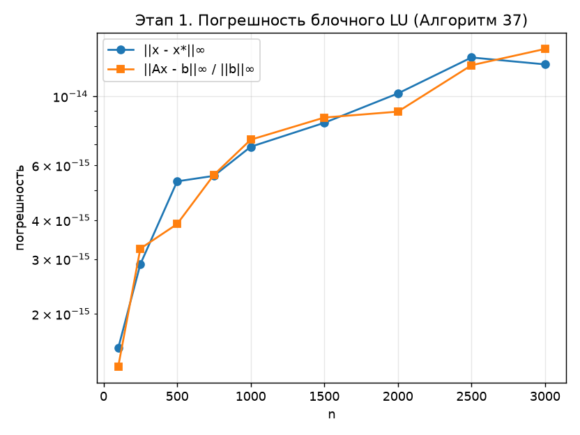

# Задание

Вариант задания – блочный алгоритм LU-разложения из параграфа 2.4 учебного пособия Д. Л. Головашкина (Алгоритм 37) [1].

Требуется:

- реализовать последовательный аналог алгоритма на любом языке программирования;
- исследовать зависимость погрешности решения системы линейных алгебраических уравнений от размерности матрицы и построить график.

# Введение

LU-разложением квадратной матрицы $A \in \mathbb{R}^{n \times n}$ называют её представление в виде произведения

$$
A = L\,U,
$$

где $L$ – нижняя унитреугольная матрица (с единицами на главной диагонали), $U$ – верхняя треугольная матрица [1, 2]. После разложения система $Ax = b$ решается двумя подстановками: прямой $Ly = b$ и обратной $Ux = y$. LU-разложение без перестановок строк существует и единственно, если все ведущие главные миноры матрицы $A$ отличны от нуля [2].

Блочные алгоритмы учитывают ёмкость «быстрой» памяти ЭВМ: большая часть операций выполняется над небольшими блоками, которые целиком помещаются в кэш процессора. Матрица делится на $N^2$ малых блоков размера $\alpha \times \alpha$, где $\alpha = n/N$, и раскладывается на три сомножителя [1, формула (18)]:

$$
\begin{pmatrix} A_{11} & A_{12} \\ A_{21} & A_{22} \end{pmatrix}
=
\begin{pmatrix} L_{11} & 0 \\ L_{21} & E \end{pmatrix}
\begin{pmatrix} E & 0 \\ 0 & A' \end{pmatrix}
\begin{pmatrix} U_{11} & U_{12} \\ 0 & E \end{pmatrix},
$$

где $A_{11}, L_{11}, U_{11}$ – малые блоки размера $\alpha \times \alpha$, $A_{21}, L_{21}$ – блочные столбцы, $A_{12}, U_{12}$ – блочные строки, $E$ – единичные матрицы. Перемножив сомножители в правой части формулы (2), получим четыре соответствия:

$$
A_{11} = L_{11} U_{11}, \quad A_{21} = L_{21} U_{11}, \quad A_{12} = L_{11} U_{12}, \quad A_{22} = A' + L_{21} U_{12}.
$$

Из соответствий (3) следуют четыре шага одной итерации Алгоритма 37:

1. LU-разложение малого блока $A_{11}$ на $L_{11}$ и $U_{11}$ одним из векторных алгоритмов;
2. решение набора систем $L(b,a)\,U(a,a) = A(b,a)$ с верхней треугольной матрицей $U_{11}$ – по одной системе на каждый малый блок блочного столбца;
3. решение набора систем $L(a,a)\,U(a,c) = A(a,c)$ с нижней унитреугольной матрицей $L_{11}$ – по одной системе на каждый малый блок блочной строки;
4. блочная модификация матрицы внешним произведением – основная операция алгоритма.

Здесь $a$ – индексы текущего малого блока, $b$ и $c$ – индексы малых блоков внутри блочного столбца и блочной строки. Основная операция четвёртого шага выполняется для всех пар малых блоков:

$$
A'(b,c) = A(b,c) - L(b,a)\,U(a,c).
$$

Матрица $A'$ – дополнение Шура блока $A_{11}$. Далее за $A$ принимается $A'$, и шаги повторяются. После $N-1$ итераций остаётся разложить последний малый блок в правом нижнем углу матрицы.

В программе матрица хранится по строкам, поэтому все шаги записаны так, чтобы внутренний цикл шёл вдоль строки. На первом шаге используется строчный вариант Алгоритма 30 [1]: для каждой строки $s > l$ малого блока

$$
\ell_{sl} = \frac{a_{sl}}{u_{ll}}, \qquad a_{sq} \leftarrow a_{sq} - \ell_{sl}\, u_{lq}, \quad q > l.
$$

На втором шаге каждая строка блочного столбца – система вида $xU = b$, которая решается по тем же формулам (5) (задача 2.1.3 [1]). На третьем шаге каждый столбец блочной строки – система $Lx = b$, решаемая Алгоритмом 27 [1]; циклы по строкам и столбцам переставлены, чтобы внутренний цикл шёл вдоль строки, а деление отсутствует, так как $\ell_{ll} = 1$. Матрицы $L$ и $U$ записываются на место $A$: ниже диагонали лежат элементы $L$, на диагонали и выше – элементы $U$. Если $n$ не делится на $\alpha$ нацело (задача 2.4.4 [1]), последний малый блок берётся короче. В программе $\alpha = 32$.

Выбора ведущего элемента в Алгоритме 37 нет, поэтому для экспериментов используется матрица с преобладающей диагональю:

$$
a_{ij} = \xi_{ij} - \tfrac12, \quad \xi_{ij} \sim U[0, 1], \qquad a_{ii} \leftarrow a_{ii} + \frac{n}{4}.
$$

Правая часть $b_i = \sum_j a_{ij}$ выбрана так, что точное решение известно: $x^* = (1, \ldots, 1)^T$. Погрешность оценивается двумя величинами:

$$
\mathrm{err} = \lVert x - x^* \rVert_\infty, \qquad \mathrm{res} = \frac{\lVert A x - b \rVert_\infty}{\lVert b \rVert_\infty},
$$

где $\mathrm{err}$ – прямая погрешность решения, $\mathrm{res}$ – относительная невязка.

# Теоретические ожидания

## Трудоёмкость

Подсчитаем число операций с плавающей точкой на итерации, где ниже текущего блока осталось $m$ строк. LU малого блока стоит $\tfrac23 \alpha^3$ операций, второй и третий шаги – по $m\alpha^2$, основная операция – $2m^2\alpha$. Суммируя по итерациям, получаем:

$$
T_{\mathrm{flops}} \approx \tfrac23 n \alpha^2 + n^2 \alpha + \left(\tfrac23 n^3 - n^2\alpha\right) \approx \tfrac23 n^3.
$$

Сложность совпадает со сложностью метода Гаусса. На основную операцию приходится 98,4 % операций при $n = 3000$, на второй и третий шаги – по 0,8 %, на LU малых блоков – 0,01 %. Следовательно, время работы должно расти пропорционально $n^3$: при увеличении $n$ в 3 раза – в 27 раз.

## Погрешность

Для метода Гаусса без выбора ведущего элемента вычисленные множители удовлетворяют оценке обратной погрешности [3]:

$$
\hat L \hat U = A + \delta A, \qquad |\delta A| \le \gamma_n\, |\hat L|\, |\hat U|, \qquad \gamma_n = \frac{n\varepsilon}{1 - n\varepsilon},
$$

где $\varepsilon = 2^{-53} \approx 1{,}11 \cdot 10^{-16}$ – машинная точность для типа double. Блочная перестановка порядка вычислений эту оценку не ухудшает [3]. Для прямой погрешности

$$
\frac{\lVert x - x^* \rVert}{\lVert x^* \rVert} \lesssim \kappa(A)\, \gamma_n\, \rho,
$$

где $\kappa(A) = \lVert A \rVert \lVert A^{-1} \rVert$ – число обусловленности, $\rho$ – коэффициент роста элементов. Для матриц с преобладающей диагональю $\kappa(A)$ и $\rho$ малы, поэтому ожидается **рост погрешности с размерностью не быстрее $n\varepsilon$**. Оценка (9) – худший случай; на практике ошибки округления частично компенсируют друг друга, и рост ближе к $\sqrt{n}\,\varepsilon$ [3].

# Результаты экспериментов

## Методика

Эксперименты проводились на ноутбуке с процессором Intel Core i5-1135G7 (4 ядра, 8 потоков, кэш L1d 48 КБ на ядро, L2 1,25 МБ на ядро, L3 8 МБ), компилятор MinGW GCC 9.2 (32 бита) с ключами `-std=gnu99 -msse2 -mfpmath=sse -O2 -fno-tree-vectorize`. Ключ `-mfpmath=sse` нужен, чтобы вычисления шли в 64-битной арифметике SSE, а не в 80-битной арифметике сопроцессора x87.

Для каждого размера матрица генерируется заново с одним и тем же начальным значением генератора случайных чисел. Разложение повторяется три раза, в таблицу записывается минимальное время; генерация матрицы и решение системы в замер не входят. Время измеряется функцией `QueryPerformanceCounter`.

## Погрешность

Результаты приведены в таблице 1. Для сравнения с оценками раздела 1 погрешность выражена также в единицах $\varepsilon$ и $\sqrt{n}\,\varepsilon$.

: Погрешность и время работы последовательной программы

| $n$ | $\mathrm{err}$ | $\mathrm{res}$ | $\mathrm{err}/\varepsilon$ | $\mathrm{err}/(\sqrt{n}\,\varepsilon)$ | Время, с |
|---|---|---|---|---|---|
| 100 | $1{,}554 \cdot 10^{-15}$ | $1{,}355 \cdot 10^{-15}$ | 14 | 1,40 | 0,0002 |
| 250 | $2{,}887 \cdot 10^{-15}$ | $3{,}241 \cdot 10^{-15}$ | 26 | 1,64 | 0,003 |
| 500 | $5{,}329 \cdot 10^{-15}$ | $3{,}886 \cdot 10^{-15}$ | 48 | 2,15 | 0,025 |
| 750 | $5{,}551 \cdot 10^{-15}$ | $5{,}593 \cdot 10^{-15}$ | 50 | 1,83 | 0,086 |
| 1000 | $6{,}883 \cdot 10^{-15}$ | $7{,}252 \cdot 10^{-15}$ | 62 | 1,96 | 0,207 |
| 1500 | $8{,}216 \cdot 10^{-15}$ | $8{,}543 \cdot 10^{-15}$ | 74 | 1,91 | 0,707 |
| 2000 | $1{,}021 \cdot 10^{-14}$ | $8{,}925 \cdot 10^{-15}$ | 92 | 2,06 | 1,72 |
| 2500 | $1{,}332 \cdot 10^{-14}$ | $1{,}258 \cdot 10^{-14}$ | 120 | 2,40 | 3,39 |
| 3000 | $1{,}266 \cdot 10^{-14}$ | $1{,}419 \cdot 10^{-14}$ | 114 | 2,08 | 5,88 |

Зависимость погрешности от размерности показана на рисунке 1.

{width=85%}

Погрешность растёт с размерностью: при увеличении $n$ в 30 раз (со 100 до 3000) величина $\mathrm{err}$ выросла в 8,1 раза. Отношение $\mathrm{err} / (n\varepsilon)$ убывает с ростом $n$, а отношение $\mathrm{err}/(\sqrt{n}\,\varepsilon)$ остаётся в пределах 1–2,5, то есть рост ближе к $\sqrt{n}\,\varepsilon$, чем к $n\varepsilon$. Рост немонотонный: при $n = 2500$ погрешность больше, чем при $n = 3000$, так как каждой размерности соответствует своя случайная матрица. Во всех случаях погрешность не превышает $1{,}5 \cdot 10^{-14}$, и разложение для этих матриц численно устойчиво.

## Время работы

Время разложения приведено в таблице 1. При увеличении $n$ с 1000 до 3000 время выросло в 28,4 раза при теоретических 27, что согласуется с оценкой трудоёмкости (8).

# Заключение

В работе реализован последовательный блочный алгоритм LU-разложения – Алгоритм 37 из учебного пособия [1] – с хранением матрицы по строкам и размером малого блока $\alpha = 32$, включая случай, когда размерность не делится на размер блока.

Эксперимент на матрицах размерности от 100 до 3000 показал:

- погрешность решения растёт с размерностью матрицы от $1{,}6 \cdot 10^{-15}$ до $1{,}3 \cdot 10^{-14}$, примерно пропорционально $\sqrt{n}\,\varepsilon$, что не противоречит теоретической оценке роста не быстрее $n\varepsilon$;
- относительная невязка остаётся порядка $10^{-15}$–$10^{-14}$, то есть алгоритм без выбора ведущего элемента устойчив на матрицах с преобладающей диагональю;
- время работы растёт пропорционально $n^3$, что соответствует трудоёмкости $\tfrac23 n^3$ операций, 98 % которых приходится на блочную модификацию матрицы внешним произведением.

Последнее свойство определяет возможности ускорения алгоритма в следующих работах: основная операция состоит из независимых умножений малых блоков, внутренний цикл которых идёт по соседним элементам памяти.

# Список использованных источников

1. Головашкин, Д. Л. Векторные алгоритмы вычислительной линейной алгебры : учебное пособие / Д. Л. Головашкин. – Самара : Изд-во Самарского университета, 2019. – 76 с.
2. Голуб, Дж. Матричные вычисления / Дж. Голуб, Ч. Ван Лоун ; пер. с англ. – Москва : Мир, 1999. – 548 с.
3. Higham, N. J. Accuracy and Stability of Numerical Algorithms / N. J. Higham. – 2nd ed. – Philadelphia : SIAM, 2002. – 680 p.

# Приложение А. Исходный код программы

Программа собирается командой

```
gcc -std=gnu99 -msse2 -mfpmath=sse -O2 -fno-tree-vectorize stage1_seq.c -o stage1_seq.exe
```

и принимает список размеров матриц в аргументах командной строки. Результат выводится в формате CSV.

```
/*
 * Этап 1. Последовательное блочное LU-разложение: Алгоритм 37 из пособия
 * Головашкина (параграф 2.4). Обозначения k, N, alpha, a, b, c — как в пособии.
 * Единичная диагональ L не записывается.
 * Выбора ведущего элемента и проверки нулевых пивотов нет.
 */
#include <stdio.h>
#include <stdlib.h>
#include <math.h>

#define ALPHA 32  /* размер малого блока */
#define REPS  3   /* число повторов, берётся минимальное время */

#ifdef _WIN32
#include <windows.h>
static double wtime(void)
{
    LARGE_INTEGER f, c;
    QueryPerformanceFrequency(&f);
    QueryPerformanceCounter(&c);
    return (double)c.QuadPart / (double)f.QuadPart;
}
#else
#include <time.h>
static double wtime(void)
{
    struct timespec t;
    clock_gettime(CLOCK_MONOTONIC, &t);
    return (double)t.tv_sec + 1e-9 * (double)t.tv_nsec;
}
#endif

/* A хранится по строкам: ниже диагонали — L, на диагонали и выше — U. */
#define A(i, j) A[(size_t)(i) * n + (j)]
/* Граница блока с номером i; последний блок может быть короче (задача 2.4.4). */
#define END(i) ((i) * alpha + alpha < n ? (i) * alpha + alpha : n)

void block_lu(int n, int alpha, double *A)
{
    int N = (n + alpha - 1) / alpha;

    for (int k = 0; k < N; k++) {
        int a0 = k * alpha, a1 = END(k);

        /* 1. A(a,a) = L(a,a) U(a,a): Алгоритм 30 со строчным saxpy */
        for (int l = a0; l < a1; l++)
            for (int s = l + 1; s < a1; s++) {
                A(s, l) /= A(l, l);
                for (int q = l + 1; q < a1; q++)
                    A(s, q) -= A(s, l) * A(l, q);
            }

        /* 2. L(b,a) U(a,a) = A(b,a): для каждой строки xU = b (задача 2.1.3) */
        for (int i = k + 1; i < N; i++)
            for (int s = i * alpha; s < END(i); s++)
                for (int l = a0; l < a1; l++) {
                    A(s, l) /= A(l, l);
                    for (int q = l + 1; q < a1; q++)
                        A(s, q) -= A(s, l) * A(l, q);
                }

        /* 3. L(a,a) U(a,c) = A(a,c): Алгоритм 27 для каждого столбца блока */
        for (int j = k + 1; j < N; j++)
            for (int l = a0; l < a1; l++)
                for (int s = l + 1; s < a1; s++)
                    for (int q = j * alpha; q < END(j); q++)
                        A(s, q) -= A(s, l) * A(l, q);

        /* 4. A'(b,c) = A(b,c) - L(b,a) U(a,c): основная операция */
        for (int i = k + 1; i < N; i++)
            for (int j = k + 1; j < N; j++)
                for (int s = i * alpha; s < END(i); s++)
                    for (int l = a0; l < a1; l++)
                        for (int q = j * alpha; q < END(j); q++)
                            A(s, q) -= A(s, l) * A(l, q);
    }
}

/* Решение L U x = b (x на входе содержит b) */
static void lu_solve(int n, const double *A, double *x)
{
    for (int i = 0; i < n; i++)
        for (int j = 0; j < i; j++) x[i] -= A(i, j) * x[j];
    for (int i = n - 1; i >= 0; i--) {
        for (int j = i + 1; j < n; j++) x[i] -= A(i, j) * x[j];
        x[i] /= A(i, i);
    }
}

static void run(int n)
{
    double *A0 = malloc((size_t)n * n * sizeof(double));
    double *A  = malloc((size_t)n * n * sizeof(double));
    double *b  = malloc(n * sizeof(double));
    double *x  = malloc(n * sizeof(double));

    srand(12345);
    for (size_t i = 0; i < (size_t)n * n; i++) A0[i] = (double)rand() / RAND_MAX - 0.5;
    /* Сдвиг диагонали не гарантирует строгого диагонального преобладания. */
    for (int i = 0; i < n; i++) A0[(size_t)i * n + i] += n / 4.0;
    for (int i = 0; i < n; i++) {           /* b = A x*, x* = (1,...,1) */
        double s = 0;
        for (int j = 0; j < n; j++) s += A0[(size_t)i * n + j];
        b[i] = s;
    }

    double tmin = 1e30;
    for (int rep = 0; rep < REPS; rep++) {
        for (size_t i = 0; i < (size_t)n * n; i++) A[i] = A0[i];
        double t = wtime();
        block_lu(n, ALPHA, A);
        t = wtime() - t;
        if (t < tmin) tmin = t;
    }

    for (int i = 0; i < n; i++) x[i] = b[i];
    lu_solve(n, A, x);
    double err = 0, res = 0, bn = 0;
    for (int i = 0; i < n; i++) {
        err = fmax(err, fabs(x[i] - 1.0));
        double s = -b[i];
        for (int j = 0; j < n; j++) s += A0[(size_t)i * n + j] * x[j];
        res = fmax(res, fabs(s));
        bn = fmax(bn, fabs(b[i]));
    }
    printf("%d,%d,%.6f,%.3e,%.3e\n", n, ALPHA, tmin, err, res / bn);
    fflush(stdout);
    free(A0); free(A); free(b); free(x);
}

int main(int argc, char **argv)
{
    static const int def[] = {100, 250, 500, 750, 1000, 1500, 2000, 2500, 3000};
    printf("n,alpha,time,err,res\n");
    if (argc > 1)
        for (int i = 1; i < argc; i++) run(atoi(argv[i]));
    else
        for (size_t i = 0; i < sizeof def / sizeof *def; i++) run(def[i]);
    return 0;
}
```
