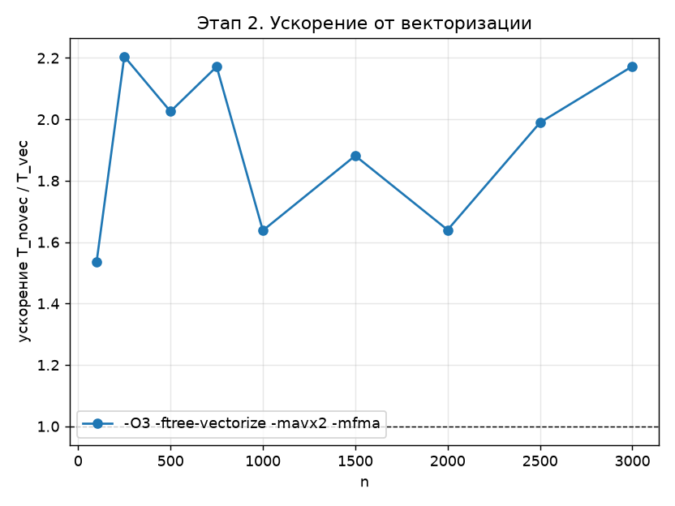

# Задание

Выполнить автовекторизацию блочного LU-разложения средствами GCC. Сравнить время двух сборок одной программы и построить график ускорения.

# Введение

Векторные инструкции выполняют одну операцию над несколькими числами. В 256-битном регистре AVX2 помещаются четыре числа типа `double`. Инструкция FMA совмещает умножение со сложением или вычитанием и выполняет одно округление. GCC может автоматически векторизовать циклы с независимыми итерациями [2].

Панель текущей подматрицы состоит из диагонального блока $A_{11}$ и блока $A_{21}$ под ним. Её ширина $w$ равна $\alpha$, кроме последнего блока, который может быть короче. Нумерация внутри панели начинается с нуля.

Столбцы панели обрабатываются слева направо. После прямой подстановки для элементов $U$ выше диагонали из столбца вычитаются вклады предыдущих столбцов $L$. Для $i\ge j$ получаем

$$
v_i=a_{ij}-\sum_{q=0}^{j-1}l_{iq}u_{qj},\qquad
u_{jj}=v_j,\qquad l_{ij}=v_i/u_{jj}\quad(i>j).
$$

Обновление столбца называется GAXPY [1]. Вычисление даёт $L_{11}$, $U_{11}$ и $L_{21}$ и требует ненулевых $u_{jj}$. Блок $U_{12}$ можно вычислить сразу после получения $L_{11}$.

$$
L_{11}U_{12}=A_{12},\qquad A_{22}\leftarrow A_{22}-L_{21}U_{12}.
$$

В этой реализации панель вычисляется целиком. Для прямой подстановки в $A_{12}$ и обновления $A_{22}$ применяется одна операция над участками строк.

$$
y_q\leftarrow y_q-sx_q.
$$

Здесь $x$ и $y$ — участки двух разных строк, а $s$ — элемент нижнего множителя. Цикл `saxpy` обращается к смежным элементам, и независимость участков выражена через `restrict`. В панели соседние элементы столбца расположены в памяти с шагом, равным длине строки. Условия векторизации этого цикла отличаются от условий в `saxpy`.

# Теоретические ожидания

Если доля $f$ времени базовой сборки ускоряется в $s$ раз, общее ускорение оценивается по закону Амдала.

$$
S=\frac{1}{(1-f)+f/s}.
$$

Основная арифметическая работа приходится на обновление остатка, но время обработки строк зависит и от загрузки данных. Четыре элемента в регистре задают ширину одной векторной операции. Фактическое ускорение программы измеряется как $T_{\mathrm{base}}/T_{\mathrm{vec}}$. FMA может менять последние знаки результата за счёт одного округления.

## Отчёт компилятора

Отчёт GCC с ключом `-fopt-info-vec-optimized` подтвердил применение 32-байтных векторов в цикле `saxpy` в строке 34 файла `stage2_vec.c`. Компилятор также сообщил о векторизации цикла нормировки панели в строке 30 файла `gaxpy_panel.h`, для которого созданы версии с проверкой возможного перекрытия. Циклы формирования правой части и проверки невязки находятся вне замера.

# Результаты экспериментов

## Методика

Эксперименты проведены 24 ноября 2026 г. на компьютере с процессором Intel Core i5-12450H (8 ядер, 12 логических процессоров) под Linux x86-64. Использован GCC 16.2.1. Режим управления частотой процессора — `powersave`. Ширина блока составляла 32. Для каждого размера использовалась одна и та же матрица во всех конфигурациях. Перед каждым повтором восстанавливались её исходные элементы. В таблицах приведён минимум из трёх замеров времени разложения. Сравнивались сборка с `-O2 -fno-tree-vectorize` и сборка с `-O3 -ftree-vectorize -mavx2 -mfma`. В замер входило только разложение. Ключи различаются уровнем оптимизации, поэтому измеренное отношение характеризует сборки целиком.

## Ускорение

В таблице 1 приведено время каждой сборки. На рисунке 1 показано отношение этих времён.

Таблица 1 – Время работы базовой и векторной сборок и ускорение

| $n$ | $T_{\mathrm{base}}$, с | $T_{\mathrm{vec}}$, с | $S$ |
| --- | --- | --- | --- |
| 100 | 0,000198 | 0,000129 | 1,53 |
| 250 | 0,001689 | 0,000766 | 2,20 |
| 500 | 0,013572 | 0,006700 | 2,03 |
| 750 | 0,046023 | 0,021192 | 2,17 |
| 1000 | 0,107611 | 0,065702 | 1,64 |
| 1500 | 0,355771 | 0,189097 | 1,88 |
| 2000 | 0,841920 | 0,513404 | 1,64 |
| 2500 | 1,667032 | 0,837949 | 1,99 |
| 3000 | 2,931676 | 1,349237 | 2,17 |

{width=85%}

Рисунок 1 – Ускорение векторной сборки относительно базовой

Векторная сборка оказалась быстрее на всех девяти размерах. При $n=3000$ время уменьшилось с 2,931676 до 1,349237 с, ускорение составило 2,17.

## Погрешность

Для проверки выбирали точное решение $x^*=(1,\ldots,1)^T$ и формировали $b=Ax^*$. После разложения решали системы $Ly=b$ и $Ux=y$. Измеряли ошибку решения и относительную невязку.

$$
\mathrm{err}=\|x-x^*\|_\infty,\qquad
\mathrm{res}=\frac{\|Ax-b\|_\infty}{\|b\|_\infty}.
$$

Наибольшая по двум сборкам ошибка решения составила 1,532·10⁻¹⁴, максимальная относительная невязка — 1,623·10⁻¹⁴. Порядок погрешности сохранился.

# Заключение

GCC векторизовал обновление участков строк и цикл нормировки панели. Отношение времён базовой и векторной сборок составило 1,53–2,20. Точность проверена на всех исследованных размерах от 100 до 3000.

# Список использованных источников

1. Головашкин, Д. Л. Векторные алгоритмы вычислительной линейной алгебры : учебное пособие / Д. Л. Головашкин. – Самара : Изд-во Самарского университета, 2019. – 76 с.
2. Auto-vectorization in GCC. – Текст : электронный // GCC, the GNU Compiler Collection : [сайт]. – URL: https://gcc.gnu.org/projects/tree-ssa/vectorization.html (дата обращения: 09.11.2026).

# Приложение А. Исходный код программы

Команды сборки и запуска из корня проекта приведены ниже.

```sh
gcc -std=gnu99 -O2 -fno-tree-vectorize stage2_vec.c -lm -o bin/stage2_novec
```

```sh
gcc -std=gnu99 -O3 -ftree-vectorize -mavx2 -mfma stage2_vec.c -lm -o bin/stage2_vec
```

```sh
./bin/stage2_novec 100 500 1000
```

```sh
./bin/stage2_vec 100 500 1000
```

Листинг файла `stage2_vec.c`.

```c
/*
 * Блочное LU-разложение с GAXPY-панелью. Для сравнения сборок с векторизацией
 * и без неё основная работа выполняется над смежными элементами строк.
 */
#include <stdio.h>
#include <stdlib.h>
#include <math.h>
#include "include/gaxpy_panel.h"

#define ALPHA 32
#define REPS  3

#ifdef _WIN32
#include <windows.h>
static double wtime(void)
{
    LARGE_INTEGER f, c;
    QueryPerformanceFrequency(&f);
    QueryPerformanceCounter(&c);
    return (double)c.QuadPart / (double)f.QuadPart;
}
#else
#include <time.h>
static double wtime(void)
{
    struct timespec t;
    clock_gettime(CLOCK_MONOTONIC, &t);
    return (double)t.tv_sec + 1e-9 * (double)t.tv_nsec;
}
#endif

static inline void saxpy(int m, double s, const double *restrict x, double *restrict y)
{
    for (int q = 0; q < m; q++)
        y[q] -= s * x[q];
}

#define ROW(i) (A + (size_t)(i) * n)
#define END(i) ((i) * alpha + alpha < n ? (i) * alpha + alpha : n)

/* Факторы записываются в A: L ниже диагонали, U на диагонали и выше. */
void block_lu(int n, int alpha, double *A)
{
    int N = (n + alpha - 1) / alpha;

    for (int k = 0; k < N; k++) {
        int a0 = k * alpha, a1 = END(k);

        /* Вычисляем L11, U11 и L21 по столбцам панели. */
        gaxpy_panel(ROW(a0) + a0, n, n - a0, a1 - a0);

        /* Прямая подстановка для U12: L11 * U12 = A12. */
        for (int j = k + 1; j < N; j++) {
            int c0 = j * alpha, m = END(j) - c0;
            for (int l = a0; l < a1; l++)
                for (int s = l + 1; s < a1; s++)
                    saxpy(m, ROW(s)[l], ROW(l) + c0, ROW(s) + c0);
        }

        /* A22 <- A22 - L21 * U12. */
        for (int i = k + 1; i < N; i++)
            for (int j = k + 1; j < N; j++) {
                int c0 = j * alpha, m = END(j) - c0;
                for (int s = i * alpha; s < END(i); s++)
                    for (int l = a0; l < a1; l++)
                        saxpy(m, ROW(s)[l], ROW(l) + c0, ROW(s) + c0);
            }
    }
}

static void lu_solve(int n, const double *A, double *x)
{
    for (int i = 0; i < n; i++)
        for (int j = 0; j < i; j++) x[i] -= A[(size_t)i * n + j] * x[j];
    for (int i = n - 1; i >= 0; i--) {
        for (int j = i + 1; j < n; j++) x[i] -= A[(size_t)i * n + j] * x[j];
        x[i] /= A[(size_t)i * n + i];
    }
}

static void run(int n)
{
    double *A0 = malloc((size_t)n * n * sizeof(double));
    double *A  = malloc((size_t)n * n * sizeof(double));
    double *b  = malloc(n * sizeof(double));
    double *x  = malloc(n * sizeof(double));

    srand(12345);
    for (size_t i = 0; i < (size_t)n * n; i++) A0[i] = (double)rand() / RAND_MAX - 0.5;
    for (int i = 0; i < n; i++) A0[(size_t)i * n + i] += n / 4.0;
    for (int i = 0; i < n; i++) {
        double s = 0;
        for (int j = 0; j < n; j++) s += A0[(size_t)i * n + j];
        b[i] = s;
    }

    double tmin = 1e30;
    for (int rep = 0; rep < REPS; rep++) {
        for (size_t i = 0; i < (size_t)n * n; i++) A[i] = A0[i];
        double t = wtime();
        block_lu(n, ALPHA, A);
        t = wtime() - t;
        if (t < tmin) tmin = t;
    }

    for (int i = 0; i < n; i++) x[i] = b[i];
    lu_solve(n, A, x);
    double err = 0, res = 0, bn = 0;
    for (int i = 0; i < n; i++) {
        err = fmax(err, fabs(x[i] - 1.0));
        double s = -b[i];
        for (int j = 0; j < n; j++) s += A0[(size_t)i * n + j] * x[j];
        res = fmax(res, fabs(s));
        bn = fmax(bn, fabs(b[i]));
    }
    printf("%d,%d,%.6f,%.3e,%.3e\n", n, ALPHA, tmin, err, res / bn);
    fflush(stdout);
    free(A0); free(A); free(b); free(x);
}

int main(int argc, char **argv)
{
    static const int def[] = {100, 250, 500, 750, 1000, 1500, 2000, 2500, 3000};
    printf("n,alpha,time,err,res\n");
    if (argc > 1)
        for (int i = 1; i < argc; i++) run(atoi(argv[i]));
    else
        for (size_t i = 0; i < sizeof def / sizeof *def; i++) run(def[i]);
    return 0;
}
```

Листинг файла `include/gaxpy_panel.h`.

```c
#ifndef GAXPY_PANEL_H
#define GAXPY_PANEL_H

#include <stddef.h>

/* a указывает на левый верхний элемент панели из height строк и width столбцов.
 * stride — расстояние между началами строк. Разложение требует ненулевых U(j,j). */
static inline void gaxpy_panel(double *a, int stride, int height, int width)
{
    for (int j = 0; j < width; j++) {
        /* Прямая подстановка для элементов U выше диагонали. */
        for (int p = 0; p < j - 1; p++) {
            double u = a[(size_t)p * stride + j];
            for (int i = p + 1; i < j; i++) {
                double *row = a + (size_t)i * stride;
                row[j] -= row[p] * u;
            }
        }

        /* v = a[j:height,j] - L[j:height,0:j] * U[0:j,j].
         * Первый элемент v становится U(j,j), остальные делим на U(j,j). */
        for (int p = 0; p < j; p++) {
            double u = a[(size_t)p * stride + j];
            for (int i = j; i < height; i++) {
                double *row = a + (size_t)i * stride;
                row[j] -= row[p] * u;
            }
        }
        double pivot = a[(size_t)j * stride + j];
        for (int i = j + 1; i < height; i++)
            a[(size_t)i * stride + j] /= pivot;
    }
}

/* Для нижней строки: L(i,j) = (a(i,j) - sum_{p<j} L(i,p) * U(p,j)) / U(j,j). */
static inline void gaxpy_panel_row(double *row, const double *u, int stride, int width)
{
    for (int j = 0; j < width; j++) {
        for (int p = 0; p < j; p++)
            row[j] -= row[p] * u[(size_t)p * stride + j];
        row[j] /= u[(size_t)j * stride + j];
    }
}

#endif
```
