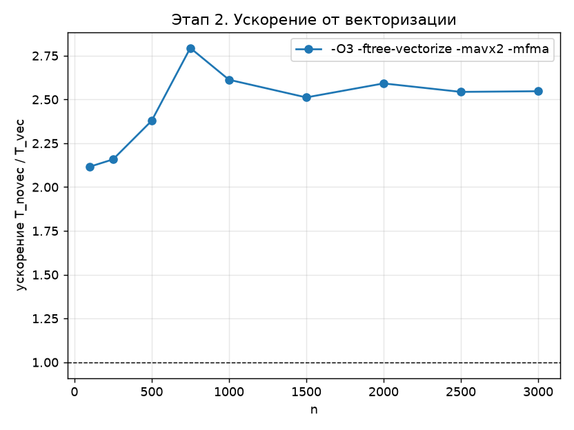

# Задание

Вариант задания – блочный алгоритм LU-разложения из параграфа 2.4 учебного пособия Д. Л. Головашкина (Алгоритм 37) [1].

Требуется выполнить векторизацию алгоритма средствами компилятора gcc (ключами компиляции) и построить график ускорения.

# Введение

Современные процессоры поддерживают SIMD-инструкции (Single Instruction, Multiple Data), которые выполняют одну операцию сразу над несколькими числами. Процессор Intel Core i5-1135G7 поддерживает набор AVX2 с 256-битными регистрами, каждый из которых вмещает

$$
\frac{256}{64} = 4
$$

числа типа double, и набор FMA (fused multiply-add), выполняющий операцию $d \leftarrow a \cdot b + c$ одной инструкцией с одним округлением.

Автоматическая векторизация – преобразование компилятором скалярного цикла в цикл, обрабатывающий на каждой итерации по 4 элемента [2]. Компилятор GCC векторизует цикл, если:

- итерации внутреннего цикла не зависят друг от друга;
- элементы массивов идут в памяти подряд (единичный шаг);
- массивы, в которые идёт запись, не перекрываются с массивами, из которых идёт чтение, или это можно проверить во время выполнения;
- цикл имеет простую форму: известное число итераций, без вызовов функций и ветвлений в теле.

Блочный алгоритм LU-разложения (Алгоритм 37 [1]) на каждой итерации выполняет четыре шага: LU-разложение малого блока, решение двух наборов треугольных систем и блочную модификацию матрицы внешним произведением $A'(b,c) = A(b,c) - L(b,a)\,U(a,c)$. При хранении матрицы по строкам самая внутренняя операция всех четырёх шагов одинакова – это операция saxpy над строкой:

$$
y \leftarrow y - s \cdot x,
$$

где $y$ – участок обновляемой строки $s$, $x$ – участок строки $l$ текущего малого блока, $s$ – множитель $\ell_{sl}$. На шагах 3 и 4 длина участка равна размеру малого блока $\alpha = 32$, на шагах 1 и 2 она меньше $\alpha$ и зависит от номера строки.

Поэтому для векторизации вся арифметика алгоритма вынесена в одну функцию:

```
static inline void saxpy(int m, double s, const double *restrict x, double *restrict y)
{
    for (int q = 0; q < m; q++)
        y[q] -= s * x[q];
}
```

Цикл идёт по соседним элементам строки, а ключевое слово `restrict` сообщает компилятору, что массивы `x` и `y` не перекрываются. Это обещание верно: $x$ и $y$ – разные строки матрицы. Множитель $s$ передаётся по значению, поэтому компилятор размножает его на все элементы векторного регистра. Функция объявлена `static inline` и встраивается во все четыре шага.

Сравниваются две сборки одной программы:

- базовая: `-O2 -fno-tree-vectorize` – автовекторизация запрещена;
- векторная: `-O3 -ftree-vectorize -mavx2 -mfma` – автовекторизация с инструкциями AVX2 и FMA.

Общие ключи обеих сборок – `-std=gnu99 -msse2 -mfpmath=sse`.

# Теоретические ожидания

## Ускорение

Ускорение определяется как отношение времени базовой и векторной сборок:

$$
S(n) = \frac{T_{\mathrm{novec}}(n)}{T_{\mathrm{vec}}(n)}.
$$

Пусть доля $f$ времени приходится на векторизуемый цикл, который ускоряется в $s$ раз. По закону Амдала

$$
S = \frac{1}{(1 - f) + f/s}.
$$

Через функцию saxpy проходят все операции алгоритма, кроме $O(n^2)$ делений на шагах 1 и 2, поэтому $f \approx 1$, и ускорение определяется величиной $s$. По ширине регистра $s \le 4$. Ещё в 2 раза ускорение могла бы увеличить FMA, но цикл saxpy на каждые 4 элемента выполняет две загрузки и одну запись: и скалярный, и векторный варианты ограничены пропускной способностью портов загрузки и записи процессора, а не числом арифметических инструкций. Поэтому ожидаемая верхняя граница ускорения – около 4.

Реальное ускорение должно быть меньше 4 по следующим причинам:

- на шагах 1 и 2 длина цикла меньше 32 и уменьшается, часть элементов обрабатывается скалярно;
- на каждой итерации основная операция заново загружает в кэш блоки оставшейся подматрицы, а при $n = 3000$ её размер – до 72 МБ, что больше кэша L3;
- при малых $n$ относительно велика доля невекторизуемой части (деления, накладные расходы циклов).

## Погрешность

Инструкция FMA вычисляет $y - s \cdot x$ с одним округлением вместо двух. Поэтому результаты векторной сборки могут отличаться от базовой в последних знаках, но порядок погрешности должен сохраниться.

# Результаты экспериментов

## Методика

Эксперименты проводились на ноутбуке с процессором Intel Core i5-1135G7 (4 ядра, 8 потоков), компилятор MinGW GCC 9.2 (32 бита). Для каждого размера матрица генерируется заново с одним и тем же начальным значением генератора; разложение повторяется три раза, используется минимальное время.

## Отчёт компилятора

Ключ `-fopt-info-vec-optimized` выводит список векторизованных циклов. Для векторной сборки GCC сообщает:

```
stage2_vec.c:36:5: optimized: loop vectorized using 32 byte vectors
stage2_vec.c:87:5: optimized: loop vectorized using 32 byte vectors
stage2_vec.c:107:9: optimized: loop vectorized using 32 byte vectors
stage2_vec.c:126:9: optimized: loop vectorized using 32 byte vectors
```

Строка 36 – цикл функции saxpy: он векторизован 32-байтными векторами AVX без проверок перекрытия во время выполнения. Остальные циклы – прямая подстановка при решении системы и суммы при вычислении правой части и невязки; они в замер времени не входят.

## Ускорение

Время работы обеих сборок и ускорение приведены в таблице 1, график ускорения – на рисунке 1.

: Время работы базовой и векторной сборок и ускорение

| $n$ | $T_{\mathrm{novec}}$, с | $T_{\mathrm{vec}}$, с | $S$ |
|---|---|---|---|
| 100 | 0,0002 | 0,0001 | 2,12 |
| 250 | 0,003 | 0,002 | 2,16 |
| 500 | 0,030 | 0,012 | 2,38 |
| 750 | 0,109 | 0,039 | 2,79 |
| 1000 | 0,257 | 0,098 | 2,61 |
| 1500 | 0,850 | 0,338 | 2,51 |
| 2000 | 2,04 | 0,786 | 2,59 |
| 2500 | 4,01 | 1,58 | 2,54 |
| 3000 | 6,90 | 2,71 | 2,55 |

{width=85%}

При $n \ge 750$ ускорение стабильно составляет 2,5–2,8 и не уменьшается с ростом размера матрицы. Основная операция работает с тремя блоками $32 \times 32$ (24 КБ), которые помещаются в кэш L1 (48 КБ), поэтому векторный цикл почти не зависит от размера всей матрицы. При малых $n$ (100–500) ускорение ниже – 2,1–2,4: малых блоков мало, и заметную долю времени занимают шаги 1 и 2 с короткими циклами. До теоретической границы 4 ускорение не доходит; вклад каждой из причин, перечисленных в разделе 1, отдельно не измерялся.

Ключи сборок различаются не только векторизацией: базовая сборка компилируется с `-O2`, векторная – с `-O3`. Поэтому измерено ускорение сборки в целом.

## Погрешность

Погрешность $\mathrm{err}$ векторной сборки совпадает с базовой до последнего знака при всех $n$, кроме $n = 2000$ ($9{,}992 \cdot 10^{-15}$ против $1{,}021 \cdot 10^{-14}$) и $n = 3000$ ($1{,}243 \cdot 10^{-14}$ против $1{,}266 \cdot 10^{-14}$). Относительная невязка отличается в большинстве точек на уровне машинной точности. Это следствие одного округления в инструкции FMA, как и ожидалось.

# Заключение

В работе выполнена автоматическая векторизация блочного алгоритма LU-разложения (Алгоритм 37 [1]) средствами компилятора GCC. Для этого вся арифметика алгоритма сведена к одной операции saxpy над соседними элементами строки, а отсутствие перекрытия массивов сообщено компилятору ключевым словом `restrict`. Отчёт компилятора подтвердил векторизацию этого цикла 256-битными векторами AVX2.

Векторная сборка с ключами `-O3 -ftree-vectorize -mavx2 -mfma` работает в 2,1–2,8 раза быстрее базовой сборки `-O2 -fno-tree-vectorize`; при $n \ge 750$ ускорение устойчиво держится на уровне 2,5–2,8. Это ниже теоретической границы 4, определяемой шириной регистра AVX2. Погрешность векторной версии отличается от базовой только в последних знаках из-за инструкции FMA.

# Список использованных источников

1. Головашкин, Д. Л. Векторные алгоритмы вычислительной линейной алгебры : учебное пособие / Д. Л. Головашкин. – Самара : Изд-во Самарского университета, 2019. – 76 с.
2. Auto-vectorization in GCC. – Текст : электронный // GCC, the GNU Compiler Collection : [сайт]. – URL: https://gcc.gnu.org/projects/tree-ssa/vectorization.html (дата обращения: 09.11.2026).

# Приложение А. Исходный код программы

Программа собирается двумя командами – без векторизации и с векторизацией:

```
gcc -std=gnu99 -msse2 -mfpmath=sse -O2 -fno-tree-vectorize stage2_vec.c -o stage2_novec.exe
gcc -std=gnu99 -msse2 -mfpmath=sse -O3 -ftree-vectorize -mavx2 -mfma stage2_vec.c -o stage2_vec.exe
```

```
/*
 * Этап 2. Блочное LU-разложение (Алгоритм 37) для автовекторизации.
 * Все шаги сводятся к одной векторной операции saxpy над соседними элементами
 * строки; restrict описывает отсутствие перекрытия строк для векторизатора.
 * Сравниваются две сборки этого файла. Флаги и запуск — README.md, REPORT.md.
 */
#include <stdio.h>
#include <stdlib.h>
#include <math.h>

#define ALPHA 32
#define REPS  3

#ifdef _WIN32
#include <windows.h>
static double wtime(void)
{
    LARGE_INTEGER f, c;
    QueryPerformanceFrequency(&f);
    QueryPerformanceCounter(&c);
    return (double)c.QuadPart / (double)f.QuadPart;
}
#else
#include <time.h>
static double wtime(void)
{
    struct timespec t;
    clock_gettime(CLOCK_MONOTONIC, &t);
    return (double)t.tv_sec + 1e-9 * (double)t.tv_nsec;
}
#endif

/* y(0:m) -= s * x(0:m) — единственный векторизуемый цикл алгоритма */
static inline void saxpy(int m, double s, const double *restrict x, double *restrict y)
{
    for (int q = 0; q < m; q++)
        y[q] -= s * x[q];
}

#define ROW(i) (A + (size_t)(i) * n)
#define END(i) ((i) * alpha + alpha < n ? (i) * alpha + alpha : n)

/* A (n x n, по строкам) заменяется на LU без выбора ведущего элемента. */
void block_lu(int n, int alpha, double *A)
{
    int N = (n + alpha - 1) / alpha;

    for (int k = 0; k < N; k++) {
        int a0 = k * alpha, a1 = END(k);

        /* 1. A(a,a) = L(a,a) U(a,a) */
        for (int l = a0; l < a1; l++)
            for (int s = l + 1; s < a1; s++) {
                ROW(s)[l] /= ROW(l)[l];
                saxpy(a1 - l - 1, ROW(s)[l], ROW(l) + l + 1, ROW(s) + l + 1);
            }

        /* 2. L(b,a) U(a,a) = A(b,a) */
        for (int i = k + 1; i < N; i++)
            for (int s = i * alpha; s < END(i); s++)
                for (int l = a0; l < a1; l++) {
                    ROW(s)[l] /= ROW(l)[l];
                    saxpy(a1 - l - 1, ROW(s)[l], ROW(l) + l + 1, ROW(s) + l + 1);
                }

        /* 3. L(a,a) U(a,c) = A(a,c) */
        for (int j = k + 1; j < N; j++) {
            int c0 = j * alpha, m = END(j) - c0;
            for (int l = a0; l < a1; l++)
                for (int s = l + 1; s < a1; s++)
                    saxpy(m, ROW(s)[l], ROW(l) + c0, ROW(s) + c0);
        }

        /* 4. A'(b,c) = A(b,c) - L(b,a) U(a,c) */
        for (int i = k + 1; i < N; i++)
            for (int j = k + 1; j < N; j++) {
                int c0 = j * alpha, m = END(j) - c0;
                for (int s = i * alpha; s < END(i); s++)
                    for (int l = a0; l < a1; l++)
                        saxpy(m, ROW(s)[l], ROW(l) + c0, ROW(s) + c0);
            }
    }
}

static void lu_solve(int n, const double *A, double *x)
{
    for (int i = 0; i < n; i++)
        for (int j = 0; j < i; j++) x[i] -= A[(size_t)i * n + j] * x[j];
    for (int i = n - 1; i >= 0; i--) {
        for (int j = i + 1; j < n; j++) x[i] -= A[(size_t)i * n + j] * x[j];
        x[i] /= A[(size_t)i * n + i];
    }
}

static void run(int n)
{
    double *A0 = malloc((size_t)n * n * sizeof(double));
    double *A  = malloc((size_t)n * n * sizeof(double));
    double *b  = malloc(n * sizeof(double));
    double *x  = malloc(n * sizeof(double));

    srand(12345);
    for (size_t i = 0; i < (size_t)n * n; i++) A0[i] = (double)rand() / RAND_MAX - 0.5;
    for (int i = 0; i < n; i++) A0[(size_t)i * n + i] += n / 4.0;
    for (int i = 0; i < n; i++) {
        double s = 0;
        for (int j = 0; j < n; j++) s += A0[(size_t)i * n + j];
        b[i] = s;
    }

    double tmin = 1e30;
    for (int rep = 0; rep < REPS; rep++) {
        for (size_t i = 0; i < (size_t)n * n; i++) A[i] = A0[i];
        double t = wtime();
        block_lu(n, ALPHA, A);
        t = wtime() - t;
        if (t < tmin) tmin = t;
    }

    for (int i = 0; i < n; i++) x[i] = b[i];
    lu_solve(n, A, x);
    double err = 0, res = 0, bn = 0;
    for (int i = 0; i < n; i++) {
        err = fmax(err, fabs(x[i] - 1.0));
        double s = -b[i];
        for (int j = 0; j < n; j++) s += A0[(size_t)i * n + j] * x[j];
        res = fmax(res, fabs(s));
        bn = fmax(bn, fabs(b[i]));
    }
    printf("%d,%d,%.6f,%.3e,%.3e\n", n, ALPHA, tmin, err, res / bn);
    fflush(stdout);
    free(A0); free(A); free(b); free(x);
}

int main(int argc, char **argv)
{
    static const int def[] = {100, 250, 500, 750, 1000, 1500, 2000, 2500, 3000};
    printf("n,alpha,time,err,res\n");
    if (argc > 1)
        for (int i = 1; i < argc; i++) run(atoi(argv[i]));
    else
        for (size_t i = 0; i < sizeof def / sizeof *def; i++) run(def[i]);
    return 0;
}
```
