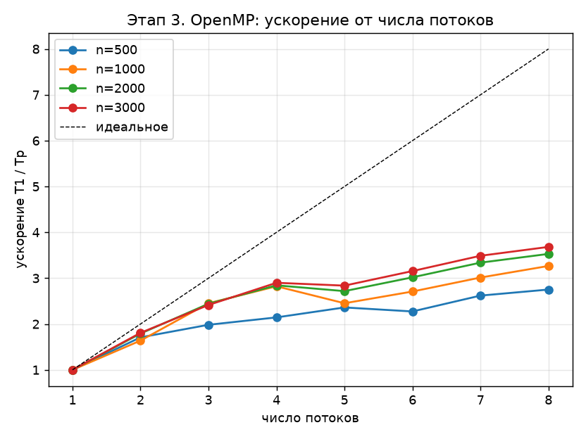
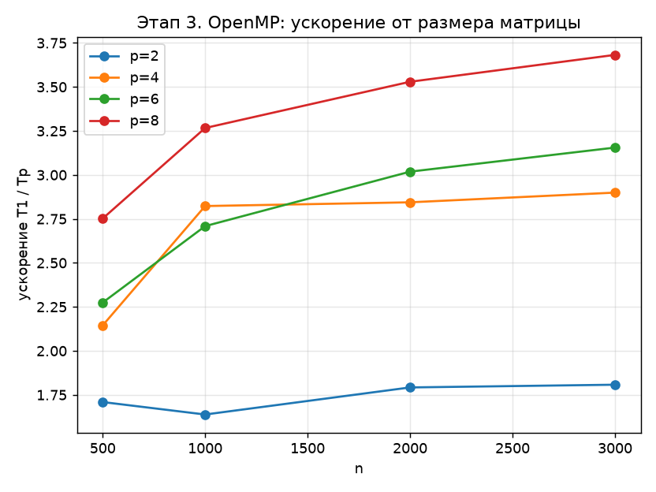

# Задание

Распараллелить блочное LU-разложение средствами OpenMP с автоматическим распределением итераций циклов. Измерить ускорение при разном числе потоков и построить графики.

# Введение

OpenMP распределяет итерации цикла между потоками по директиве `parallel for` [2]. В программе используется `schedule(static)`, распределение выполняет библиотека OpenMP. В конце каждого распараллеленного цикла неявный барьер гарантирует готовность его результата.

Панель текущей подматрицы состоит из диагонального блока $A_{11}$ и блока $A_{21}$ под ним. Её ширина $w$ равна $\alpha$, кроме последнего блока, который может быть короче. Нумерация внутри панели начинается с нуля.

Столбцы панели обрабатываются слева направо. После прямой подстановки для элементов $U$ выше диагонали из столбца вычитаются вклады предыдущих столбцов $L$. Для $i\ge j$ получаем

$$
v_i=a_{ij}-\sum_{q=0}^{j-1}l_{iq}u_{qj},\qquad
u_{jj}=v_j,\qquad l_{ij}=v_i/u_{jj}\quad(i>j).
$$

Обновление столбца называется GAXPY [1]. Вычисление даёт $L_{11}$, $U_{11}$ и $L_{21}$ и требует ненулевых $u_{jj}$. Блок $U_{12}$ можно вычислить сразу после получения $L_{11}$.

$$
L_{11}U_{12}=A_{12},\qquad A_{22}\leftarrow A_{22}-L_{21}U_{12}.
$$

Диагональная часть панели вычисляется последовательно, поскольку очередной её столбец зависит от предыдущих. После получения $U_{11}$ для нижней строки нужны только элементы этой строки и готового $U_{11}$. Поэтому первый параллельный цикл распределяет все строки $L_{21}$ по отдельности. В каждой строке столбцы по-прежнему вычисляются слева направо.

Второй параллельный цикл распределяет блоки столбцов $U_{12}$. Третий с `collapse(2)` распределяет пары индексов блоков $A_{22}$. Разные итерации обновляют разные элементы матрицы. Внешний цикл по панелям выполняется последовательно, поскольку каждая панель берётся из остатка предыдущей итерации.

# Теоретические ожидания

Пусть $T_P$ – время разложения на $P$ потоках, а $\sigma$ – доля последовательной работы. Ускорение и оценка по закону Амдала имеют вид

$$
S(P)=\frac{T_1}{T_P},\qquad
S_{\mathrm{model}}(P)=\frac{1}{\sigma+(1-\sigma)/P}.
$$

Суммарная стоимость факторизации диагональных блоков имеет порядок $O(n\alpha^2)$, а основная работа по обновлению остатка имеет порядок $O(n^3)$. При росте матрицы доля последовательной арифметики уменьшается. Модель предполагает одинаковую скорость потоков и не учитывает ожидание на барьерах, работу с общей памятью и различия между ядрами.

# Результаты экспериментов

## Методика

Эксперименты проведены 24 ноября 2026 г. на компьютере с процессором Intel Core i5-12450H (8 ядер, 12 логических процессоров) под Linux x86-64. Использован GCC 16.2.1. Режим управления частотой процессора – `powersave`. Ширина блока составляла 32. Для каждого размера использовалась одна и та же матрица во всех конфигурациях. Перед каждым повтором восстанавливались её исходные элементы. В таблицах приведён минимум из трёх замеров времени разложения. Размеры матриц составили 500, 1000, 2000 и 3000. Число потоков от 1 до 8 задавалось через `OMP_NUM_THREADS`, динамическое изменение числа потоков было отключено. Потоки явно не закреплялись за ядрами. Время измерялось только для разложения.

## Ускорение

В таблице 1 приведено ускорение относительно одного потока. На рисунке 1 показана зависимость от числа потоков, на рисунке 2 – от размера матрицы.

Таблица 1 – Ускорение OpenMP относительно одного потока

| $n$ | $T_1$, с | $P=2$ | $P=3$ | $P=4$ | $P=5$ | $P=6$ | $P=7$ | $P=8$ |
| --- | --- | --- | --- | --- | --- | --- | --- | --- |
| 500 | 0,012733 | 1,71 | 1,98 | 2,14 | 2,36 | 2,27 | 2,62 | 2,75 |
| 1000 | 0,108181 | 1,64 | 2,45 | 2,82 | 2,45 | 2,71 | 3,01 | 3,27 |
| 2000 | 0,866529 | 1,79 | 2,44 | 2,84 | 2,72 | 3,02 | 3,34 | 3,53 |
| 3000 | 2,962198 | 1,81 | 2,42 | 2,90 | 2,84 | 3,16 | 3,49 | 3,68 |

{width=85%}

Рисунок 1 – Зависимость ускорения от числа потоков

{width=85%}

Рисунок 2 – Зависимость ускорения от размера матрицы

На четырёх потоках ускорение составило 2,14–2,90. Наибольшее ускорение 3,68 получено при $n=3000$ на восьми потоках. При этом время разложения уменьшилось с 2,962198 до 0,804471 с. Эффект добавления потоков зависит от размера матрицы.

## Погрешность

Для проверки выбирали точное решение $x^*=(1,\ldots,1)^T$ и формировали $b=Ax^*$. После разложения решали системы $Ly=b$ и $Ux=y$. Измеряли ошибку решения и относительную невязку.

$$
\mathrm{err}=\|x-x^*\|_\infty,\qquad
\mathrm{res}=\frac{\|Ax-b\|_\infty}{\|b\|_\infty}.
$$

Для каждого размера выведенные значения ошибки и невязки совпали для всех вариантов числа потоков. Максимальная ошибка составила 1,199·10⁻¹⁴, максимальная относительная невязка – 1,238·10⁻¹⁴.

# Заключение

Средствами OpenMP распараллелены нижние строки панели, блоки $U_{12}$ и блоки обновляемого остатка. Для матрицы размерности 3000 получено ускорение 3,68 на восьми потоках относительно одного потока. Ошибка решения и невязка сохранились при изменении числа потоков.

# Список использованных источников

1. Головашкин, Д. Л. Векторные алгоритмы вычислительной линейной алгебры : учебное пособие / Д. Л. Головашкин. – Самара : Изд-во Самарского университета, 2019. – 76 с.
2. OpenMP Application Programming Interface. Version 4.5. – Текст : электронный // OpenMP Architecture Review Board : [сайт]. – 2015. – URL: https://www.openmp.org/specifications/ (дата обращения: 09.11.2026).

# Приложение А. Исходный код программы

Команды сборки и запуска из корня проекта приведены ниже.

```sh
gcc -std=gnu99 -O2 -fno-tree-vectorize -fopenmp stage3_omp.c -lm -o bin/stage3_omp
```

```sh
OMP_DYNAMIC=FALSE OMP_NUM_THREADS=4 ./bin/stage3_omp 500 1000 2000 3000
```

Листинг файла `stage3_omp.c`.

```c
/* Блочное LU-разложение с GAXPY-панелью и автоматическим распределением циклов OpenMP. */
#include <stdio.h>
#include <stdlib.h>
#include <math.h>
#include <omp.h>
#include "include/gaxpy_panel.h"

#define ALPHA 32
#define REPS  3

#ifdef _WIN32
#include <windows.h>
static double wtime(void)
{
    LARGE_INTEGER f, c;
    QueryPerformanceFrequency(&f);
    QueryPerformanceCounter(&c);
    return (double)c.QuadPart / (double)f.QuadPart;
}
#else
#include <time.h>
static double wtime(void)
{
    struct timespec t;
    clock_gettime(CLOCK_MONOTONIC, &t);
    return (double)t.tv_sec + 1e-9 * (double)t.tv_nsec;
}
#endif

static inline void saxpy(int m, double s, const double *restrict x, double *restrict y)
{
    for (int q = 0; q < m; q++)
        y[q] -= s * x[q];
}

#define ROW(i) (A + (size_t)(i) * n)
#define END(i) ((i) * alpha + alpha < n ? (i) * alpha + alpha : n)

/* После каждого параллельного цикла неявный барьер гарантирует готовность данных. */
void block_lu(int n, int alpha, double *A)
{
    int N = (n + alpha - 1) / alpha;

    for (int k = 0; k < N; k++) {
        int a0 = k * alpha, a1 = END(k);

        int w = a1 - a0;
        double *diagonal = ROW(a0) + a0;

        /* После вычисления U11 каждая нижняя строка панели зависит только от U11
         * и ранее вычисленных элементов той же строки. */
        gaxpy_panel(diagonal, n, w, w);
        #pragma omp parallel for schedule(static)
        for (int s = a1; s < n; s++)
            gaxpy_panel_row(ROW(s) + a0, diagonal, n, w);

        /* L11 * U12 = A12. Потоки обрабатывают разные блоки столбцов U12. */
        #pragma omp parallel for schedule(static)
        for (int j = k + 1; j < N; j++) {
            int c0 = j * alpha, m = END(j) - c0;
            for (int l = a0; l < a1; l++)
                for (int s = l + 1; s < a1; s++)
                    saxpy(m, ROW(s)[l], ROW(l) + c0, ROW(s) + c0);
        }

        /* A22 <- A22 - L21 * U12. Каждая пара (i, j) задаёт отдельный блок A22. */
        #pragma omp parallel for collapse(2) schedule(static)
        for (int i = k + 1; i < N; i++)
            for (int j = k + 1; j < N; j++) {
                int c0 = j * alpha, m = END(j) - c0;
                for (int s = i * alpha; s < END(i); s++)
                    for (int l = a0; l < a1; l++)
                        saxpy(m, ROW(s)[l], ROW(l) + c0, ROW(s) + c0);
            }
    }
}

static void lu_solve(int n, const double *A, double *x)
{
    for (int i = 0; i < n; i++)
        for (int j = 0; j < i; j++) x[i] -= A[(size_t)i * n + j] * x[j];
    for (int i = n - 1; i >= 0; i--) {
        for (int j = i + 1; j < n; j++) x[i] -= A[(size_t)i * n + j] * x[j];
        x[i] /= A[(size_t)i * n + i];
    }
}

static void run(int n)
{
    double *A0 = malloc((size_t)n * n * sizeof(double));
    double *A  = malloc((size_t)n * n * sizeof(double));
    double *b  = malloc(n * sizeof(double));
    double *x  = malloc(n * sizeof(double));

    srand(12345);
    for (size_t i = 0; i < (size_t)n * n; i++) A0[i] = (double)rand() / RAND_MAX - 0.5;
    for (int i = 0; i < n; i++) A0[(size_t)i * n + i] += n / 4.0;
    for (int i = 0; i < n; i++) {
        double s = 0;
        for (int j = 0; j < n; j++) s += A0[(size_t)i * n + j];
        b[i] = s;
    }

    double tmin = 1e30;
    for (int rep = 0; rep < REPS; rep++) {
        for (size_t i = 0; i < (size_t)n * n; i++) A[i] = A0[i];
        double t = wtime();
        block_lu(n, ALPHA, A);
        t = wtime() - t;
        if (t < tmin) tmin = t;
    }

    for (int i = 0; i < n; i++) x[i] = b[i];
    lu_solve(n, A, x);
    double err = 0, res = 0, bn = 0;
    for (int i = 0; i < n; i++) {
        err = fmax(err, fabs(x[i] - 1.0));
        double s = -b[i];
        for (int j = 0; j < n; j++) s += A0[(size_t)i * n + j] * x[j];
        res = fmax(res, fabs(s));
        bn = fmax(bn, fabs(b[i]));
    }
    printf("%d,%d,%d,%.6f,%.3e,%.3e\n", n, omp_get_max_threads(), ALPHA, tmin, err, res / bn);
    fflush(stdout);
    free(A0); free(A); free(b); free(x);
}

int main(int argc, char **argv)
{
    static const int def[] = {100, 250, 500, 750, 1000, 1500, 2000, 2500, 3000};
    printf("n,threads,alpha,time,err,res\n");
    if (argc > 1)
        for (int i = 1; i < argc; i++) run(atoi(argv[i]));
    else
        for (size_t i = 0; i < sizeof def / sizeof *def; i++) run(def[i]);
    return 0;
}
```

Листинг файла `include/gaxpy_panel.h`.

```c
#ifndef GAXPY_PANEL_H
#define GAXPY_PANEL_H

#include <stddef.h>

/* a указывает на левый верхний элемент панели из height строк и width столбцов.
 * stride – расстояние между началами строк. Разложение требует ненулевых U(j,j). */
static inline void gaxpy_panel(double *a, int stride, int height, int width)
{
    for (int j = 0; j < width; j++) {
        /* Прямая подстановка для элементов U выше диагонали. */
        for (int p = 0; p < j - 1; p++) {
            double u = a[(size_t)p * stride + j];
            for (int i = p + 1; i < j; i++) {
                double *row = a + (size_t)i * stride;
                row[j] -= row[p] * u;
            }
        }

        /* v = a[j:height,j] - L[j:height,0:j] * U[0:j,j].
         * Первый элемент v становится U(j,j), остальные делим на U(j,j). */
        for (int p = 0; p < j; p++) {
            double u = a[(size_t)p * stride + j];
            for (int i = j; i < height; i++) {
                double *row = a + (size_t)i * stride;
                row[j] -= row[p] * u;
            }
        }
        double pivot = a[(size_t)j * stride + j];
        for (int i = j + 1; i < height; i++)
            a[(size_t)i * stride + j] /= pivot;
    }
}

/* Для нижней строки: L(i,j) = (a(i,j) - sum_{p<j} L(i,p) * U(p,j)) / U(j,j). */
static inline void gaxpy_panel_row(double *row, const double *u, int stride, int width)
{
    for (int j = 0; j < width; j++) {
        for (int p = 0; p < j; p++)
            row[j] -= row[p] * u[(size_t)p * stride + j];
        row[j] /= u[(size_t)j * stride + j];
    }
}

#endif
```
