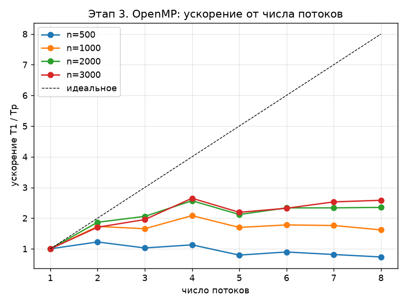
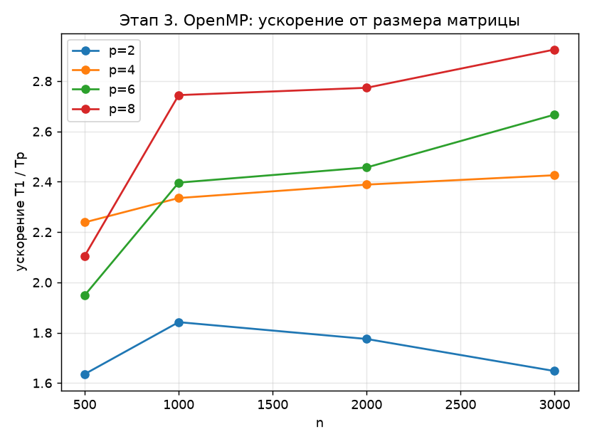

# Задание

Вариант задания – блочный алгоритм LU-разложения из параграфа 2.4 учебного пособия Д. Л. Головашкина (Алгоритм 37) [1].

Требуется распараллелить алгоритм с помощью OpenMP, используя только автоматическое распределение итераций циклов директивой `#pragma omp parallel for`, и построить график ускорения.

# Введение

OpenMP – стандарт параллельного программирования для систем с общей памятью [2]. Программа начинает работу одним потоком. Директива `#pragma omp parallel for` перед циклом работает по схеме fork–join: главный поток запускает команду из $P$ потоков, итерации цикла распределяются между ними, а в конце цикла выполняется неявный барьер – главный поток продолжает работу, когда все итерации завершены. Число потоков задаётся переменной окружения `OMP_NUM_THREADS`.

При расписании `schedule(static)` итерации делятся на $P$ непрерывных частей почти равного размера. Точное деление стандарт оставляет реализации; в библиотеке libgomp компилятора GCC при $q = \lfloor m/P \rfloor$ и $r = m \bmod P$ поток $t$ получает итерации

$$
\bigl[\, t q + \min(t, r),\; (t+1) q + \min(t+1, r) \,\bigr), \qquad t = 0, \ldots, P-1,
$$

где $m$ – число итераций, то есть первые $r$ потоков получают на одну итерацию больше. Это деление выполняет библиотека OpenMP, в программе нет ручного распределения итераций по номеру потока. Предложение `collapse(2)` объединяет два вложенных цикла в один, и между потоками распределяются пары итераций.

Директива корректна, только если итерации цикла не зависят друг от друга: ни одна итерация не пишет в элементы, которые читает или пишет другая итерация. Проверка этого условия – задача программиста. Блочный алгоритм LU-разложения (Алгоритм 37 [1]) на итерации $k$ выполняет четыре шага; рассмотрим их зависимости.

1. LU-разложение малого блока $A(a,a)$. Строки блока зависят друг от друга: строка $l$ должна быть готова раньше строк $s > l$. Шаг выполняется последовательно; на него приходится 0,01 % операций.
2. Решение систем $L(b,a)\,U(a,a) = A(b,a)$. Итерация по малому блоку $i$ блочного столбца пишет только строки своего блока и читает блок $U(a,a)$, который на этом шаге не меняется. Блоки независимы, цикл по $i$ параллелится.
3. Решение систем $L(a,a)\,U(a,c) = A(a,c)$. Внутри малого блока строки зависимы, но разные блоки $j$ блочной строки – разные правые части одной системы и не зависят друг от друга. Цикл по $j$ параллелится.
4. Основная операция $A'(b,c) = A(b,c) - L(b,a)\,U(a,c)$. Итерация $(i, j)$ пишет только блок $A(b,c)$ и читает блоки $L(b,a)$ и $U(a,c)$, в которые на этом шаге никто не пишет. Две итерации пересекаются по записи, только если совпадают и $i$, и $j$. Двойной цикл по $(i, j)$ параллелится с предложением `collapse(2)`.

Внешний цикл по $k$ параллелить нельзя: итерация $k$ работает с матрицей $A'$, полученной на итерации $k - 1$. Таким образом, на одну итерацию алгоритма приходятся три параллельные области:

```
#pragma omp parallel for schedule(static)              /* шаг 2 */
for (int i = k + 1; i < N; i++) ...

#pragma omp parallel for schedule(static)              /* шаг 3 */
for (int j = k + 1; j < N; j++) ...

#pragma omp parallel for collapse(2) schedule(static)  /* шаг 4 */
for (int i = k + 1; i < N; i++)
    for (int j = k + 1; j < N; j++) ...
```

Переменные, объявленные внутри тела цикла, и счётчики параллельных циклов – локальные для каждого потока. Матрица `A` – общая; корректность обеспечивается тем, что разные итерации пишут в разные элементы. Порядок вычислений над каждым элементом от распределения по потокам не зависит, поэтому результат при любом числе потоков должен совпадать с последовательной версией до последнего знака.

# Теоретические ожидания

Ускорение определяется как

$$
S(P) = \frac{T_1}{T_P},
$$

где $T_P$ – время работы программы на $P$ потоках. Последовательная часть алгоритма – только LU малых блоков, $\tfrac23 n\alpha^2$ операций из $\tfrac23 n^3$. Её доля $\sigma = \alpha^2 / n^2$, и по закону Амдала

$$
S(P) = \frac{1}{\sigma + (1 - \sigma)/P}.
$$

При $\alpha = 32$ и $n = 500$ доля $\sigma \approx 0{,}004$, при $n = 3000$ – $\sigma \approx 10^{-4}$, поэтому модель (3) даёт $S(P) \approx P$: по арифметике алгоритм почти идеально параллелится. Накладные расходы на запуск параллельных областей невелики: при $n = 3000$ за разложение выполняется около 280 областей, каждая стоит единицы микросекунд.

Оценим объём обмена с оперативной памятью. На итерации основная операция читает и записывает оставшуюся подматрицу из $m^2$ элементов; блоки $L(b,a)$ и $U(a,c)$ многократно используются из кэша. За разложение это

$$
V \approx \sum_k 16\, m_k^2 \approx \frac{16\, n^3}{3\alpha}\ \text{байт},
$$

при $n = 3000$ – около 4,5 ГБ, что при пропускной способности памяти порядка десятков гигабайт в секунду занимает доли секунды при времени разложения в несколько секунд. Поэтому память не должна быть главным ограничением.

Ограничения, которые модель (3) не учитывает:

- у процессора 4 физических ядра; при $P > 4$ потоки делят ядра через Hyper-Threading, и вычислительная мощность растёт слабо;
- при загрузке всех ядер процессор снижает тактовую частоту (Turbo Boost), поэтому каждый из четырёх потоков работает медленнее одного.

Ожидается ускорение, близкое к $P$ при $P \le 4$ и слабо растущее при $P > 4$, если снижение частоты невелико.

# Результаты экспериментов

## Методика

Эксперименты проводились на ноутбуке с процессором Intel Core i5-1135G7 (4 ядра, 8 потоков) при питании от батареи. Программа собрана компилятором MinGW GCC 9.2 с ключами `-std=gnu99 -msse2 -mfpmath=sse -O2 -fno-tree-vectorize -fopenmp`: векторизация отключена, чтобы измерить вклад именно многопоточности. Число потоков $P$ от 1 до 8 задавалось переменной `OMP_NUM_THREADS`; базой для ускорения служит та же программа при $P = 1$. Разложение повторяется три раза, используется минимальное время.

## Ускорение

Ускорение приведено в таблице 1, зависимость ускорения от числа потоков – на рисунке 1, от размера матрицы – на рисунке 2.

: Ускорение OpenMP-версии относительно одного потока

| $n$ | $T_1$, с | $P = 2$ | $P = 3$ | $P = 4$ | $P = 5$ | $P = 6$ | $P = 7$ | $P = 8$ |
|---|---|---|---|---|---|---|---|---|
| 500 | 0,030 | 1,64 | 1,94 | 2,24 | 1,79 | 1,95 | 2,05 | 2,11 |
| 1000 | 0,256 | 1,84 | 2,24 | 2,34 | 2,15 | 2,40 | 2,62 | 2,74 |
| 2000 | 2,01 | 1,78 | 2,14 | 2,39 | 2,23 | 2,46 | 2,70 | 2,77 |
| 3000 | 6,89 | 1,65 | 2,27 | 2,43 | 2,44 | 2,67 | 2,75 | 2,93 |

{width=85%}

{width=85%}

При $P = 4$ ускорение составляет 2,24–2,43 и растёт с размером матрицы. Лучшее значение – 2,93 при $n = 3000$ и $P = 8$: потоки сверх четырёх работают через Hyper-Threading и дают небольшой прирост. При $P = 5$ и $n \le 2000$ заметен провал: потоков больше, чем физических ядер, и при статическом распределении итераций все потоки, вероятно, ждут самый медленный из них. Погрешности $\mathrm{err}$ и $\mathrm{res}$ при всех $P$ совпадают с последовательной версией до последнего знака.

## Контрольный опыт

Ускорение 2,4 при $P = 4$ заметно ниже модели $S \approx 4$. Чтобы отделить свойства алгоритма от свойств оборудования, проведён контрольный опыт: на четырёх ядрах одновременно запущены четыре независимые однопоточные копии программы. Копии не обмениваются данными и не синхронизируются, поэтому их замедление относительно одиночного запуска вызвано только оборудованием. Опыт проводился позднее основных замеров, при питании от сети. Результаты приведены в таблице 2.

: Время разложения одной копии программы при одиночном и одновременном запуске

| $n$ | Одна копия, с | Каждая из 4 копий, с | Замедление | Ускорение OpenMP при $P = 4$ |
|---|---|---|---|---|
| 400 | 0,015–0,019 | 0,025–0,028 | 1,4–1,8 | – |
| 2000 | 2,07–2,34 | 4,07–4,35 | 1,9–2,0 | 1,9–2,2 |

Четыре независимые копии работают в 1,4–2 раза медленнее одной, то есть четыре ядра этого ноутбука выполняют работу лишь примерно в 2–2,8 раза быстрее одного. Ускорение OpenMP-версии при $P = 4$ упирается в тот же предел. При $n = 400$ матрица помещается в кэш, а замедление всё равно составляет 1,4–1,8 раза; это указывает на снижение тактовой частоты при загрузке всех ядер как на основную причину. При $n = 2000$ к нему добавляется конкуренция за память. Сам алгоритм вносит в потерю ускорения малый вклад.

# Заключение

В работе блочный алгоритм LU-разложения (Алгоритм 37 [1]) распараллелен с помощью OpenMP. Анализ зависимостей показал, что шаги 2–4 каждой итерации состоят из независимых операций над малыми блоками, и их циклы помечены директивой `#pragma omp parallel for`; итерации между потоками распределяет библиотека OpenMP. Последовательным остался только шаг 1, на который приходится 0,01 % операций.

Эксперимент показал ускорение 2,24–2,43 на четырёх потоках и до 2,93 на восьми потоках при $n = 3000$. Результат при любом числе потоков совпадает с последовательной версией до последнего знака. Теоретическая модель предсказывает ускорение, близкое к числу потоков; контрольный опыт с независимыми копиями программы показал, что расхождение вызвано главным образом оборудованием ноутбука – снижением тактовой частоты при загрузке всех ядер и общей памятью, – а не свойствами алгоритма.

# Список использованных источников

1. Головашкин, Д. Л. Векторные алгоритмы вычислительной линейной алгебры : учебное пособие / Д. Л. Головашкин. – Самара : Изд-во Самарского университета, 2019. – 76 с.
2. OpenMP Application Programming Interface. Version 4.5. – Текст : электронный // OpenMP Architecture Review Board : [сайт]. – 2015. – URL: https://www.openmp.org/specifications/ (дата обращения: 09.11.2026).

# Приложение А. Исходный код программы

Программа собирается командой

```
gcc -std=gnu99 -msse2 -mfpmath=sse -O2 -fno-tree-vectorize -fopenmp stage3_omp.c -o stage3_omp.exe
```

Число потоков задаётся переменной окружения `OMP_NUM_THREADS`, размеры матриц – аргументами командной строки.

```
/*
 * Этап 3. OpenMP: блочное LU-разложение (Алгоритм 37).
 * Параллельные циклы помечены #pragma omp parallel for; итерации между
 * потоками распределяет сама OpenMP (schedule(static)), без ручного деления
 * по номеру потока. Число потоков задаёт OMP_NUM_THREADS.
 * Сборка и запуск — README.md; алгоритм и результаты — docs/03_openmp.md.
 */
#include <stdio.h>
#include <stdlib.h>
#include <math.h>
#include <omp.h>

#define ALPHA 32
#define REPS  3

/* omp_get_wtime в MinGW GCC 9.2 имеет разрешение около 1 мс. */
#ifdef _WIN32
#include <windows.h>
static double wtime(void)
{
    LARGE_INTEGER f, c;
    QueryPerformanceFrequency(&f);
    QueryPerformanceCounter(&c);
    return (double)c.QuadPart / (double)f.QuadPart;
}
#else
#include <time.h>
static double wtime(void)
{
    struct timespec t;
    clock_gettime(CLOCK_MONOTONIC, &t);
    return (double)t.tv_sec + 1e-9 * (double)t.tv_nsec;
}
#endif

static inline void saxpy(int m, double s, const double *restrict x, double *restrict y)
{
    for (int q = 0; q < m; q++)
        y[q] -= s * x[q];
}

#define ROW(i) (A + (size_t)(i) * n)
#define END(i) ((i) * alpha + alpha < n ? (i) * alpha + alpha : n)

/* A (n x n, по строкам) заменяется на LU без выбора ведущего элемента.
 * Шаг 1 последователен: это единственный шаг, где строки зависят друг от друга.
 * В шагах 2-4 малые блоки независимы; каждый цикл завершается неявным барьером. */
void block_lu(int n, int alpha, double *A)
{
    int N = (n + alpha - 1) / alpha;

    for (int k = 0; k < N; k++) {
        int a0 = k * alpha, a1 = END(k);

        /* 1. A(a,a) = L(a,a) U(a,a) */
        for (int l = a0; l < a1; l++)
            for (int s = l + 1; s < a1; s++) {
                ROW(s)[l] /= ROW(l)[l];
                saxpy(a1 - l - 1, ROW(s)[l], ROW(l) + l + 1, ROW(s) + l + 1);
            }

        /* 2. L(b,a) U(a,a) = A(b,a): блоки блочного столбца независимы */
        #pragma omp parallel for schedule(static)
        for (int i = k + 1; i < N; i++)
            for (int s = i * alpha; s < END(i); s++)
                for (int l = a0; l < a1; l++) {
                    ROW(s)[l] /= ROW(l)[l];
                    saxpy(a1 - l - 1, ROW(s)[l], ROW(l) + l + 1, ROW(s) + l + 1);
                }

        /* 3. L(a,a) U(a,c) = A(a,c): блоки блочной строки независимы */
        #pragma omp parallel for schedule(static)
        for (int j = k + 1; j < N; j++) {
            int c0 = j * alpha, m = END(j) - c0;
            for (int l = a0; l < a1; l++)
                for (int s = l + 1; s < a1; s++)
                    saxpy(m, ROW(s)[l], ROW(l) + c0, ROW(s) + c0);
        }

        /* 4. A'(b,c) = A(b,c) - L(b,a) U(a,c): пары блоков (i, j) независимы */
        #pragma omp parallel for collapse(2) schedule(static)
        for (int i = k + 1; i < N; i++)
            for (int j = k + 1; j < N; j++) {
                int c0 = j * alpha, m = END(j) - c0;
                for (int s = i * alpha; s < END(i); s++)
                    for (int l = a0; l < a1; l++)
                        saxpy(m, ROW(s)[l], ROW(l) + c0, ROW(s) + c0);
            }
    }
}

static void lu_solve(int n, const double *A, double *x)
{
    for (int i = 0; i < n; i++)
        for (int j = 0; j < i; j++) x[i] -= A[(size_t)i * n + j] * x[j];
    for (int i = n - 1; i >= 0; i--) {
        for (int j = i + 1; j < n; j++) x[i] -= A[(size_t)i * n + j] * x[j];
        x[i] /= A[(size_t)i * n + i];
    }
}

static void run(int n)
{
    double *A0 = malloc((size_t)n * n * sizeof(double));
    double *A  = malloc((size_t)n * n * sizeof(double));
    double *b  = malloc(n * sizeof(double));
    double *x  = malloc(n * sizeof(double));

    srand(12345);
    for (size_t i = 0; i < (size_t)n * n; i++) A0[i] = (double)rand() / RAND_MAX - 0.5;
    for (int i = 0; i < n; i++) A0[(size_t)i * n + i] += n / 4.0;
    for (int i = 0; i < n; i++) {
        double s = 0;
        for (int j = 0; j < n; j++) s += A0[(size_t)i * n + j];
        b[i] = s;
    }

    double tmin = 1e30;
    for (int rep = 0; rep < REPS; rep++) {
        for (size_t i = 0; i < (size_t)n * n; i++) A[i] = A0[i];
        double t = wtime();
        block_lu(n, ALPHA, A);
        t = wtime() - t;
        if (t < tmin) tmin = t;
    }

    for (int i = 0; i < n; i++) x[i] = b[i];
    lu_solve(n, A, x);
    double err = 0, res = 0, bn = 0;
    for (int i = 0; i < n; i++) {
        err = fmax(err, fabs(x[i] - 1.0));
        double s = -b[i];
        for (int j = 0; j < n; j++) s += A0[(size_t)i * n + j] * x[j];
        res = fmax(res, fabs(s));
        bn = fmax(bn, fabs(b[i]));
    }
    printf("%d,%d,%d,%.6f,%.3e,%.3e\n", n, omp_get_max_threads(), ALPHA, tmin, err, res / bn);
    fflush(stdout);
    free(A0); free(A); free(b); free(x);
}

int main(int argc, char **argv)
{
    static const int def[] = {100, 250, 500, 750, 1000, 1500, 2000, 2500, 3000};
    printf("n,threads,alpha,time,err,res\n");
    if (argc > 1)
        for (int i = 1; i < argc; i++) run(atoi(argv[i]));
    else
        for (size_t i = 0; i < sizeof def / sizeof *def; i++) run(def[i]);
    return 0;
}
```
