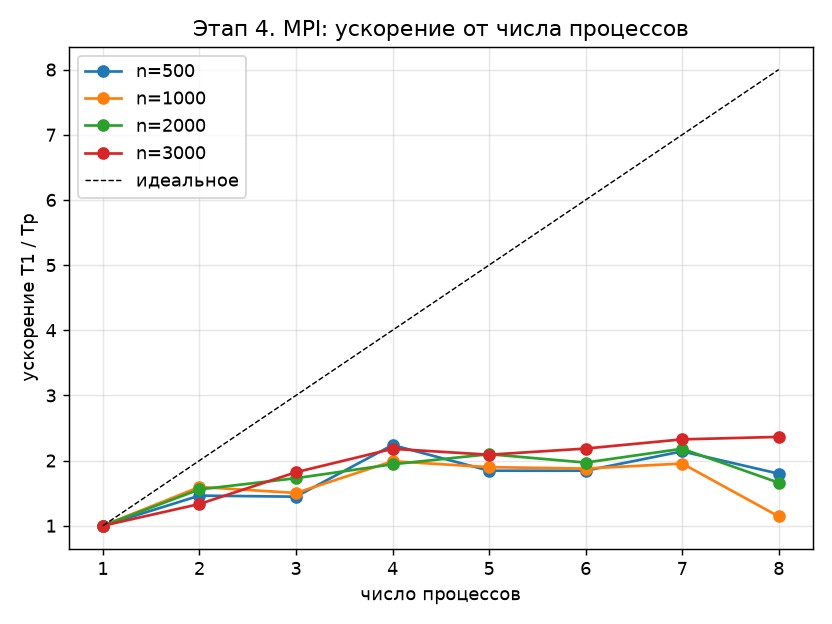
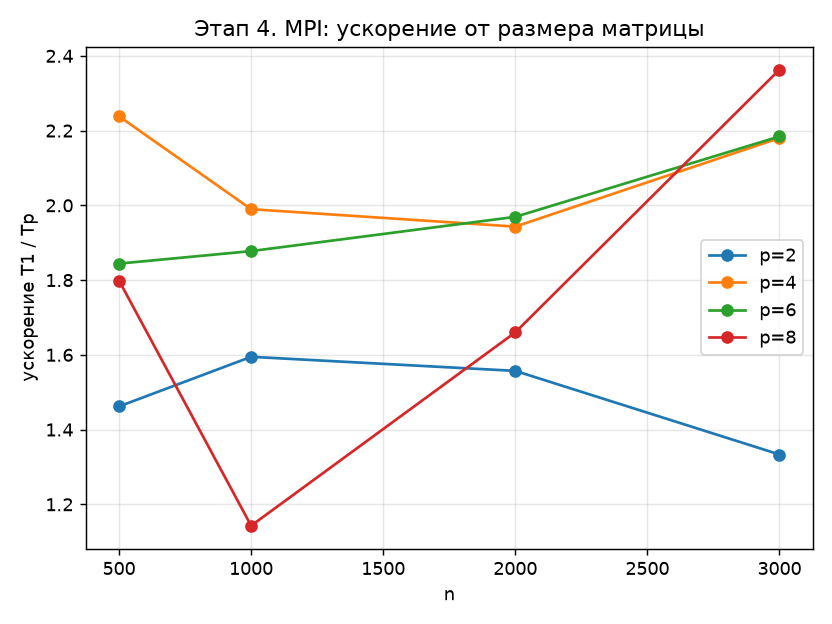

# Задание

Вариант задания – блочный алгоритм LU-разложения из параграфа 2.4 учебного пособия Д. Л. Головашкина (Алгоритм 37) [1].

Требуется разработать полноценную MPI-программу и построить графики ускорения: зависимость ускорения от количества ядер и от размера матрицы.

# Введение

MPI (Message Passing Interface) – стандарт программирования систем с распределённой памятью [2]. Программа запускается как $p$ независимых процессов, у каждого своя память; процесс знает свой номер `rank` от 0 до $p - 1$ и общее число процессов. Данные между процессами передаются только явными сообщениями. В программе используются вызовы:

- `MPI_Bcast` – рассылка массива от одного процесса всем остальным;
- `MPI_Send` и `MPI_Recv` – передача сообщения от одного процесса другому;
- `MPI_Barrier` – синхронизация всех процессов.

Блочный алгоритм LU-разложения (Алгоритм 37 [1]) на итерации $k$ выполняет четыре шага: LU-разложение малого блока $A(a,a)$, решение систем $L(b,a)\,U(a,a) = A(b,a)$ для малых блоков блочного столбца, решение систем $L(a,a)\,U(a,c) = A(a,c)$ для малых блоков блочной строки и основную операцию $A'(b,c) = A(b,c) - L(b,a)\,U(a,c)$.

Шаги 1 и 3 работают только с блочной строкой $k$, а шаги 2 и 4 для малого блока $i$ пишут только в строки этого блока. Поэтому матрица распределяется между процессами по блочным строкам, и каждый процесс хранит только свои строки. Распределение циклическое:

$$
\mathrm{owner}(i) = i \bmod p, \qquad i = 0, \ldots, N - 1,
$$

где $N = \lceil n / \alpha \rceil$ – число блочных строк, $\alpha = 32$ – размер малого блока. На итерации $k$ работа есть только у блоков $i > k$; при циклическом распределении у всех процессов остаётся поровну блоков почти до конца разложения, тогда как при распределении непрерывными кусками процессы с первыми строками быстро остались бы без работы.

Итерация $k$ выполняется так:

1. процесс-владелец блочной строки $k$ выполняет шаги 1 и 3 и копирует блочную строку (блоки $L_{11} \backslash U_{11}$ и $U_{12}$) в непрерывный буфер $W$;
2. владелец рассылает буфер $W$ всем процессам вызовом `MPI_Bcast`;
3. каждый процесс для своих блоков $i > k$ выполняет шаг 2, используя $U_{11}$ из буфера, и шаг 4, используя $U_{12}$ из буфера.

Разные процессы пишут в разные строки, поэтому других обменов не нужно. Каждый элемент вычисляется одним процессом в том же порядке операций, что и в последовательной версии, поэтому результат при любом числе процессов должен совпадать с ней до последнего знака. Процесс 0 генерирует матрицу, раздаёт блочные строки владельцам перед разложением и собирает результат после него для проверки решения; эти пересылки в замер времени не входят.

# Теоретические ожидания

Обозначим $t_c$ – время одной операции с плавающей точкой, $\lambda$ – задержку сообщения, $\beta$ – время передачи одного байта. Шаги 2 и 4 делятся между процессами поровну, а шаги 1 и 3 выполняет владелец блочной строки, пока остальные процессы ждут рассылку. На итерации $k$ рассылается блочная строка из $\alpha (n - k\alpha)$ чисел, а за всё разложение – около $n^2/2$ чисел, то есть $4n^2$ байт. При рассылке по двоичному дереву время разложения на $p$ процессах

$$
T_p \approx \frac{2 n^3}{3 p}\, t_c + \frac{n^2 \alpha}{2}\, t_c + \lceil \log_2 p \rceil \left( N \lambda + 4 n^2 \beta \right).
$$

Первое слагаемое – делящаяся работа, второе – шаг 3 у владельца, третье – обмены. Ускорение

$$
S(p) = \frac{T_1}{T_p}.
$$

Главное слагаемое растёт как $n^3$, а остальные – как $n^2$, поэтому с ростом $n$ ускорение должно приближаться к $p$.

Оценим слагаемые для $n = 3000$. Из времени одного процесса $T_1 = 7{,}16$ с и числа операций $\tfrac23 n^3 = 1{,}8 \cdot 10^{10}$ получаем $t_c \approx 0{,}4$ нс. Шаг 3 занимает $\tfrac12 n^2 \alpha\, t_c \approx 0{,}06$ с. За разложение рассылается около 36 МБ в 93 сообщениях; через общую память одного компьютера это занимает порядка 10 мс. По формуле (2) при $p = 4$ получаем $T_4 \approx 1{,}87$ с и $S(4) \approx 3{,}8$.

Модель (2) считает, что операция стоит одинаково при любом числе процессов. На одном ноутбуке это не так: у процессора 4 физических ядра, при $p > 4$ процессы делят ядра через Hyper-Threading, а при загрузке всех ядер процессор снижает тактовую частоту. Кроме того, библиотека MS-MPI ожидает сообщения активным опросом и при $p > 4$ отнимает время ядра у соседнего процесса.

# Результаты экспериментов

## Методика

Эксперименты проводились на ноутбуке с процессором Intel Core i5-1135G7 (4 ядра, 8 потоков) при питании от батареи, все процессы работали на одном компьютере, сообщения передавались через общую память. Программа собрана компилятором MinGW GCC 9.2 с ключами `-std=gnu99 -msse2 -mfpmath=sse -O2 -fno-tree-vectorize` и библиотекой MS-MPI; число процессов $p$ от 1 до 8 задавалось ключом `mpiexec -n`. Базой для ускорения служит та же программа при $p = 1$.

Перед замером процесс 0 раздаёт блочные строки владельцам, затем все процессы синхронизируются вызовом `MPI_Barrier`. В замер входят вычисления, все рассылки и завершающий барьер, то есть время самого медленного процесса. Разложение повторяется три раза, используется минимальное время.

## Ускорение

Ускорение приведено в таблице 1, зависимость ускорения от числа процессов (ядер) – на рисунке 1, от размера матрицы – на рисунке 2.

: Ускорение MPI-версии относительно одного процесса

| $n$ | $T_1$, с | $p = 2$ | $p = 3$ | $p = 4$ | $p = 5$ | $p = 6$ | $p = 7$ | $p = 8$ |
|---|---|---|---|---|---|---|---|---|
| 500 | 0,033 | 1,46 | 1,45 | 2,24 | 1,84 | 1,84 | 2,14 | 1,80 |
| 1000 | 0,267 | 1,59 | 1,50 | 1,99 | 1,90 | 1,88 | 1,95 | 1,14 |
| 2000 | 2,08 | 1,56 | 1,73 | 1,94 | 2,10 | 1,97 | 2,18 | 1,66 |
| 3000 | 7,16 | 1,33 | 1,82 | 2,18 | 2,09 | 2,18 | 2,33 | 2,36 |

{width=85%}

{width=85%}

При $p = 4$, по числу физических ядер, ускорение составляет 1,94–2,24, лучшее значение – 2,36 при $n = 3000$ и $p = 8$. При $p > 4$ результат растёт слабо и становится шумным: например, при $n = 1000$ и $p = 8$ в этой серии получено 1,14, а в предыдущей серии замеров того же кода – 2,67. Время разложения при этом – десятые доли секунды, и активное ожидание сообщений на перегруженных ядрах сильно сказывается на результате. Погрешности $\mathrm{err}$ и $\mathrm{res}$ при всех $p$ совпадают с последовательной версией до последнего знака.

## Сравнение с моделью

Модель (2) предсказывает $S(4) \approx 3{,}8$, измерено 2,18. Контрольный опыт, описанный в отчёте по OpenMP-версии, показал, что четыре независимые однопоточные копии программы на этом ноутбуке работают в 1,4–2 раза медленнее одной даже без обменов данными: при загрузке всех ядер снижается тактовая частота, а на больших матрицах добавляется конкуренция за память. С учётом этого множителя модель даёт $S(4) \approx 1{,}9$–$2{,}7$, что согласуется с измерением. Объём обменов в 36 МБ за разложение не является главным ограничением.

MPI-версия уступает OpenMP-версии (ускорение 2,43 при четырёх потоках и $n = 3000$): шаги 1 и 3 выполняет один процесс, пока остальные ждут рассылку, а блочную строку приходится копировать в буфер и пересылать.

# Заключение

В работе разработана MPI-программа блочного LU-разложения (Алгоритм 37 [1]) для систем с распределённой памятью. Блочные строки матрицы циклически распределены между процессами, каждый процесс хранит только свои строки – около $n^2/p$ чисел. На итерации владелец блочной строки выполняет LU малого блока и решение систем для блочной строки и рассылает её всем процессам; основную операцию каждый процесс выполняет над своими строками. Единственный обмен внутри разложения – одна рассылка `MPI_Bcast` на итерацию, всего около $4n^2$ байт.

Эксперимент на одном четырёхъядерном ноутбуке показал ускорение 1,94–2,24 на четырёх процессах и до 2,36 на восьми процессах при $n = 3000$; ускорение растёт с размером матрицы, как и предсказывает модель. Результат при любом числе процессов совпадает с последовательной версией до последнего знака. Расхождение с моделью объясняется оборудованием ноутбука: снижением частоты при загрузке всех ядер и общими ресурсами процессора. На вычислительном кластере, где у каждого процесса своё ядро и своя память, распределённое хранение матрицы позволит программе масштабироваться дальше.

# Список использованных источников

1. Головашкин, Д. Л. Векторные алгоритмы вычислительной линейной алгебры : учебное пособие / Д. Л. Головашкин. – Самара : Изд-во Самарского университета, 2019. – 76 с.
2. MPI: A Message-Passing Interface Standard. Version 3.1. – Текст : электронный // Message Passing Interface Forum : [сайт]. – 2015. – URL: https://www.mpi-forum.org/docs/ (дата обращения: 09.11.2026).

# Приложение А. Исходный код программы

Программа собирается компилятором MinGW GCC с библиотекой MS-MPI:

```
gcc -std=gnu99 -msse2 -mfpmath=sse -O2 -fno-tree-vectorize -Iinclude -I"$MSMPI_INC" -D"__int64=long long" stage4_mpi.c -L"$MSMPI_LIB32" -lmsmpi -o stage4_mpi.exe
```

Число процессов задаётся ключом `-n` команды `mpiexec`, размеры матриц – аргументами командной строки.

```
/*
 * Этап 4. MPI: блочное LU-разложение (Алгоритм 37) на распределённой памяти.
 * Блочные строки матрицы циклически распределены по процессам: блок i хранится
 * только у процесса i % size. На итерации k владелец блочной строки k выполняет
 * шаги 1 и 3 и рассылает её, остальные шаги каждый делает над своими строками.
 * Генерация матрицы, проверка решения и вывод CSV — только на процессе 0.
 * Сборка и запуск — README.md; алгоритм и методика замеров — REPORT.md.
 */
#include <mpi.h>
#include <stdio.h>
#include <stdlib.h>
#include <math.h>

#define ALPHA 32
#define REPS  3
static int rank, size;

#define END(i) ((i) * alpha + alpha < n ? (i) * alpha + alpha : n)
/* Начало строк блока i в локальном массиве владельца: все предшествующие
 * блоки этого процесса полные, короче может быть только последний блок матрицы. */
#define LOCAL_ROW(i) ((size_t)((i) / size) * alpha * n)

static inline void saxpy(int m, double s, const double *restrict x, double *restrict y)
{
    for (int q = 0; q < m; q++)
        y[q] -= s * x[q];
}

/* A — локальные блочные строки этого процесса, по n элементов в строке. */
void block_lu_mpi(int n, int alpha, double *A)
{
    int N = (n + alpha - 1) / alpha;
    double *W = malloc((size_t)alpha * n * sizeof(double));   /* блочная строка k */

    for (int k = 0; k < N; k++) {
        int a0 = k * alpha, w = END(k) - a0, t = n - a0;      /* W: w строк по t чисел */
        int owner = k % size;

        if (rank == owner) {
            double *Ak = A + LOCAL_ROW(k);
            /* 1. A(a,a) = L(a,a) U(a,a) */
            for (int l = 0; l < w; l++) {
                const double *rl = Ak + (size_t)l * n + a0;
                for (int s = l + 1; s < w; s++) {
                    double *rs = Ak + (size_t)s * n + a0;
                    rs[l] /= rl[l];
                    saxpy(w - l - 1, rs[l], rl + l + 1, rs + l + 1);
                }
            }
            /* 3. L(a,a) U(a,c) = A(a,c) */
            for (int j = k + 1; j < N; j++) {
                int c0 = j * alpha, m = END(j) - c0;
                for (int l = 0; l < w; l++) {
                    const double *rl = Ak + (size_t)l * n;
                    for (int s = l + 1; s < w; s++) {
                        double *rs = Ak + (size_t)s * n;
                        saxpy(m, rs[a0 + l], rl + c0, rs + c0);
                    }
                }
            }
            for (int s = 0; s < w; s++)
                for (int q = 0; q < t; q++)
                    W[(size_t)s * t + q] = Ak[(size_t)s * n + a0 + q];
        }
        /* После последнего блока строк ниже нет: рассылать некому и незачем. */
        if (k == N - 1) break;
        MPI_Bcast(W, w * t, MPI_DOUBLE, owner, MPI_COMM_WORLD);

        /* Первый свой блок ниже k: i >= k + 1, i % size == rank */
        for (int i = k + 1 + ((rank - k - 1) % size + size) % size; i < N; i += size) {
            double *Ai = A + LOCAL_ROW(i);
            int h = END(i) - i * alpha;
            /* 2. L(b,a) U(a,a) = A(b,a) */
            for (int s = 0; s < h; s++) {
                double *rs = Ai + (size_t)s * n + a0;
                for (int l = 0; l < w; l++) {
                    const double *ul = W + (size_t)l * t;
                    rs[l] /= ul[l];
                    saxpy(w - l - 1, rs[l], ul + l + 1, rs + l + 1);
                }
            }
            /* 4. A'(b,c) = A(b,c) - L(b,a) U(a,c) */
            for (int j = k + 1; j < N; j++) {
                int c0 = j * alpha, m = END(j) - c0;
                for (int s = 0; s < h; s++) {
                    double *rs = Ai + (size_t)s * n;
                    for (int l = 0; l < w; l++)
                        saxpy(m, rs[a0 + l], W + (size_t)l * t + c0 - a0, rs + c0);
                }
            }
        }
    }
    free(W);
}

/* Раздать блочные строки A0 (процесс 0) по локальным массивам A. Вне замера. */
static void scatter_rows(int n, int alpha, const double *A0, double *A)
{
    int N = (n + alpha - 1) / alpha;
    for (int i = 0; i < N; i++) {
        int h = END(i) - i * alpha, owner = i % size;
        if (rank == 0 && owner == 0) {
            for (size_t e = 0; e < (size_t)h * n; e++)
                A[LOCAL_ROW(i) + e] = A0[(size_t)i * alpha * n + e];
        } else if (rank == 0) {
            MPI_Send(A0 + (size_t)i * alpha * n, h * n, MPI_DOUBLE, owner, i, MPI_COMM_WORLD);
        } else if (rank == owner) {
            MPI_Recv(A + LOCAL_ROW(i), h * n, MPI_DOUBLE, 0, i, MPI_COMM_WORLD, MPI_STATUS_IGNORE);
        }
    }
}

/* Собрать разложение на процессе 0, чтобы проверить решение. Вне замера. */
static void gather_rows(int n, int alpha, const double *A, double *LU)
{
    int N = (n + alpha - 1) / alpha;
    for (int i = 0; i < N; i++) {
        int h = END(i) - i * alpha, owner = i % size;
        if (rank == 0 && owner == 0) {
            for (size_t e = 0; e < (size_t)h * n; e++)
                LU[(size_t)i * alpha * n + e] = A[LOCAL_ROW(i) + e];
        } else if (rank == 0) {
            MPI_Recv(LU + (size_t)i * alpha * n, h * n, MPI_DOUBLE, owner, i, MPI_COMM_WORLD, MPI_STATUS_IGNORE);
        } else if (rank == owner) {
            MPI_Send(A + LOCAL_ROW(i), h * n, MPI_DOUBLE, 0, i, MPI_COMM_WORLD);
        }
    }
}

static void run(int n)
{
    int alpha = ALPHA, N = (n + alpha - 1) / alpha, rows = 0;
    for (int i = rank; i < N; i += size) rows += END(i) - i * alpha;
    /* При числе процессов больше N у процесса может не быть строк. */
    double *A = malloc(((size_t)rows * n + 1) * sizeof(double));
    double *A0 = NULL, *b = NULL;

    if (rank == 0) {
        A0 = malloc((size_t)n * n * sizeof(double));
        b = malloc(n * sizeof(double));
        srand(12345);
        for (size_t i = 0; i < (size_t)n * n; i++) A0[i] = (double)rand() / RAND_MAX - 0.5;
        for (int i = 0; i < n; i++) A0[(size_t)i * n + i] += n / 4.0;
        for (int i = 0; i < n; i++) {
            double s = 0;
            for (int j = 0; j < n; j++) s += A0[(size_t)i * n + j];
            b[i] = s;
        }
    }

    double tmin = 1e30;
    for (int rep = 0; rep < REPS; rep++) {
        scatter_rows(n, alpha, A0, A);
        MPI_Barrier(MPI_COMM_WORLD);
        double t = MPI_Wtime();
        block_lu_mpi(n, alpha, A);
        /* Конечный барьер входит во время: ждём самый медленный процесс. */
        MPI_Barrier(MPI_COMM_WORLD);
        t = MPI_Wtime() - t;
        if (t < tmin) tmin = t;
    }

    double *LU = rank == 0 ? malloc((size_t)n * n * sizeof(double)) : NULL;
    gather_rows(n, alpha, A, LU);

    if (rank == 0) {
        double *x = malloc(n * sizeof(double));
        for (int i = 0; i < n; i++) x[i] = b[i];
        for (int i = 0; i < n; i++)
            for (int j = 0; j < i; j++) x[i] -= LU[(size_t)i * n + j] * x[j];
        for (int i = n - 1; i >= 0; i--) {
            for (int j = i + 1; j < n; j++) x[i] -= LU[(size_t)i * n + j] * x[j];
            x[i] /= LU[(size_t)i * n + i];
        }
        double err = 0, res = 0, bn = 0;
        for (int i = 0; i < n; i++) {
            err = fmax(err, fabs(x[i] - 1.0));
            double s = -b[i];
            for (int j = 0; j < n; j++) s += A0[(size_t)i * n + j] * x[j];
            res = fmax(res, fabs(s));
            bn = fmax(bn, fabs(b[i]));
        }
        printf("%d,%d,%d,%.6f,%.3e,%.3e\n", size, n, alpha, tmin, err, res / bn);
        fflush(stdout);
        free(x); free(A0); free(b); free(LU);
    }
    free(A);
}

int main(int argc, char **argv)
{
    static const int def[] = {500, 1000, 2000, 3000};
    MPI_Init(&argc, &argv);
    MPI_Comm_rank(MPI_COMM_WORLD, &rank);
    MPI_Comm_size(MPI_COMM_WORLD, &size);
    if (rank == 0) printf("procs,n,alpha,time,err,res\n");
    if (argc > 1)
        for (int i = 1; i < argc; i++) run(atoi(argv[i]));
    else
        for (size_t i = 0; i < sizeof def / sizeof *def; i++) run(def[i]);
    MPI_Finalize();
    return 0;
}
```
