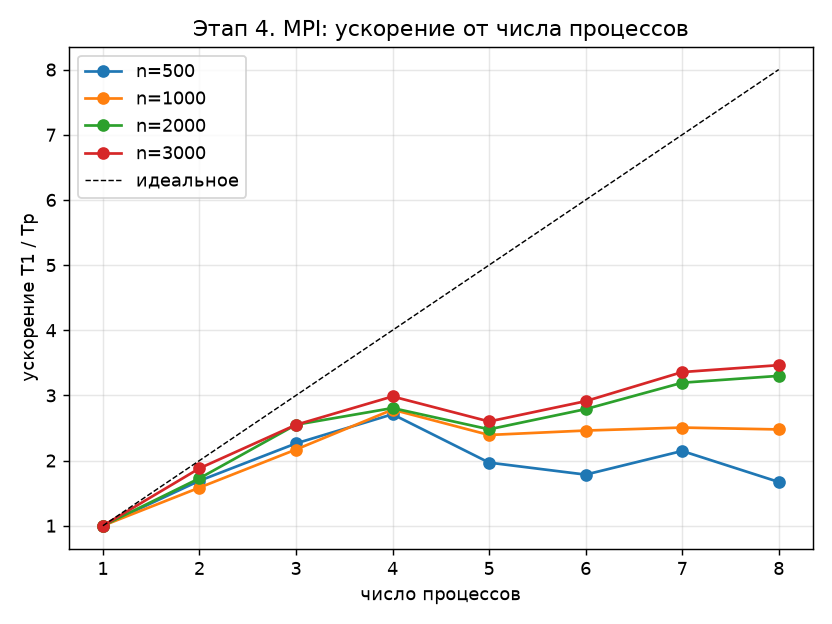
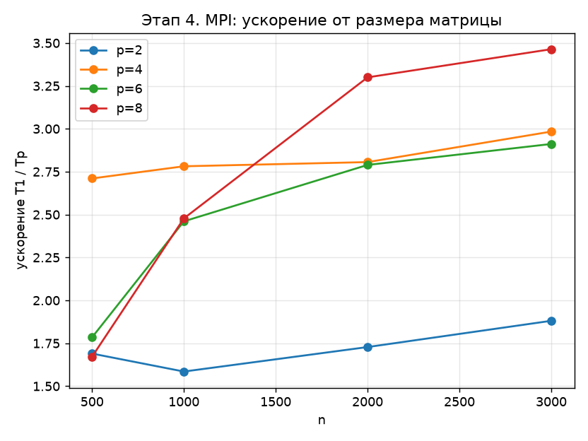

# Задание

Разработать программу на MPI для блочного разложения вида A = LU. Исследовать, как ускорение зависит от количества процессов и размера матрицы.

# Введение

MPI определяет обмен сообщениями между процессами с раздельной памятью [2]. Матрица распределяется циклически по блочным строкам: строка блоков с номером $i$ хранится у процесса $i\bmod p$, где $p$ обозначает число процессов. Процесс 0 генерирует исходную матрицу и раздаёт её блоки через `MPI_Send` и `MPI_Recv`.

Панель текущей подматрицы состоит из диагонального блока $A_{11}$ и блока $A_{21}$ под ним. Её ширина $w$ равна $\alpha$, кроме последнего блока, который может быть короче. Нумерация внутри панели начинается с нуля.

Столбцы панели обрабатываются слева направо. После прямой подстановки для элементов $U$ выше диагонали из столбца вычитаются вклады предыдущих столбцов $L$. Для $i\ge j$ получаем

$$
v_i=a_{ij}-\sum_{q=0}^{j-1}l_{iq}u_{qj},\qquad
u_{jj}=v_j,\qquad l_{ij}=v_i/u_{jj}\quad(i>j).
$$

Обновление столбца называется GAXPY [1]. Вычисление даёт $L_{11}$, $U_{11}$ и $L_{21}$ и требует ненулевых $u_{jj}$. Блок $U_{12}$ можно вычислить сразу после получения $L_{11}$.

$$
L_{11}U_{12}=A_{12},\qquad A_{22}\leftarrow A_{22}-L_{21}U_{12}.
$$

На итерации $k$ владелец текущей блочной строки вычисляет $L_{11}$ и $U_{11}$ по столбцам, а затем решает нижнетреугольную систему для $U_{12}$. Он упаковывает диагональный блок и $U_{12}$ в непрерывный буфер и передаёт его всем процессам через `MPI_Bcast`. На последней итерации ниже текущего блока строк уже нет, поэтому рассылка пропускается.

Получив $U_{11}$, каждый процесс завершает обработку своих нижних строк по формуле для $l_{ij}$. Для этого нужны готовый $U_{11}$ и предыдущие элементы той же строки. Затем процесс использует $U_{12}$ для обновления своей части $A_{22}$. На следующей итерации рассылку выполняет владелец очередной блочной строки.

# Теоретические ожидания

Обновление остатка требует порядка $n^3$ операций. Оно распределяется между процессами по принадлежащим им строкам. Владелец на каждой итерации последовательно обрабатывает диагональный блок и верхнюю блочную строку. Суммарная трудоёмкость этой части составляет $O(n^2\alpha)$.

При $a_k=k\alpha$ ширину диагонального блока обозначим $w_k=\min(\alpha,n-a_k)$. Буфер рассылки содержит $w_k(n-a_k)$ чисел типа `double`. Суммарный объём переданных в вызовы рассылки буферов составляет

$$
V=8\sum_{k=0}^{N-2}w_k(n-a_k),\qquad N=\lceil n/\alpha\rceil .
$$

При $n=3000$ выполняется 93 рассылки с суммарным объёмом буферов около 36,4 МБ. Фактический обмен между процессами зависит от реализации коллективной операции. Ускорение измеряется по отношению $S(p)=T_1/T_p$. На него влияют вычислительная нагрузка, ожидание рассылок и доступ к памяти.

# Результаты экспериментов

## Методика

Эксперименты проведены 24 ноября 2026 г. на компьютере с процессором Intel Core i5-12450H (8 ядер, 12 логических процессоров) под Linux x86-64. Использован GCC 16.2.1. Для управления частотой процессора использован режим `powersave`. Использована библиотека MPICH 5.0.2. Все процессы работали на одном компьютере, без явного закрепления за ядрами. Ширина блока составляла 32. Для каждого размера использовалась одна и та же матрица во всех конфигурациях. Перед каждым повтором восстанавливались её исходные элементы. В таблицах приведён минимум из трёх замеров времени разложения. Размеры матриц составляли 500, 1000, 2000 и 3000, число процессов менялось от 1 до 8.

Перед началом замера процесс 0 раздаёт строки, затем выполняется начальный барьер. В замер входят вычисления, рассылки и завершающий барьер. Сбор факторов на процессе 0 и проверка решения выполняются после замера.

## Ускорение

Таблица 1 содержит ускорение относительно одного процесса. Зависимости от числа процессов и размера матрицы представлены на рисунках 1 и 2.

Таблица 1. Ускорение MPI относительно одного процесса

| $n$ | $T_1$, с | $p=2$ | $p=3$ | $p=4$ | $p=5$ | $p=6$ | $p=7$ | $p=8$ |
| --- | --- | --- | --- | --- | --- | --- | --- | --- |
| 500 | 0,012634 | 1,69 | 2,26 | 2,71 | 1,97 | 1,78 | 2,15 | 1,67 |
| 1000 | 0,106449 | 1,59 | 2,17 | 2,78 | 2,39 | 2,46 | 2,51 | 2,48 |
| 2000 | 0,851503 | 1,73 | 2,55 | 2,81 | 2,48 | 2,79 | 3,19 | 3,30 |
| 3000 | 2,986017 | 1,88 | 2,55 | 2,98 | 2,60 | 2,91 | 3,36 | 3,46 |

{width=85%}

Рисунок 1. Зависимость ускорения от числа процессов

{width=85%}

Рисунок 2. Зависимость ускорения от размера матрицы

На четырёх процессах ускорение составило от 2,71 до 2,98. Максимум 3,46 получен при $n=3000$ на восьми процессах. В этой конфигурации время уменьшилось с 2,986017 до 0,862037 с.

## Погрешность

Для проверки выбирали точное решение $x^*=(1,\ldots,1)^T$ и формировали $b=Ax^*$. После разложения решали системы $Ly=b$ и $Ux=y$. Измеряли ошибку решения и относительную невязку.

$$
\mathrm{err}=\|x-x^*\|_\infty,\qquad
\mathrm{res}=\frac{\|Ax-b\|_\infty}{\|b\|_\infty}.
$$

Для каждого размера выводимые значения ошибки и невязки совпали при всех значениях $p$. Максимальная ошибка составила 1,199·10⁻¹⁴, максимальная относительная невязка составила 1,238·10⁻¹⁴.

# Заключение

Реализовано блочное разложение вида A = LU с циклическим распределением строк. Для каждого блока, под которым остаются строки, выполняется одна рассылка. Она передаёт данные для вычисления нижней части панели и обновления остатка. При размере 3000 восемь процессов дали ускорение 3,46. Оценка относится к замерам на одном компьютере.

# Список использованных источников

1. Головашкин, Д. Л. Векторные алгоритмы вычислительной линейной алгебры : учебное пособие / Д. Л. Головашкин. Самара : Издательство Самарского университета, 2019. 76 с.
2. MPI: A Message-Passing Interface Standard. Version 3.1. Текст : электронный // Message Passing Interface Forum : [сайт]. 2015. URL: https://www.mpi-forum.org/docs/ (дата обращения: 09.11.2026).

# Приложение А. Исходный код программы

Команды сборки и запуска из корня проекта приведены ниже.

```sh
mpicc -std=gnu99 -O2 -fno-tree-vectorize stage4_mpi.c -lm -o bin/stage4_mpi
```

```sh
mpiexec -n 4 ./bin/stage4_mpi 500 1000 2000 3000
```

Листинг файла `stage4_mpi.c`.

```c
/*
 * Блочное разложение вида A = LU с вычислением панели через GAXPY на распределённой памяти.
 * Блочная строка i хранится у процесса i % size.
 */
#include <mpi.h>
#include <stdio.h>
#include <stdlib.h>
#include <math.h>
#include "include/gaxpy_panel.h"

#define ALPHA 32
#define REPS  3
static int rank, size;

#define END(i) ((i) * alpha + alpha < n ? (i) * alpha + alpha : n)
/* Смещение блока i у владельца. Все предшествующие блоки имеют alpha строк. */
#define LOCAL_ROW(i) ((size_t)((i) / size) * alpha * n)

static inline void saxpy(int m, double s, const double *restrict x, double *restrict y)
{
    for (int q = 0; q < m; q++)
        y[q] -= s * x[q];
}

void block_lu_mpi(int n, int alpha, double *A)
{
    int N = (n + alpha - 1) / alpha;
    double *W = malloc((size_t)alpha * n * sizeof(double));

    for (int k = 0; k < N; k++) {
        int a0 = k * alpha, w = END(k) - a0, t = n - a0;
        int owner = k % size;

        if (rank == owner) {
            double *Ak = A + LOCAL_ROW(k);
            gaxpy_panel(Ak + a0, n, w, w);
            /* Владелец вычисляет U12 из L11 * U12 = A12. */
            for (int j = k + 1; j < N; j++) {
                int c0 = j * alpha, m = END(j) - c0;
                for (int l = 0; l < w; l++) {
                    const double *rl = Ak + (size_t)l * n;
                    for (int s = l + 1; s < w; s++) {
                        double *rs = Ak + (size_t)s * n;
                        saxpy(m, rs[a0 + l], rl + c0, rs + c0);
                    }
                }
            }
            for (int s = 0; s < w; s++)
                for (int q = 0; q < t; q++)
                    W[(size_t)s * t + q] = Ak[(size_t)s * n + a0 + q];
        }
        if (k == N - 1) break;
        /* В W упакованы w строк длины t с U11 и U12 для нижних блоков. */
        MPI_Bcast(W, w * t, MPI_DOUBLE, owner, MPI_COMM_WORLD);

        /* Первый свой блок ниже k: i >= k + 1, i % size == rank */
        for (int i = k + 1 + ((rank - k - 1) % size + size) % size; i < N; i += size) {
            double *Ai = A + LOCAL_ROW(i);
            int h = END(i) - i * alpha;
            for (int s = 0; s < h; s++)
                gaxpy_panel_row(Ai + (size_t)s * n + a0, W, t, w);
            /* Обновляем локальную часть A22: A22 <- A22 - L21 * U12. */
            for (int j = k + 1; j < N; j++) {
                int c0 = j * alpha, m = END(j) - c0;
                for (int s = 0; s < h; s++) {
                    double *rs = Ai + (size_t)s * n;
                    for (int l = 0; l < w; l++)
                        saxpy(m, rs[a0 + l], W + (size_t)l * t + c0 - a0, rs + c0);
                }
            }
        }
    }
    free(W);
}

/* Раздача строк с процесса 0 выполняется до начала замера. */
static void scatter_rows(int n, int alpha, const double *A0, double *A)
{
    int N = (n + alpha - 1) / alpha;
    for (int i = 0; i < N; i++) {
        int h = END(i) - i * alpha, owner = i % size;
        if (rank == 0 && owner == 0) {
            for (size_t e = 0; e < (size_t)h * n; e++)
                A[LOCAL_ROW(i) + e] = A0[(size_t)i * alpha * n + e];
        } else if (rank == 0) {
            MPI_Send(A0 + (size_t)i * alpha * n, h * n, MPI_DOUBLE, owner, i, MPI_COMM_WORLD);
        } else if (rank == owner) {
            MPI_Recv(A + LOCAL_ROW(i), h * n, MPI_DOUBLE, 0, i, MPI_COMM_WORLD, MPI_STATUS_IGNORE);
        }
    }
}

/* Собираем факторы на процессе 0 для проверки решения после замера. */
static void gather_rows(int n, int alpha, const double *A, double *LU)
{
    int N = (n + alpha - 1) / alpha;
    for (int i = 0; i < N; i++) {
        int h = END(i) - i * alpha, owner = i % size;
        if (rank == 0 && owner == 0) {
            for (size_t e = 0; e < (size_t)h * n; e++)
                LU[(size_t)i * alpha * n + e] = A[LOCAL_ROW(i) + e];
        } else if (rank == 0) {
            MPI_Recv(LU + (size_t)i * alpha * n, h * n, MPI_DOUBLE, owner, i, MPI_COMM_WORLD, MPI_STATUS_IGNORE);
        } else if (rank == owner) {
            MPI_Send(A + LOCAL_ROW(i), h * n, MPI_DOUBLE, 0, i, MPI_COMM_WORLD);
        }
    }
}

static void run(int n)
{
    int alpha = ALPHA, N = (n + alpha - 1) / alpha, rows = 0;
    for (int i = rank; i < N; i += size) rows += END(i) - i * alpha;
    /* При числе процессов больше N у процесса может не быть строк. */
    double *A = malloc(((size_t)rows * n + 1) * sizeof(double));
    double *A0 = NULL, *b = NULL;

    if (rank == 0) {
        A0 = malloc((size_t)n * n * sizeof(double));
        b = malloc(n * sizeof(double));
        srand(12345);
        for (size_t i = 0; i < (size_t)n * n; i++) A0[i] = (double)rand() / RAND_MAX - 0.5;
        for (int i = 0; i < n; i++) A0[(size_t)i * n + i] += n / 4.0;
        for (int i = 0; i < n; i++) {
            double s = 0;
            for (int j = 0; j < n; j++) s += A0[(size_t)i * n + j];
            b[i] = s;
        }
    }

    double tmin = 1e30;
    for (int rep = 0; rep < REPS; rep++) {
        scatter_rows(n, alpha, A0, A);
        MPI_Barrier(MPI_COMM_WORLD);
        double t = MPI_Wtime();
        block_lu_mpi(n, alpha, A);
        /* Конечный барьер входит во время: ждём самый медленный процесс. */
        MPI_Barrier(MPI_COMM_WORLD);
        t = MPI_Wtime() - t;
        if (t < tmin) tmin = t;
    }

    double *LU = rank == 0 ? malloc((size_t)n * n * sizeof(double)) : NULL;
    gather_rows(n, alpha, A, LU);

    if (rank == 0) {
        double *x = malloc(n * sizeof(double));
        for (int i = 0; i < n; i++) x[i] = b[i];
        for (int i = 0; i < n; i++)
            for (int j = 0; j < i; j++) x[i] -= LU[(size_t)i * n + j] * x[j];
        for (int i = n - 1; i >= 0; i--) {
            for (int j = i + 1; j < n; j++) x[i] -= LU[(size_t)i * n + j] * x[j];
            x[i] /= LU[(size_t)i * n + i];
        }
        double err = 0, res = 0, bn = 0;
        for (int i = 0; i < n; i++) {
            err = fmax(err, fabs(x[i] - 1.0));
            double s = -b[i];
            for (int j = 0; j < n; j++) s += A0[(size_t)i * n + j] * x[j];
            res = fmax(res, fabs(s));
            bn = fmax(bn, fabs(b[i]));
        }
        printf("%d,%d,%d,%.6f,%.3e,%.3e\n", size, n, alpha, tmin, err, res / bn);
        fflush(stdout);
        free(x); free(A0); free(b); free(LU);
    }
    free(A);
}

int main(int argc, char **argv)
{
    static const int def[] = {500, 1000, 2000, 3000};
    MPI_Init(&argc, &argv);
    MPI_Comm_rank(MPI_COMM_WORLD, &rank);
    MPI_Comm_size(MPI_COMM_WORLD, &size);
    if (rank == 0) printf("procs,n,alpha,time,err,res\n");
    if (argc > 1)
        for (int i = 1; i < argc; i++) run(atoi(argv[i]));
    else
        for (size_t i = 0; i < sizeof def / sizeof *def; i++) run(def[i]);
    MPI_Finalize();
    return 0;
}
```

Листинг файла `include/gaxpy_panel.h`.

```c
#ifndef GAXPY_PANEL_H
#define GAXPY_PANEL_H

#include <stddef.h>

/* a указывает на левый верхний элемент панели из height строк и width столбцов.
 * stride задаёт расстояние между началами строк. Разложение требует ненулевых U(j,j). */
static inline void gaxpy_panel(double *a, int stride, int height, int width)
{
    for (int j = 0; j < width; j++) {
        /* Прямая подстановка для элементов U выше диагонали. */
        for (int p = 0; p < j - 1; p++) {
            double u = a[(size_t)p * stride + j];
            for (int i = p + 1; i < j; i++) {
                double *row = a + (size_t)i * stride;
                row[j] -= row[p] * u;
            }
        }

        /* v = a[j:height,j] - L[j:height,0:j] * U[0:j,j].
         * Первый элемент v становится U(j,j), остальные делим на U(j,j). */
        for (int p = 0; p < j; p++) {
            double u = a[(size_t)p * stride + j];
            for (int i = j; i < height; i++) {
                double *row = a + (size_t)i * stride;
                row[j] -= row[p] * u;
            }
        }
        double pivot = a[(size_t)j * stride + j];
        for (int i = j + 1; i < height; i++)
            a[(size_t)i * stride + j] /= pivot;
    }
}

/* Для нижней строки: L(i,j) = (a(i,j) - sum_{p<j} L(i,p) * U(p,j)) / U(j,j). */
static inline void gaxpy_panel_row(double *row, const double *u, int stride, int width)
{
    for (int j = 0; j < width; j++) {
        for (int p = 0; p < j; p++)
            row[j] -= row[p] * u[(size_t)p * stride + j];
        row[j] /= u[(size_t)j * stride + j];
    }
}

#endif
```
